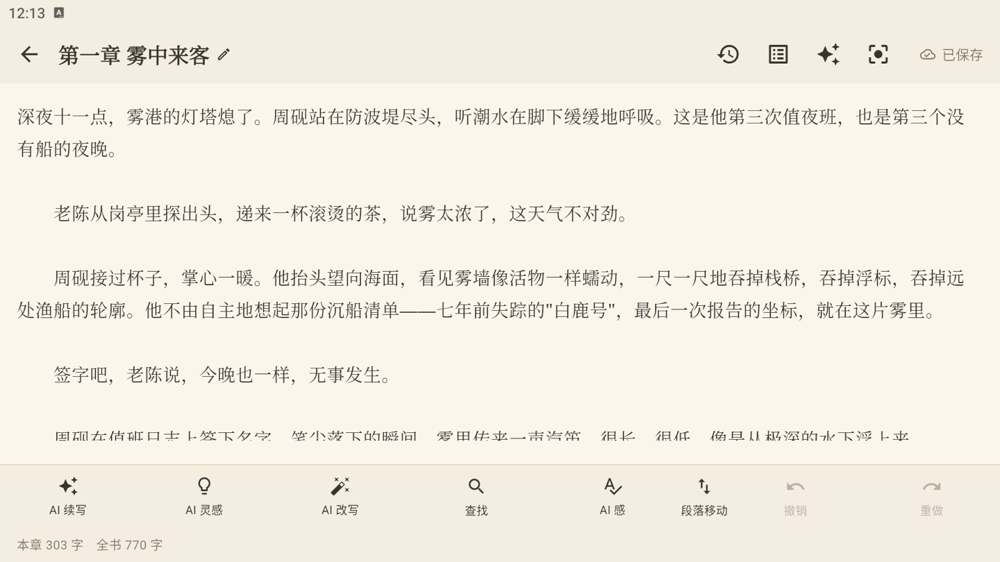
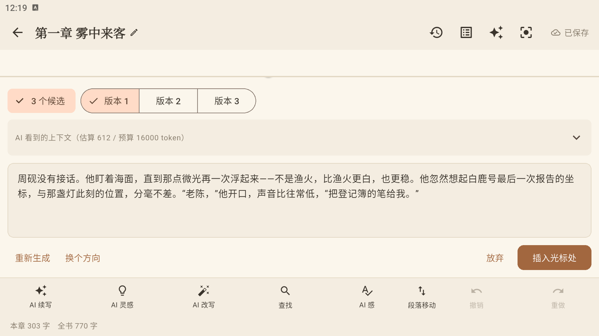
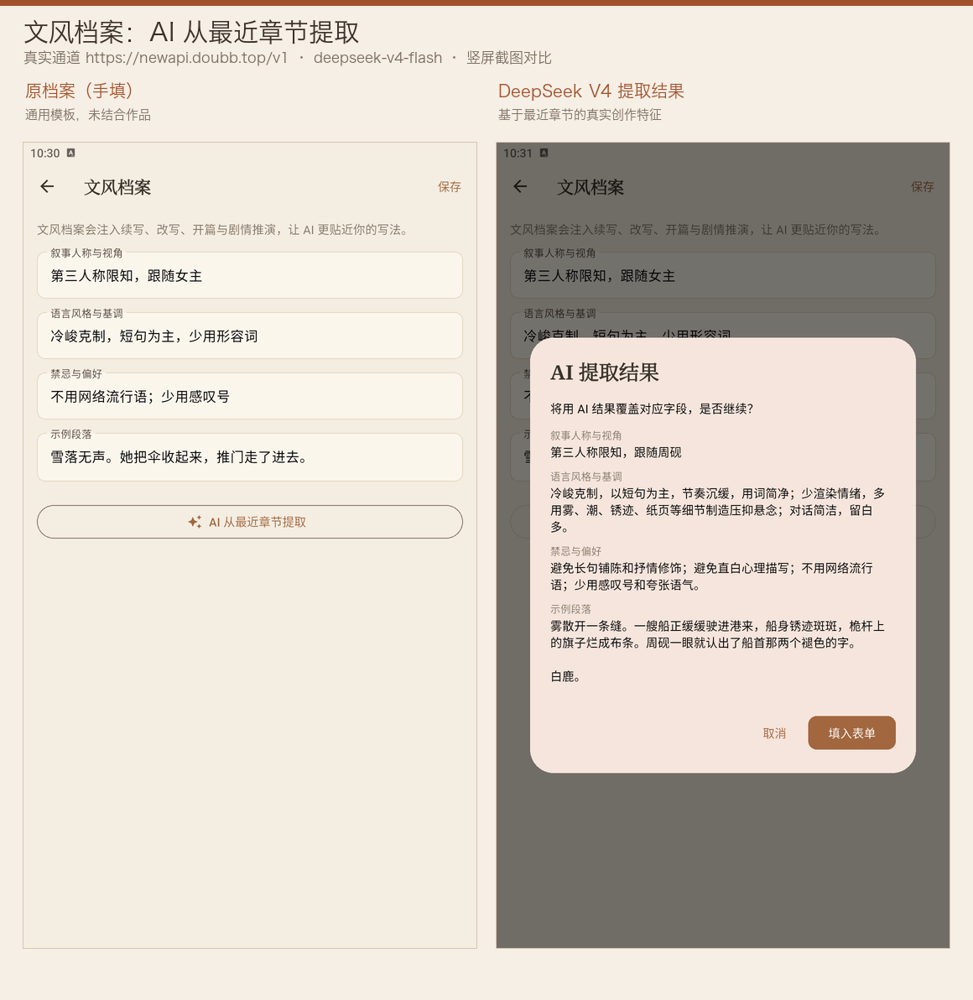
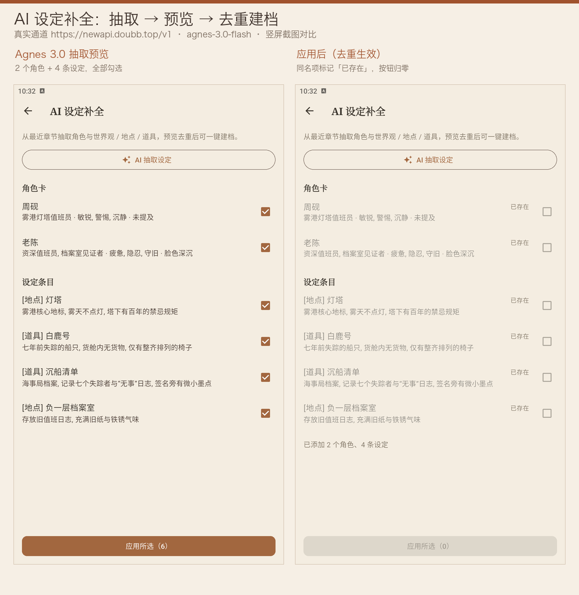
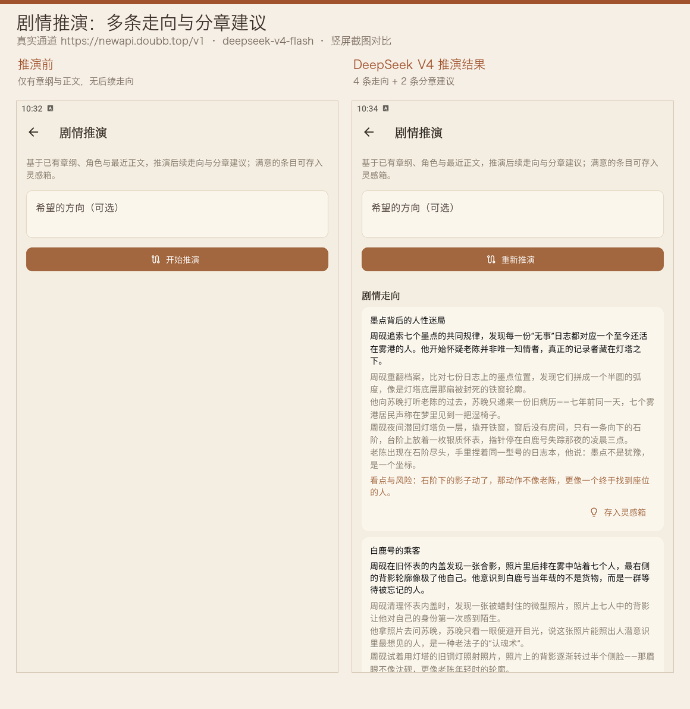

# NovelPhone

[简体中文](README.md) | English

[](https://github.com/wly2lcl/NovelPhone/actions/workflows/ci.yml)
[](LICENSE)


**A local-first AI novel-writing app for mobile.** Manuscripts, worldbuilding, characters and stats all live on your device. AI is an on-demand writing partner that talks directly to the model provider *you* configure — no middleman server involved.

Two design principles:

- **Your data stays yours** — SQLite storage on device, API keys in the OS secure store, backups to local files or your own object storage;
- **Curating the "AI flavor"** — a built-in rule engine plus optional LLM deep-check flags clichés and repetitive sentence patterns with locate-and-replace actions; AI continuation generates multiple candidates in parallel for you to compare.

Status: the MVP scope (78 / 78) is complete, followed by 50 enhancements (ENH-01~50, including a full Simplified-Chinese / English bilingual UI, MCP OAuth 2.1 PKCE and skill front-matter import, accessibility semantics, a branded app icon / launch splash, release-artifact delivery, plus the recycle bin, MCP call audit, backup checksum preview, skill export, style profile, AI setting completion, plot brainstorming, work Q&A, whole-work consistency scan and stability hardening; ENH-24 adds Markdown / EPUB import, plot-to-outline transfer, relation extraction, batch summaries, a monthly AI budget and release closure; ENH-25 adds automatic output-limit retry for empty reasoning-model responses and an app lock backed by biometrics / device credentials; ENH-26 adds screenshot / recent-task thumbnail protection and optional passphrase encryption for backups; ENH-27 adds paragraph-level acceptance of AI results, in-result multi-turn revision and local writing-preference injection; ENH-28 adds blank-line separation when inserting AI results, visible management of author preferences and switchable / comparable revision history; ENH-29 adds paragraph-level rejection reasons, task-aware adopted-sample ordering, consistent usage outcomes on revision / close, quick revision chips and rewrite-original comparison; ENH-30 adds an automatic pre-adoption snapshot, save-to-inspiration for continuation / rewrite results, and post-edit / verbatim adoption metrics; ENH-31 adds structured character-state / foreshadow / timeline story-state cards that are injected into AI context; ENH-32 adds local RAG-lite passage retrieval that injects Top-K related passages into continuation and work Q&A; ENH-33 fixes long-work retrieval coverage and keeps both ends of the chapter catalog visible in work Q&A; ENH-34 feeds story-state cards into the consistency check; ENH-35 lets AI extract per-chapter state changes for review before writing them into cards; ENH-36 gives each candidate a dialogue / action / atmosphere focus and supports paragraph-level cross-candidate mixing; ENH-37 recommends task-to-model mappings from the last 30 days of adoption quality; ENH-38 turns the setting-consistency check into structured conflict reports (quote / source / severity / suggestion, with locate-in-manuscript, generate-revision and re-check actions, plus structured per-chapter details in the whole-work scan); ENH-39 fixes story-state card injection order and deduplication and feeds the cards into plot brainstorming and outline expansion; ENH-40 adds IDF term weighting, character alias / title expansion and adjacent-chapter boosting to local retrieval, and an alias field on character cards; ENH-41 lets authors ignore consistency conflicts they have deliberately kept, with later checks filtering them out and the preferences page restoring them; ENH-42 pairs the model draft with the author's final text for adopted samples edited by 10%~30% and injects both into preferences; ENH-43 adds navigable chapter citation markers to work Q&A and lets answers be saved to the inspiration box without the markers; ENH-44 adds per-work hand-written collaboration rules, an AI-cliché blacklist and local cliché discovery from "too AI" abandoned drafts; ENH-45 distills rewrite preferences from model-draft → author-final pairs and can add them to the rules in one tap; ENH-46 injects collaboration preferences into scene ideas and the opening assistant and adds a full injection preview; ENH-47 renders citations inline, adds copy / regenerate, and lets the last question be edited and re-asked; ENH-48 adds a local rule self-check under continuation / rewrite results with one-tap blacklisting and rule-based rewriting; ENH-49 gives each rule task scopes, editing / reordering and conflict hints, injects collaboration preferences into outline expansion and plot planning, and estimates tokens per task in the injection preview; ENH-50 archives adoptions edited by more than 30% as local-only analysis samples and broadens the cliché candidate lexicon). Android release signing, AAB / split-ABI APKs and GitHub Actions CI (including an iOS unsigned-build job and release-artifact archiving) are in place; the iOS unsigned release build passes and 589 automated tests pass. Real-device acceptance records are in [docs/TODO.md](docs/TODO.md) (Chinese). On 2026-10-18 the ENH-23 style profile, AI setting completion and plot brainstorming were re-verified against two real model channels — `deepseek-v4-flash` and `agnes-3.0-flash` (portrait comparison screenshots below).

## Screenshots

| Works list | Volumes & chapters | Editor |
|:---:|:---:|:---:|
|  |  |  |

| AI-flavor check | AI continuation (3 candidates) |
|:---:|:---:|
|  |  |

**ENH-23 real-model acceptance (portrait comparison, left: before / right: AI result)**

| Style profile (DeepSeek V4) | AI setting completion (Agnes 3.0) |
|:---:|:---:|
|  |  |

| Plot brainstorming (DeepSeek V4) |
|:---:|
|  |

## Features

### Writing & work management

- Multiple works with cover colors, word counts and last-edited times; global search across works with highlighted hits and jump-to-editor
- Volumes and chapters: move volumes up / down, rename, delete; create chapters inside a volume; rename chapters, move them up / down or to another volume, and delete them
- Recycle bin: deleting a work or chapter only marks it as deleted; restore it or purge it permanently within 30 days from Settings → Recycle Bin. Expired entries are cleaned automatically at startup and when the bin is opened
- Import txt / docx / Markdown / EPUB: encoding auto-detection (UTF-8 / GBK), chapter splitting on「第X章」headings with preview, merge-into-previous, 10 MB file cap; EPUB chapters follow the OPF spine (nav pages skipped) and Markdown splits on headings
- Editor: autosave with a "saved" indicator, focus mode (toolbars hidden, caret line centered), writing appearance (night paper, font size, line height)
- Find, paragraph move, undo / redo (double cap: 100 steps and 2M characters)
- Find & replace across a whole work: preview every matching chapter and snippet, then replace all at once; affected chapters get automatic snapshots you can roll back from version history
- Chapter snapshots (version history): create / preview / restore / delete, with paragraph-level diff against the current text (change counts, colored lines, long unchanged runs collapsed), carried through backups
- Export: single chapter as txt / markdown; a whole work as Word (.docx) and EPUB 3

### Story assets

- Character cards with tags, descriptions and aliases / titles (up to 8, ENH-40; aliases participate in retrieval expansion and AI context matching), fed into AI context assembly
- Story bible: categorized worldbuilding / location / item entries
- Chapter outlines, expandable by AI
- Character relationship graph: ring layout with add / edit / delete

### AI writing partner

- **AI continuation**: 3 candidates generated in parallel by default (slightly varied temperature plus dialogue / action / atmosphere focuses, ENH-36), length slider, custom direction, insert-at-caret; candidates can be mixed paragraph by paragraph; expandable "what the AI sees" panel showing estimated tokens vs. budget
- **AI inspiration**: streamed scene ideas, with previous-chapter summaries and the current outline injected; since ENH-46 both scene ideas and the opening assistant also follow author collaboration preferences (hand-written rules, cliché blacklist and adopted samples), with a dedicated section in the context preview
- **AI rewrite**: rewrite a selected paragraph as polish / expand / condense / tone-shift plus extra instructions; replacing the original goes through the undo stack
- **AI result collaboration**: continuation / rewrite results support **paragraph-level acceptance** — tick and edit each paragraph before writing it into the manuscript (rewrites badge paragraphs that differ from the original; unticked paragraphs are skipped). You can also send revision notes and have the AI revise **the current draft** instead of regenerating everything. Discarding a result can record a reason (too AI-like / out of character / slow pace / setting mismatch / other); reason counts and recent adopted snippets stay on device and are injected as author preferences into later generations. Since ENH-28, inserting at the caret adds blank-line separation (no more glued text); the work menu lets you view / toggle / clear preferences (purged when a work is permanently deleted); the result panel keeps up to 5 revisions that can be switched between and compared with the previous version. Since ENH-29, when some paragraphs stay unticked you can add a rejection reason that merges into those preference counts; closing with X also asks for a reason; a failed revision keeps the old result and its usage record; the panel offers "more specific / tighter / more dialogue / different ending / remove AI flavor" quick revisions, and rewrite mode can compare the result with the original text. Since ENH-30, a "before AI insertion" snapshot is taken automatically before the first write of each generation; continuation / rewrite results can be saved to the inspiration box (not counted as adoption unless written into the manuscript); the edit ratio from raw AI output to final text is recorded and token stats show a verbatim adoption rate, while heavily edited samples are no longer used as preference references; since ENH-36, candidates can be mixed paragraph by paragraph before revision / acceptance; since ENH-42, adopted samples edited by 10%~30% keep both the model draft and the author's final text, injected as a pair into later preferences, and the preferences dialog can view / restore ignored consistency conflicts (ENH-41). Since ENH-44 the preferences dialog supports hand-written collaboration rules and a cliché blacklist: abandoning a result as "too AI" archives it locally, frequent clichés can be blacklisted in one tap, and both rules and blacklist are injected into continuation / rewrite / inspiration / opening; since ENH-45 paired samples can be distilled locally into rewrite tendencies (compress / add detail, more or less dialogue, paragraph length, avoiding clichés from the draft), added one by one or all at once; since ENH-46 the dialog shows an injection preview with the exact preference text that will be appended to the next request; since ENH-48 the result area runs a local rule self-check in real time — blacklist hits, quoted rule terms and lexicon clichés show "N hits" with replacement / deletion hints, and each can be blacklisted or turned into a rule-based rewrite; since ENH-49 each rule can be scoped to continuation / rewrite / inspiration / outline / plot tasks, with editing, reordering and opposite-rule conflict hints, and the injection preview filters by task and shows tokens; outline expansion and plot planning also carry the preferences; since ENH-50 adoptions edited by more than 30% are archived separately for local-only distillation (never injected), and the cliché candidates now combine hand-written entries with medium/high-weight lexicon entries
- **Story-state cards**: structured entries for character state / foreshadowing / timeline; foreshadows can be marked open or closed and linked to a chapter. Continuation, rewrite and work Q&A automatically receive current character states, open foreshadows and the latest timeline events, while resolved foreshadows stay out of context. Since ENH-35, AI can extract per-chapter state changes from the manuscript and let you tick which new / updated cards to apply (resolved foreshadows are marked closed); the setting-consistency check also reads these cards (ENH-34). Since ENH-39, injection order is fixed and duplicate states are skipped, and the cards also reach plot brainstorming and outline expansion
- **Local retrieval augmentation (RAG-lite)**: before generation, character-bigram similarity picks the Top-K relevant passages from the manuscript and injects them into context — continuation only looks back at the latest 60 chapters, while work Q&A searches the whole work; everything runs locally at no extra model cost. Since ENH-33, the scan budget is split evenly across chapters and sampled within each chapter, so the back half of a long novel is no longer unreachable; the Q&A chapter catalog keeps the first and last 30 chapters and labels the omitted middle. Since ENH-40, rare terms weigh more via inverse document frequency, character aliases / titles expand the query (e.g.「沈公子」or「小砚」 both find 沈砚), and nearby chapters are preferred (distance 1 ×1.25, 2 ×1.1, within 4 ×1.04)
- **AI per-chapter summaries + volume recaps**: rolling summaries fight long-novel "amnesia"; summaries are viewable / editable and warn when stale
- **AI outline expansion**: turn a one-line premise into a scene-by-scene outline written back to the chapter
- **AI setting-consistency check**: combines the current chapter, character cards, story bible, story-state cards (ENH-34) and outline into a one-shot report of character / setting / timeline conflicts with fix suggestions (each citing its source card); results are read-only and never modify the manuscript. Since ENH-38, conflicts are shown as structured entries (quote / source / severity / suggestion) with "locate in manuscript" (jumps back and highlights), "generate revision" (carries the selection and conflict notes into the rewrite flow) and "re-check" actions; if the model does not return structured output, the app falls back to the raw report with a notice. Since ENH-41, conflicts the author marks as deliberately kept are remembered per work and filtered from later checks, with an ignored count in the report; the preferences page can restore or clear them, and the ignore list is injected into the check context so the model skips them
- **Whole-work consistency scan**: scans every chapter and expands per-chapter conflict details; generation streams live and can be stopped at any time while keeping the partial report; since ENH-38 each chapter expands into the same structured conflict cards with a shortcut to open that chapter; since ENH-41 conflicts can be ignored individually, existing results are filtered accordingly and the ignored count is shown
- **Style profile**: extracts narrative perspective, tone, sentence-length and wording preferences from sample chapters into the work, then injects them into writing and Q&A context automatically
- **AI setting completion**: extracts characters, story-bible entries and character relations from chapter text, previews the merged result with automatic deduplication, and applies it to character cards / the story bible / the relation graph in one step; relations whose endpoints cannot be resolved report why they were skipped
- **Plot brainstorming**: proposes multiple directions and per-chapter suggestions from existing settings, outlines and the latest progress, saveable to the inspiration box or transferable to chapter outlines
- **Batch summaries**: generates summaries for chapters that lack one or whose text changed, sequentially, with a stop control
- **Work Q&A**: multi-turn conversation about a whole work, answering after retrieving chapters, characters, settings and outlines locally; history persists per work (latest 40 turns), with a context preview for the current turn and a clear action. Since ENH-43, answers cite chapters with `[[ch:<id>]]`, rendered as tappable citation chips (deleted chapters are labelled), and can be saved to the inspiration box with markers stripped. Since ENH-47 citation chips render inline in the answer text, assistant answers offer copy (marker-free text with empty brackets / duplicate punctuation cleaned) and regenerate, and the last question can be edited and re-asked
- **AI-flavor check**: two tiers — a rule engine (~200 phrase entries, sentence-pattern repetition, punctuation density) and an optional LLM deep check. The panel supports scope stats, type filters, in-place highlight & locate, one-tap replace, ignore / bulk-ignore, and handling-rate stats; runs without freezing the UI for both single chapters and entire works

### Models & extensibility

- Model groups: OpenAI-compatible / Anthropic / Responses endpoint protocols, multiple groups with enable toggles, baseUrl and model list, per-task generation parameters
- Task-to-model mapping: continuation / inspiration / rewrite / check / summary / outline / volume-recap / setting-consistency check / state extraction each bind to their own group; unconfigured states guide you to Settings. The consistency check falls back to the AI-flavor check group and then the continuation group, while state extraction falls back to setting completion and then continuation; since ENH-37 the mapping page recommends better models from the last 30 days of adoption quality (≥3 calls, adoption rate ≥20% and ≥10 points above the current model) with one-tap switching
- Network resilience: exponential backoff retry on 429 / 5xx before the first text delta; classified, readable errors for content-filtering and other failures; 30-second connect timeout and 90-second stream-idle timeout so requests cannot hang forever
- **Empty-output automatic retry**: when a reasoning model spends the whole output budget on reasoning and returns no visible text, the output limit is doubled and the request retried once (capped by the model context window and 16384); requests that already called remote MCP tools are not replayed, and each attempt is recorded separately in token stats
- MCP tool service: connect a remote Streamable HTTP server and let AI call its tools; authentication supports custom headers and **OAuth 2.1 PKCE** (authorization in the system browser, loopback callback, dynamic client registration, automatic refresh_token renewal; tokens stay in the on-device secure store). The **MCP call audit** keeps the latest 100 remote tool calls on device (tool name, argument / result summaries, duration, success flag), expandable and clearable, with no network access and no credentials
- Custom skills: extra instruction text plus a tool allowlist, injected into continuation and inspiration orchestration; **front matter** import from a file or pasted text following the Anthropic SKILL.md convention (name / description / allowed-tools / parameters / enabled, previewed before saving), plus Markdown export shared through the system share sheet

### UI & experience

- Bilingual UI: Simplified Chinese / English, following the system locale by default and switchable in Settings → Writing → Language (effective immediately, persisted). AI prompts and Chinese domain data stay in Chinese
- App-wide dark mode: follow-system / light / dark, with light and dark variants of the warm paper palette
- Branded look: a fountain-pen-nib app icon and a warm launch splash; an About page with the version number, privacy highlights and the open-source license list
- Accessibility: labeled switches / color swatches / overflow menus, long-press-only actions exposed as custom screen-reader actions (work cards, chapter rows), summary descriptions for charts, and sliders merged with their labels
- **App lock**: off by default; once enabled it locks on cold launch and whenever the app returns from the background, requiring system biometrics or the device PIN / pattern / password. Enabling and disabling both require system authentication; the lock covers the UI instead of tearing down the editor, so unsaved edits survive
- **Screen protection**: off by default. On Android, `FLAG_SECURE` blocks screenshots / screen recording and blanks the app thumbnail in the recent-tasks switcher; on iOS an opaque overlay covers the app the moment it resigns active, hiding manuscript text from the app switcher snapshot (iOS exposes no public API to block foreground screenshots — this limit is stated in the UI and docs)

### Data, stats & privacy

- Backup to file: whole-database zip (`data.json` + `manifest.json` + per-work markdown). Before restoring, a preview shows the export time, data version and work / chapter / character counts and verifies the **SHA-256** checksum (legacy backups without a manifest are clearly labeled); restore either as "merge as new works" or "overwrite local data"
- **Passphrase-encrypted backups**: off by default. Local export and cloud backup share the `.npbak` envelope (`NPBK` v1: PBKDF2-HMAC-SHA256 with 210,000 iterations + AES-256-GCM authenticated encryption); the passphrase lives only in the OS secure store and never ships inside a backup. With encryption enabled, a missing passphrase aborts the export — there is no silent plaintext fallback. Restore accepts both encrypted `.npbak` and legacy plaintext `.zip`; wrong passwords and tampered ciphertext both report "wrong password or corrupted backup"
- Cloud backup: bring your own S3-compatible storage (AWS S3 / Alibaba Cloud OSS / Qiniu Kodo / Tencent COS / Huawei OBS), SigV4 signed directly, off by default, manual and interval-based automatic backups; when backup encryption is on, cloud objects are `.npbak` ciphertext too, and scheduled backups skip without any network request when the passphrase is missing
- Writing stats: daily word-count goal progress, writing streak, pomodoro, a 7 / 30-day word-count trend chart and a year-long writing heatmap
- Token & adoption stats: grouped by task · model, tracking generations, token usage, adoption and ignore rates; model groups accept per-million input / output token prices, and the stats page estimates cost in CNY; an optional **monthly AI budget** warns at 80% and turns red at 100% (it does not block calls)
- Release materials: a standalone bilingual [privacy policy](docs/PRIVACY.md) and [release guide](docs/RELEASE.md) (build commands, Google Play listing, Data safety answers, iOS blockers); the About page opens the privacy policy externally
- Privacy: API keys live in the OS secure store (keychain / keystore), never in the database and never in backups; a first-network-use notice gates every AI feature; ignore reasons and recent adopted snippets are stored per work on device, excluded from backups, and sent to your configured model provider only as part of a generation request. See [docs/COMPLIANCE.md](docs/COMPLIANCE.md) (Chinese)

## Tech stack

| Layer | Choice |
|---|---|
| UI / state | Flutter 3.44 · Riverpod · go_router |
| Data | Drift (SQLite, schema v15 with a full migration chain) |
| Secure storage | flutter_secure_storage (keychain / keystore) |
| App lock | local_auth (biometrics / device credentials) |
| Privacy protection | Android `FLAG_SECURE` (MethodChannel-controlled, also blanks recent-task thumbnails); iOS background overlay; backup encryption via cryptography (PBKDF2-HMAC-SHA256 210,000 iterations + AES-256-GCM) |
| Network | http (SSE stream parsing), crypto (cloud-backup SigV4 signing) |
| AI interop | three endpoint-protocol adapters, mcp_dart (remote MCP), custom-skill orchestration |
| Platform | Single codebase for iOS / Android; Android is currently the primary delivery and acceptance target (iOS has passed an unsigned release build check) |

No server-side components: the app works offline; network is used only when you actively call AI or cloud backup, connecting straight to the provider you configured.

## Getting started

Requirements:

- Flutter 3.44.x (CI baseline 3.44.3) / Dart ^3.12.2
- Android SDK (to build the Android package)
- Xcode 27+ (to build the iOS package, optional; no CocoaPods needed)

```bash
flutter pub get
flutter run     # on a connected Android device or emulator
```

Release artifacts (configure signing first: point `android/key.properties` at your keystore; neither file is committed — keep offline backups):

```bash
# AAB: the Google Play upload format (required for the first submission)
flutter build appbundle --release

# Split-ABI APKs: recommended for sideloading / direct distribution (one per ABI)
flutter build apk --release --split-per-abi

# Universal APK: one package for all devices, larger size
flutter build apk --release
```

Artifact paths: APKs under `build/app/outputs/flutter-apk/`, AAB under `build/app/outputs/bundle/release/`.

iOS build (requires Xcode 27+; Flutter 3.44 uses Swift Package Manager, no CocoaPods needed; use `--no-codesign` to verify compilation without a signing certificate):

```bash
flutter build ios --no-codesign --release
```

Regenerate Drift code after changing table schemas:

```bash
dart run build_runner build --delete-conflicting-outputs
```

## Tests & CI

```bash
dart format --output=none --set-exit-if-changed lib test
flutter analyze
flutter test    # 589 cases: data layer / editor controller / AI client & orchestration / empty-output retry / paragraph-level acceptance and preference injection / paragraph rejection and quick revisions / adoption snapshots and edit ratios / paired model-draft adoption samples / collaboration rules and cliché blacklist / rule self-check and scopes / rewrite-preference distillation (including large-edit samples) / story-state cards and context injection / long-work retrieval coverage and state extraction / candidate strategies and cross-candidate mixing / task-model recommendations / local retrieval augmentation (IDF / aliases / adjacent-chapter boost) / structured consistency checks and whole-work scans / consistency-conflict suppression and restore / insertion separators and revision history / work Q&A citations and inline cleanup / app lock and screen protection / backup encryption (NPBK, wrong passphrase, tamper detection) / style profiles and structured output / work Q&A and retrieval / import parsing (txt / Markdown / EPUB) / MCP OAuth, audit and skill import-export / check engine / widgets
```

GitHub Actions ([ci.yml](.github/workflows/ci.yml)) runs the three checks on pushes and pull requests and additionally runs an unsigned iOS release build (`flutter build ios --release --no-codesign`) on `macos-latest` to catch iOS project / plugin integration issues early. On `main` pushes or manual dispatch it also builds an AAB and split-ABI APKs with an ephemeral keystore and archives them for 14 days (build verification only; rebuild with the offline release certificate before uploading, see [docs/RELEASE.md](docs/RELEASE.md)).

Dev helpers: [tool/fake_llm_server.dart](tool/fake_llm_server.dart) simulates Chat Completions / Messages success streams plus 429 / 5xx / content-filtering scenarios, and provides JSON scenarios for style / entity extraction / plot planning / per-chapter state changes / consistency check / structured conflicts / candidate strategies (`/openai-style`, `/openai-extract`, `/openai-plan`, `/openai-states`, `/openai-continuity`, `/openai-continuity-issues`, `/openai-strategies`); stream chunks are flushed immediately so incremental output and stop-with-partial-result can be observed (`GET /stats` reports request counts; the `/openai-tool` scenario issues a tool call first and answers once the tool result arrives, exercising the MCP call and audit path; the `/openai-empty-first` scenario returns no visible text on the first request and normal text on the second, logging `max_tokens` for both so the automatic doubling can be verified; `/openai-enh27` returns multi-paragraph continuations and a different draft when the request carries revision notes, exercising paragraph-level acceptance and in-result revision; `/openai-enh29-revise-fail` returns a normal draft first and always 500 for revision requests, exercising revision failure that keeps the old result adoptable). With `adb reverse` it lets you exercise AI error and retry paths on a real device without a real API key. [tool/fake_mcp_oauth_server.dart](tool/fake_mcp_oauth_server.dart) simulates an MCP server with an OAuth 2.1 PKCE authorization server (dynamic registration, S256 verification, refresh_token) and an echo tool for exercising the full authorization chain.

## Documentation

| Document | Contents |
|---|---|
| [docs/PRD.md](docs/PRD.md) | Product positioning, scope and acceptance criteria |
| [docs/ARCHITECTURE.md](docs/ARCHITECTURE.md) | Tech choices, layering, data model and AI-layer design |
| [docs/TODO.md](docs/TODO.md) | Task list, progress tracking and real-device acceptance records (M1-M4 + ENH-01~50) |
| [docs/COMPLIANCE.md](docs/COMPLIANCE.md) | Privacy policy, data-security notes and store-listing points |
| [docs/RELEASE.md](docs/RELEASE.md) | Build commands, store listing, Data safety answers and known limitations |
| [docs/PRIVACY.md](docs/PRIVACY.md) | Public privacy policy (bilingual, shared by the store listing and the in-app About page) |

(The docs above are written in Chinese.)

## License

[Apache License 2.0](LICENSE)
