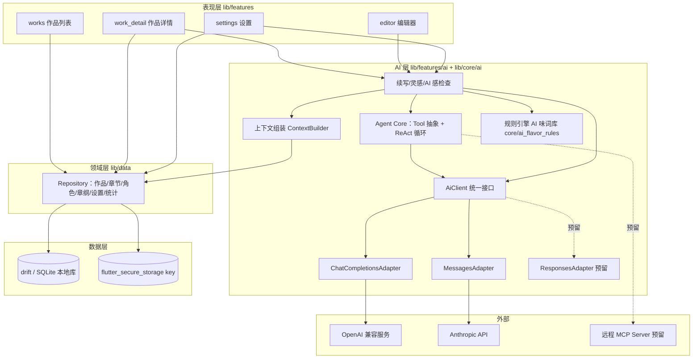
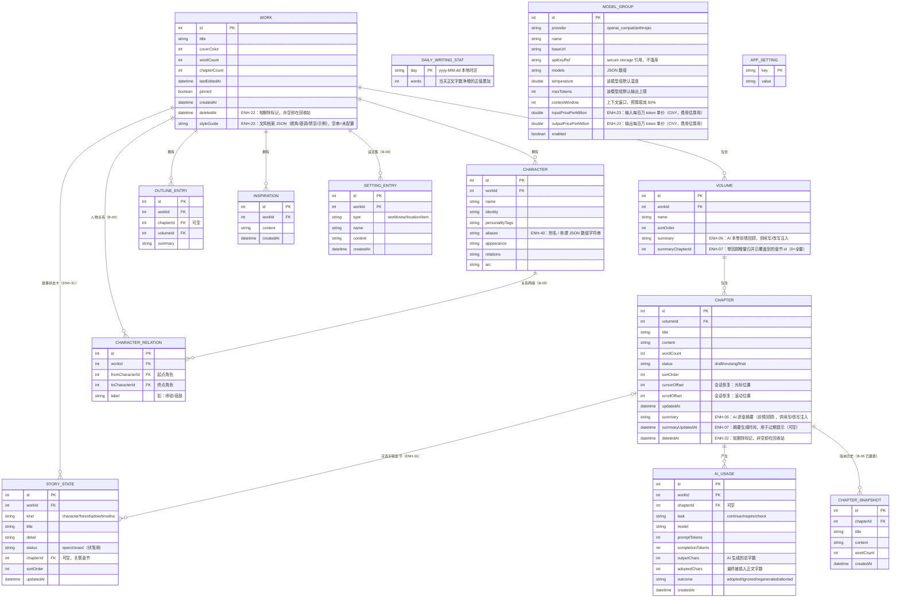
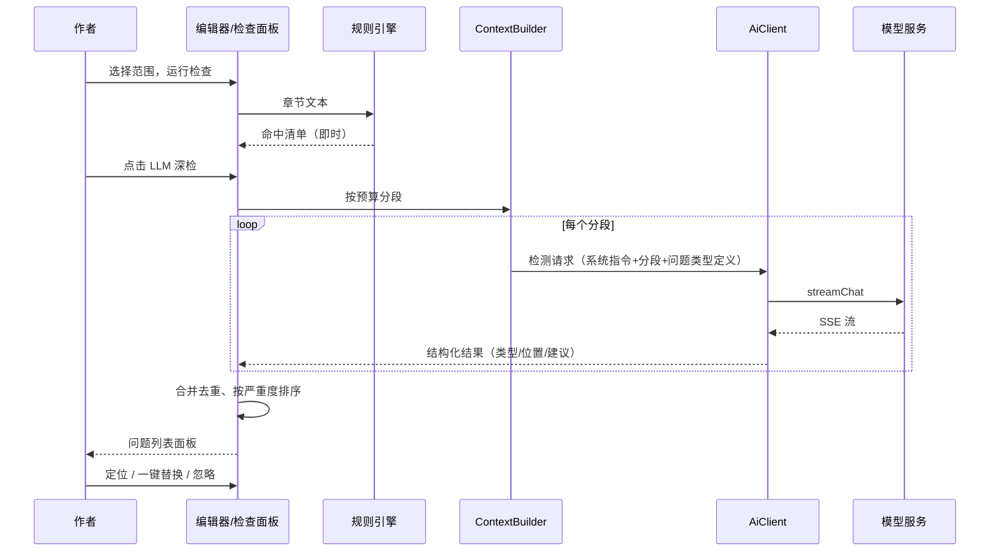

# NovelPhone 技术架构与开发文档

| 项 | 内容 |
|---|---|
| 版本 | v0.1（草案） |
| 日期 | 2026-09-30 |
| 状态 | 待评审 |
| 上游文档 | `docs/PRD.md`（定义做什么） |
| 下游文档 | `docs/TODO.md`（任务拆分与跟踪） |

---

## 1. 设计概述

### 1.1 范围

本文档覆盖 NovelPhone 的整体技术架构、模块划分、数据模型、AI 客户端设计、非功能性策略与演进路径。

明确不在本文档范围内：UI 视觉规范（另行输出设计规范）、MCP 与 SKILL 的详细设计（架构预留接入点，功能实现后补充）、服务端开发（产品为纯本地 app，无自建服务端）。

### 1.2 设计目标与约束

| 目标/约束 | 说明 | 证据 |
|---|---|---|
| 本地优先 | 写作与管理全程离线可用；仅 AI 功能联网，且仅传输 AI 请求所需的最小上下文 | `[Data-backed]` PRD 2.1 产品原则 |
| 用户自带 API Key | 不内置任何模型服务的凭证；key 仅存设备安全区；支持 OpenAI Chat Completions、Anthropic Messages 两种端点，结构上为 Responses 端点预留 | `[Data-backed]` 已确认的技术决策 |
| 手机端体验 | 启动快、长章节编辑不卡、误操作可恢复（撤销/自动保存） | `[Data-backed]` PRD 1.2 痛点 |
| 单代码库跨平台 | 优先交付 iOS/Android，架构不阻塞后续桌面端 | `[Expert judgment]` |
| 变更量最小的前提下可演进 | MCP、用户 SKILL、云备份等后置功能有明确接入点，不需要重构既有层 | `[Expert judgment]` |

### 1.3 术语表

| 术语 | 含义 |
|---|---|
| 端点（endpoint） | 模型服务商的 HTTP API 路径。本产品涉及 Chat Completions（`POST /v1/chat/completions`）、Messages（`POST /v1/messages`），预留 Responses（`POST /v1/responses`） |
| AiClient | 产品内部统一的模型调用抽象，屏蔽端点差异 |
| 上下文组装 | 从本地作品数据构造 AI 请求 prompt 的过程 |
| 规则引擎 | AI 感检查第一层：本地套话词库与句式模式匹配，零成本即时执行 |
| 待确认面板 | AI 产出进入的底部面板，作者编辑确认后才写入正文 |

---

## 2. 总体架构

### 2.1 架构风格

采用**分层 + 功能模块**混合组织：横向按技术关注点分层（表现层 / 功能层 / 领域层 / 数据层），纵向按功能域切模块（works / work_detail / editor / ai / settings）。分层之间通过接口（Dart abstract interface）通信，功能模块不直接持有数据库句柄与安全存储句柄，业务数据经 Repository 读写，API key 经 SettingsRepository 读写。选此风格的理由：单机 app 无并发写入方，不需要事件驱动；分层保证 AI 端点适配、数据源替换等变化被限制在单层内 `[Expert judgment]`。

### 2.2 架构图



架构图说明：UI 功能模块只依赖 Repository 与 AI 层的公开接口，不感知端点协议与数据库细节；所有出网请求收敛在 AiClient 的适配器内，便于做统一的错误处理与 token 统计；MCP（B-02）与 Responses（B-01）已由预留接入点落地为新增工具源与新增适配器，上层未改动。key 与 MCP 认证头的读写统一经 Repository 访问 flutter_secure_storage，UI 不直连安全存储。

### 2.3 技术选型

| 选型 | 理由 | 证据 |
|---|---|---|
| Flutter + Dart | 单代码库交付 iOS/Android；本地 app 形态（无服务端）与其定位匹配 | `[Expert judgment]` |
| Riverpod | 状态管理；编译期安全的依赖注入，编辑器与 AI 面板的流式状态用 StreamProvider 自然衔接；只在单一页面消费的 Provider 显式 `.autoDispose`，离开页面即释放底层流订阅（ENH-11） | `[Expert judgment]` |
| drift | SQLite 的类型安全封装；响应式查询让章节列表随编辑自动刷新；schema 迁移机制应对后续加表 | `[Expert judgment]` |
| go_router | 声明式路由；作品列表 → 作品详情 → 编辑器三层导航与深度链接 | `[Expert judgment]` |
| flutter_secure_storage | key 存入 keychain / keystore，满足 PRD 5.8 的安全要求 | `[Expert judgment]` |
| local_auth | 应用锁（ENH-25）：调用系统生物识别 / 设备凭证，不自实现密码校验，也不接触指纹与人脸原始数据 | `[Research-backed]` 平台 BiometricPrompt / LocalAuthentication |
| cryptography | 备份密码加密（ENH-26）：PBKDF2-HMAC-SHA256（210,000 次）派生 256 位密钥 + AES-256-GCM 认证加密；纯 Dart 实现、无平台通道，可在 isolate 内执行 | `[Research-backed]` pub.dev cryptography 2.9 / RFC 8018 / NIST SP 800-38D |
| 平台截屏保护 | Android `FLAG_SECURE` 经 MethodChannel 控制（同时阻止截屏 / 录屏与最近任务缩略图）；iOS 无阻止前台截屏的公开 API，退后台时以不透明遮罩覆盖（ENH-26） | `[Research-backed]` Android WindowManager；iOS applicationWillResignActive |
| http | 出网请求；SSE 流式用 `StreamedResponse` 逐行解析，不引入更重的客户端 | `[Expert judgment]` |
| mcp_dart | 实现 MCP 2026-07-28 规范核心 wire surface，支持 Streamable HTTP 与 stdio，与官方 TS/Python SDK 有互操作验证；B-02 引入 2.4.2，不自研协议 | `[Research-backed]` pub.dev 包文档 |

关键取舍记录：

- **不自研模型调用封装，也不引入 flutter_ai_sdk 等统一封装库**：产品只需要流式文本对话，封装库的 vision/embeddings/本地模型等能力用不到，且其 model-agnostic 抽象会与端点适配层重叠；直连 http + 自写适配器总量约 400 行，可控可测 `[Expert judgment]`。
- **M1/M2 不引入 MCP**：iOS 无法 spawn 子进程，stdio transport 在手机上不可用，用户侧 MCP 只能走远程 HTTP server；产品上前置条件（配置界面、安全模型、计费可见性）未就绪，先用 Tool 抽象占位 `[Research-backed]` MCP transport 的平台限制。
- **agent 编排自写而非引入 Genkit**：本项目 agent 形态是单 agent + 工具，ReAct 循环约 300 行；Genkit Dart 尚为 preview，且其 model-agnostic 层与端点适配层职责重叠。Tool 抽象按 MCP tool schema 结构设计（name/description/inputSchema），将来若迁移 Genkit 只换编排层 `[Expert judgment]`。

---

## 3. 模块设计

目录结构与模块职责：

```
lib/
├── main.dart                     # 入口：初始化 drift、secure storage、ProviderScope
├── app/                          # 应用壳：主题（PaperPalette 亮/暗调色板 + 全局深浅模式）、go_router 路由表、应用内语言（app/locale.dart，ENH-17）、应用锁门禁（app_lock_gate.dart，ENH-25）、截屏保护宿主（screen_protection_host.dart，ENH-26）
├── l10n/                         # 国际化（ENH-17）：app_zh.arb / app_en.arb（zh 为模板）+ generated/（gen-l10n 产物）+ l10n.dart（context.l10n 扩展）+ error_text.dart（错误文案展示时本地化）
├── models/                       # 数据模型（与 drift 表对应的实体；含 MCP 审计条目 mcp_audit_entry.dart，ENH-22；文风档案 work_style_guide.dart 与问答轮次 work_chat_turn.dart，ENH-23）
├── data/
│   ├── db.dart                   # drift 数据库定义与迁移
│   ├── dao/                      # 各表 DAO
│   └── repositories/             # Repository：领域操作的唯一入口（含回收站 trash_repository.dart 与 MCP 审计 mcp_audit_repository.dart，ENH-22；作品问答记录 chat_repository.dart 与故事状态卡 story_state_repository.dart，ENH-23 / ENH-31）
├── core/
│   ├── ai/
│   │   ├── ai_client.dart        # AiClient 抽象 + 统一请求/响应模型
│   │   ├── chat_completions_adapter.dart
│   │   ├── messages_adapter.dart
│   │   ├── responses_adapter.dart # OpenAI Responses 端点（B-01）
│   │   ├── ai_timeouts.dart      # 连接 / 流式空闲超时（ENH-23）
│   │   ├── empty_output_retry.dart # 空正文重试决策：输出上限翻倍与封顶（ENH-25）
│   │   ├── sse.dart              # SSE 行解析（三个端点共用骨架）
│   │   ├── context_builder.dart  # 上下文组装（PRD 6.2 的实现；文风 / 抽取 / 推演 / 问答，ENH-23；修订草稿与协作偏好，ENH-27；故事状态卡与检索片段，ENH-31 / ENH-32；问答目录首尾采样，ENH-33；一致性检查接入状态卡，ENH-34；本章状态变化与关系变化提取，ENH-35 / ENH-56；状态卡去重 / 新近优先并注入章纲扩写 / 剧情推演，ENH-39；角色别名参与匹配与检索扩展，ENH-40；一致性忽略清单注入，ENH-41；问答章节 id 与引用要求，ENH-43；协作守则 / 套话黑名单注入并将偏好文本传入开篇，ENH-44 / ENH-46；协作偏好注入章纲扩写 / 剧情推演，ENH-49；本章写作目标与角色口吻注入，ENH-51 / ENH-52；人物关系网按任务过滤注入，ENH-53；桥段点子补齐目标 / 关系 / 状态卡，ENH-54；关系邻接角色卡（一跳邻居）注入，ENH-55）
│   │   ├── chapter_intent.dart   # 本章写作目标：核心目标 / 有序节拍 / 避免项的结构化模型、JSON 编解码与旧纯文本兼容、提示词段落与行拆分（ENH-51）
│   │   ├── retrieval.dart        # RAG-lite 本地检索：IDF 加权字符二元组 + 整串命中 + 角色别名扩展 + 相邻章节加成；扫描预算按章均分并均匀抽样；作品问答可携带章节 id（ENH-32 / ENH-33 / ENH-40 / ENH-43）
│   │   ├── writing_preferences.dart # 作者协作偏好：忽略原因 / 分段未采纳原因 → 提示约束（阈值）、采纳片段裁剪与任务优先排序、prompt 组装、作品级 key 清单与启停（ENH-27 / ENH-28 / ENH-29）；采纳样本保留模型原稿（ENH-42）；纳入一致性忽略清单 key（ENH-41）；纳入协作守则 / 套话黑名单 / 「太 AI」留档 key（ENH-44）；纳入手写守则作用域（ENH-49）与大改分析样本 key（ENH-50）
│   │   ├── collaboration_rules.dart # 协作守则与 AI 套话黑名单：清洗 / 去重 / 截断与上限、18 条套话统计与推荐、注入块（ENH-44）；逐条任务作用域与冲突识别（ENH-49）；结果内自检与词库扩展候选（ENH-48 / ENH-50）
│   │   ├── preference_distillation.dart # 改写偏好蒸馏：从「模型原稿 → 作者定稿」配对样本统计压缩 / 扩写 / 对白 / 段落倾向并规避原稿套话（ENH-45）；大改样本仅本地分析并标注 evidence（ENH-50）
│   │   ├── insert_separator.dart # AI 插入光标处的段落分隔：按插入点前后空行补齐，避免正文粘连（ENH-28）
│   │   ├── adoption_metrics.dart # 采纳编辑比例：去空白字符二元组 Dice 相似度，10% 原样阈值 / 30% 样本上限；10%~30% 保留模型原稿（ENH-30 / ENH-42）
│   │   ├── continuity_suppression.dart # 一致性冲突忽略记忆：指纹归一化、提示块、结果过滤与恢复（ENH-41）
│   │   ├── chat_citations.dart # 作品问答章节引用标记解析与展示清洗：文本 / 引用交替片段、内联渲染、空括号与重复标点清理（ENH-43 / ENH-47）
│   │   ├── structured_response.dart # 宽松 JSON 解析：文风 / 实体抽取 / 剧情推演 / 本章状态变化（ENH-23 / ENH-35）
│   │   ├── task_model_recommendation.dart # 按近 30 天采纳质量推荐任务 → 模型映射（ENH-37）
│   │   ├── agent_core.dart       # Tool 抽象 + ReAct 循环
│   │   ├── mcp/mcp_bridge.dart   # 远程 MCP 工具源（B-02）+ OAuth 令牌接入（ENH-21）
│   │   ├── mcp/mcp_oauth.dart    # MCP OAuth 2.1 PKCE 授权流程（ENH-21）
│   │   ├── skills/skill.dart     # 用户自定义 SKILL：指令 / 白名单 / 参数模板与注入（B-03）
│   │   ├── skills/skill_front_matter.dart # SKILL.md front matter 解析 / 导出（ENH-21）
│   │   └── tools/                # 内置工具：get_chapter、search_chapters、get_characters、get_settings、get_outline 等（ENH-23 扩充为作品问答检索集）
│   ├── ai_flavor_rules.dart      # AI 味规则引擎（问题模型 + 句式模式 + 指标 + 纯函数检测）
│   ├── flavor_lexicon.dart       # 套话词库（约 200 条，按权重分级）
│   ├── text_diff.dart            # 段落级文本 diff（ENH-18）：快照与当前文本对比（LCS + 超限回退）
│   ├── text_search.dart          # 查找/替换匹配原语（ENH-19）：编辑器查找与全书替换共用（大小写折叠、非重叠匹配、UTF-16 偏移）
│   ├── security/app_lock_auth.dart # 应用锁系统认证适配（local_auth，ENH-25）
│   ├── security/screen_protection.dart # 截屏保护 MethodChannel（novelphone/security，ENH-26）
│   ├── word_count.dart           # 中文字数统计
│   ├── importer/                 # txt/docx/Markdown/EPUB 导入与分章（Markdown/EPUB 为 ENH-24）
│   ├── exporter/                 # 单章/整作导出（txt/md/docx/epub）、备份 zip 组装与解析（含 manifest + SHA-256 校验预览，ENH-22）、备份密码加解密（backup_crypto.dart，NPBK v1，ENH-26）与分享
│   └── cloud/                    # 云备份（B-08）：S3 兼容客户端（SigV4 签名）与备份编排
└── features/
    ├── works/                    # 作品列表
    ├── work_detail/              # 作品详情（卷/章/角色卡/设定集/章纲/人物关系图/导入/导出）+ 全书查找替换（ENH-19）+ 文风档案 / AI 设定补全 / 剧情推演 / 作品问答 / 全书体检（ENH-23）+ 批量摘要（ENH-24）+ 作者协作偏好查看 / 启停 / 清空（ENH-28）+ 故事状态卡（ENH-31）+ 角色口吻档案（ENH-52）
    ├── editor/                   # 编辑器 + AI 待确认面板（分段采纳 / 结果内继续修改，ENH-27；修订历史切换与对比，ENH-28；快捷修订 / 改写原文对比 / 关闭与用量状态，ENH-29；采纳前自动快照 / 结果存入灵感箱 / 编辑后采纳比例，ENH-30；多候选策略化与跨候选段落组合，ENH-36；结果内守则自检与按守则重写，ENH-48；大改样本留档，ENH-50）+ AI 感检查面板 + 版本历史（含快照差异对比与来源标记，ENH-18 / ENH-30）+ 流式一致性检查弹窗（ENH-23）+ 放弃原因弹窗（ENH-27，ENH-29 起支持自定义标题与提示）+ 本章状态变化提取对话框（ENH-35；ENH-56 起含人物关系变化勾选与应用）+ 本章写作目标对话框（ENH-51）
    ├── ai/                       # 续写 / 灵感 / 文风 / 抽取 / 推演 / 问答 / 一致性检查 / 状态提取用例编排；协作偏好读取与上下文注入（ENH-27）；故事状态卡与检索增强注入（ENH-31 / ENH-32）；候选叙事侧重（ENH-36）
    ├── search/                   # 全局搜索（B-06）：跨作品检索章节标题与正文；公共高亮组件（ENH-19，search 与全书替换共用）
    ├── stats/                    # 写作统计（B-07）：每日目标、连击、番茄钟、近 7/30 天字数趋势图（ENH-18）与全年写作热力图（ENH-19）
    └── settings/                 # key 与模型配置（含每百万 token 价格，ENH-23）、token 统计（含估算费用与月度预算，ENH-23 / ENH-24）、本地备份与恢复（含校验预览）、云备份（B-08）、回收站与 MCP 调用审计（ENH-22）、关于页（ENH-19，含隐私政策外链）、MCP OAuth 授权与技能导入导出（ENH-21 / ENH-22）、应用锁开关与解锁页（ENH-25）、截屏保护与备份加密开关（ENH-26）、任务模型推荐卡片（ENH-37）
```

| 模块 | 职责 | 输入 | 输出 | 依赖 | 明确不做 |
|---|---|---|---|---|---|
| features/* | UI 与交互状态 | 用户操作、Repository 流 | 界面 | Repository、AI 用例接口 | 不直接访问数据库与 http |
| features/search | 全局搜索（B-06）：关键词检索与命中高亮（高亮组件 `highlighted_text.dart` 为 ENH-19 公共提取，search 与全书替换共用） | 关键词（输入 300ms 防抖，ENH-11） | 命中列表（作品/章节/片段） | ChapterRepository.search（autoDispose，关键词未变不重查；命中位置与片段在 SQL 内计算，ENH-14） | 不做索引与分词（本地 LIKE 直查，作品量级不构成瓶颈） |
| features/stats | 写作统计（B-07）：每日字数目标进度、连续写作天数、番茄钟；近 7/30 天字数趋势图（ENH-18，自绘柱状图、无第三方依赖）；全年写作热力图（ENH-19，53×7 自绘网格 + 月份/星期标注 + 色阶图例） | 每日统计流 + 设置 | 统计页 | ChapterRepository(watchDailyWritingStats)、SettingsRepository | 番茄钟为页面内计时，不后台常驻 |
| features/work_detail（设定集/关系图） | 设定集（B-09）：世界观/地点/道具条目；人物关系图（B-09）：环形绘制角色关系并可增删改；txt/docx/Markdown/EPUB 导入（Markdown/EPUB 为 ENH-24，解析在 `Isolate.run` 执行，ENH-12）；txt/md/docx/epub 导出（docx/epub 构建在 `Isolate.run` 执行，ENH-14）；全书查找替换（ENH-19）：预览命中后单事务替换全作正文；剧情推演结果写回章纲、批量摘要（ENH-24）；作者协作偏好弹窗（ENH-28）：查看原因计数与采纳片段、总开关、清空（二次确认），ENH-41 增加一致性忽略清单的查看 / 恢复 / 清空，ENH-42 采纳片段展示模型原稿；ENH-44 增加协作守则与套话黑名单编辑、从「太 AI」留档推荐套话，ENH-45 展示改写偏好蒸馏结果并一键加入守则，ENH-46 显示合并后的偏好注入预览；ENH-49 增加守则编辑 / 排序 / 逐条任务作用域、冲突提示与按任务过滤的 token 预览；作品问答引用 chip 跳转章节（ENH-43），回答内联引用 / 复制 / 重新生成 / 编辑上一问（ENH-47） | 设定/角色/关系流 + 用户编辑 + 文件 bytes | 设定集 Tab、关系图页、导入预览、导出文件、替换页、章纲 Tab、偏好弹窗 | SettingRepository、CharacterRepository(relations)、ChapterRepository(import / findReplaceHits / replaceInWork / saveChapterSummary)、SettingsRepository(AI 偏好开关 / 清空) | 关系图为静态环形布局，不做自动布局与拖拽 |
| data/repositories | 领域读写：作品/卷/章/角色/设定集/关系/章纲/统计；回收站（ENH-22，软删除 + 30 天过期清理）与 MCP 调用审计（ENH-22，最近 100 条落 APP_SETTING） | DAO 结果 | 领域模型、响应式流 | drift | 不含业务编排（如分章策略在 importer） |
| core/ai/ai_client | 屏蔽端点差异的统一调用 | ChatRequest | `Stream<ChatChunk>` | http | 不做 prompt 组装 |
| core/ai/context_builder | 上下文组装与预算控制（前情摘要 / 本卷回顾只读元数据并按需按 id 取正文，ENH-12 / ENH-13；设定一致性检查上下文，ENH-22，ENH-34 起接入故事状态卡并要求冲突注明来源，ENH-41 起注入作者忽略清单；续写 / 改写的当前草稿 + 修订要求与协作偏好段落，ENH-27；故事状态卡与相关前文片段注入，ENH-31 / ENH-32；问答章节目录首尾各 30 章采样，ENH-33；本章状态变化与关系变化提取，ENH-35 / ENH-56；故事状态卡去重与新近优先并注入章纲扩写 / 剧情推演，ENH-39；角色别名参与匹配与检索扩展，ENH-40；问答章节 id 与引用要求，ENH-43；协作守则 / 套话黑名单经偏好文本注入续写 / 改写 / 开篇 / 灵感，ENH-44 / ENH-46；章纲扩写 / 剧情推演同样接收偏好文本，ENH-49；本章写作目标注入续写 / 改写、角色口吻随角色卡进入全部任务，ENH-51 / ENH-52；结构化人物关系按任务过滤注入（续写 / 改写 / 章纲按匹配角色，推演 / 问答 / 一致性检查全量），ENH-53；一跳关系邻居角色卡注入续写 / 改写，ENH-55；状态提取注入「已有关系」并解析 relationChanges，ENH-56） | 作品 id、任务类型、可选修订草稿 / 意见、偏好文本、忽略清单 | ChatRequest.messages | Repository | 不发起网络请求 |
| core/ai/retrieval | RAG-lite 纯函数（ENH-32 / ENH-33 / ENH-40）：按空行切段并合并到 ≤320 字，IDF 加权字符二元组覆盖度 + 整串命中加分 + 角色别名扩展加成 + 相邻章节加成（距离 0 / 1 / 2 分别 ×1.25 / 1.1 / 1.04），按每章上限与全局 Top-K 挑选；`maxScanChars` 为全书总量软上限，预算按有效章节数均分（每章至少 1 块）并在章内均匀抽样，不再顺序截断 | 章节列表（含正文）、查询文本、Top-K / 每章上限 / 分块大小 | `RetrievedPassage` 列表与格式化文本 | 无 | 不引入向量库 / 嵌入模型、不联网、不写库 |
| core/ai/task_model_recommendation | 任务模型推荐（ENH-37）：只覆盖续写 / 灵感 / 改写 / 摘要 / 章纲扩写 / 本卷回顾六类可采纳任务；≥3 次调用、采纳率 ≥20%、比当前映射高 ≥10 个百分点才推荐；同采纳率按原样采纳率与调用次数排序 | `TokenStatRow` 列表（近 30 天）、当前任务模型名 | `TaskModelRecommendation` 列表 | 无 | 不改配置、不发起调用（应用动作在设置页） |
| core/ai/writing_preferences | 作者协作偏好纯逻辑（ENH-27）：忽略原因 → 提示约束（同一原因 ≥2 次才注入）；采纳片段去重、最多 5 条 / 每条 600 字，prompt 取最近 3 条 / 每条 200 字；宽松解析脏 JSON；ENH-28 增加作品级 key 清单（`feedbackKey` / `adoptedSamplesKey` / `enabledKey` / `keysFor`，供永久删除清理）；ENH-29 增加分段未采纳原因 key（`ai_paragraph_feedback_<workId>`，纳入 `keysFor`）与 `promptBlock(preferredTask:)` 任务优先排序；ENH-41 把一致性忽略清单 key 纳入 `keysFor`；ENH-42 采纳样本可携带模型原稿（`source` / `hasSource`），prompt 以「模型原稿 / 作者定稿」成对输出；ENH-44 把协作守则 / 套话黑名单 / 「太 AI」留档三个 key 纳入 `keysFor`；ENH-49 纳入守则作用域 key；ENH-50 纳入大改分析样本 key（单独 `analysisSamplesKey`，最多 10 组） | APP_SETTING JSON / 新采纳文本 / 作品 id / 当前任务 | 原因计数 Map、采纳样本列表、prompt 文本、偏好 key 列表 | 无 | 不做网络、不写库、不记录任何模型原始输出以外的数据 |
| core/ai/collaboration_rules | 协作守则与套话黑名单纯逻辑（ENH-44 / ENH-48 / ENH-49 / ENH-50）：守则最多 10 条 × 120 字、黑名单 20 条 × 40 字、留档原文 5 条 × 300 字、大改分析样本 10 组；清洗去重、提示块（【协作守则】/【AI 套话】）；套话统计命中并从「太 AI」留档推荐候选（最多 6 条，候选为手写 18 条 + 词库中高权重条目，只折叠 ≤2 字包含短语）；逐条任务作用域（续写 / 改写 / 灵感 / 章纲 / 推演）解析与过滤；方向相反的守则冲突识别（仅提示）；`inspectText` 合并黑名单、守则引号词、内置套话与词库 cliche / repetition 做结果自检；JSON 编解码容错 | 守则 / 黑名单 / 作用域条目、留档文本、生成结果文本 | 规范化列表、prompt 文本、套话命中与推荐、`RuleCheckResult`、冲突列表 | ai_flavor_rules、flavor_lexicon | 不做网络与持久化（落 APP_SETTING 在 SettingsRepository），不自动改写用户条目，不阻断生成 |
| core/ai/preference_distillation | 改写偏好蒸馏纯逻辑（ENH-45 / ENH-50）：从「模型原稿 → 作者定稿」配对样本统计平均压缩 / 扩写比例、对白占比与段落长度倾向，达到阈值才产出提示（≤0.85 压缩 / ≥1.2 扩写 / 对白 ≥60% / 段落 ≤0.75 / ≥1.3），并提炼原稿中被删掉的套话 Top-3；最多 4 条，附证据说明；ENH-50 可合并「仅本地分析」的大改样本并记录其中大改组数（`analysisEvidence`） | 采纳样本列表（含 source）、可选大改分析样本 | `DistilledHint`（text + evidence + analysisEvidence）列表 | adoption_metrics、collaboration_rules(套话词表) | 不调用模型、不做语义改写、不自动写入守则（由作者确认）；大改样本不进入 prompt 注入 |
| core/ai/continuity_suppression | 一致性冲突忽略记忆纯逻辑（ENH-41）：原文 + 来源归一化指纹（同原文不同来源写法视为同一处）、最多 50 条、新项置顶去重、提示块（最多 20 条 / 每条 80 字）、结果过滤与忽略计数、脏 JSON 容错 | 冲突条目 / 忽略清单 JSON | 指纹、过滤后的结果与忽略数、prompt 文本 | structured_response | 不做网络与持久化（落 APP_SETTING 在 SettingsRepository） |
| core/ai/chat_citations | 作品问答引用标记（ENH-43）：解析 `[[ch:<id>]]`（空格 / 中英文冒号 / 大小写容错、按出现顺序去重、只收正数）与展示清洗（去标记、清理多余空格与空行）；ENH-47 增加 `segments` 文本 / 引用交替片段供内联 chip 渲染，并清理引用被移除后残留的空括号与重复标点 | 模型回答文本 | 章节 id 列表 / 文本片段列表 / 清洗后的文本 | 无 | 不取章节数据、不写库（界面只读元数据并负责跳转、复制与保存） |
| features/editor | 编辑器与 AI 结果协作（ENH-27）：待确认面板（流式 / 多候选 / 上下文详情）、分段采纳弹窗（勾选 / 编辑 / 改写差异标记）、结果内继续修改（当前草稿 + 意见，单路请求）、放弃原因采集；ENH-28：结果插入光标处经 `composeAiInsertion` 补齐段落空行、每路候选保留最多 5 版修订草稿（切换 / 对比上一版，手动编辑在切换时回写）；ENH-29：撤销勾选段落时采集未采纳原因、快捷修订 chips、改写「对比原文」、关闭 / 销毁 / 重生成 / 修订首片的用量状态一致性；ENH-30：首次写入前经 editor 创建「AI 采纳前」快照（`note = ai_before_adopt`）、续写 / 改写结果存入灵感箱（非灵感模式记 `ignored`）、按原稿 → 最终文本的编辑比例记录采纳质量；版本历史与检查面板（既有）；ENH-41 一致性报告逐条忽略（原因可选）并在忽略后刷新；ENH-42 采纳时按编辑比例传入模型原稿；ENH-48 对当前结果做本地守则自检（命中可加入黑名单或按守则重写）；ENH-50 编辑比例 > 30% 的采纳结果另存为大改分析样本 | 编辑器文本与选区、AI 事件流、用户意见 | 写入正文（经撤销栈）、CHAPTER_SNAPSHOT 快照、APP_SETTING 偏好记录、AI_USAGE 结果 | AiService、SettingsRepository、ChapterRepository、text_diff、core/ai/insert_separator、core/ai/adoption_metrics | 不直接访问数据库或 http |
| core/ai/adoption_metrics | 采纳编辑比例纯函数（ENH-30）：去除空白后字符二元组 Dice 相似度 → 0~100 编辑比例；<=10 视为原样采纳，>30 不作为偏好样本 | AI 原稿、最终采纳文本 | 编辑比例 int | 无 | 不做分词 / 语义判断，不写库 |
| core/ai/insert_separator | 光标插入的段落边界纯函数（ENH-28）：插入点前文非空且无换行补 `\n\n`、单个换行补 `\n`；后文同理补齐；文档首尾不产生多余空行 | 文档全文、UTF-16 偏移、待插入文本 | 实际插入串（含分隔换行） | 无 | 不做语法 / 语义判断，不直接写编辑器（由 editor_controller 落位） |
| core/ai/agent_core | Tool 注册与 ReAct 循环 | 任务描述 + 工具集 | 最终文本 / 工具调用记录 | AiClient、tools | 不感知具体端点 |
| core/ai/tools | 内置本地工具（读章节、查角色等；标题映射只读元数据，ENH-12） | 工具入参 JSON | 工具结果文本 | Repository | 不直接调模型 |
| core/ai/skills | 用户自定义 SKILL（B-03）：指令拼接与工具白名单过滤；front matter 导入 / 导出（ENH-21，Anthropic SKILL.md 约定：name / description / allowed-tools / parameters / enabled），技能可导出为 Markdown 经系统分享（ENH-22） | 启用的 Skill 列表 + 组装结果 / 工具集 / SKILL.md 文本 | 注入后的 system 与工具集 / SkillDraft | 无 | 不做网络与持久化（落库在 SettingsRepository） |
| core/ai/mcp | 远程 MCP 工具源（B-02）：Streamable HTTP 连接、白名单包装、会话关闭；OAuth 2.1 PKCE 授权流程（ENH-21）：受保护资源 / 授权服务器元数据发现、动态客户端注册、S256 PKCE、loopback 回调换令牌、refresh_token 续期；远程调用审计包装（ENH-22） | 服务器地址 / 客户端配置 / http.Client | 工具集 / McpOAuthTokens | mcp_dart、http | 不直接碰安全存储与浏览器（令牌存取在 SettingsRepository、打开系统浏览器在设置页） |
| core/ai_flavor_rules | 规则引擎检测 | 章节文本 | 问题列表 | 无 | 不做 LLM 检测 |
| core/text_search | 查找/替换匹配原语（ENH-19）：大小写折叠、非重叠匹配、UTF-16 偏移、段替换计数 | 文本、关键词（+ 替换词） | 匹配区间列表 / 替换结果与次数 | 无 | 不做正则与全词匹配；编辑器查找与全书替换共用同一实现 |
| core/importer | 解析与分章（由 features 侧经 `Isolate.run` 调用，避免整文同步计算卡 UI，ENH-12）：编码探测 / 正则分章 / docx / Markdown（ENH-24）/ EPUB（ENH-24，OPF spine + XHTML 正文）/ HTML 实体解码 | 文件 bytes | 分割预览 | 无 | 不写库（确认后交 Repository） |
| core/exporter | 导出文本生成与备份 zip 组装/解析（组装与解析的重活经 isolate 执行，ENH-14 / ENH-15）；备份 manifest 与 SHA-256 校验预览（ENH-22）；备份密码加解密（ENH-26）：`NPBK` 魔数信封、PBKDF2-HMAC-SHA256 210,000 次、AES-256-GCM，错误密码 / 篡改统一映射 `decryptionFailed` | 章节数据、导出数据 Map、明文 zip bytes + 口令 / 密文 + 口令 | txt/md/docx bytes、zip bytes、`.npbak` bytes、BackupPreview | archive、crypto、cryptography | 不写库、不直接调分享面板（由 features 触发）；不提供明文回退 |
| core/cloud | 云备份（B-08）：S3 兼容对象存储读写（SigV4 签名）与备份/恢复编排（上传、列举、清理、下载）；开启备份加密时上传 `.npbak` 密文并按扩展名列举（ENH-26） | 服务商配置（endpoint/region/bucket/凭证）+ zip / 密文 bytes / 远端对象列表 | 远端对象列表、下载 bytes、操作结果 | http、core/exporter（zip 组装与加解密） | 不直接读写数据库（配置与编排由 features/settings 与 SettingsRepository 协作），不含中心化服务器与账号体系 |
| features/settings | key/模型配置、token 累计、本地备份与恢复（恢复前校验预览，ENH-22；加密备份解密，ENH-26）、云备份配置与触发（B-08）、语言设置（ENH-17）、回收站（ENH-22）、MCP 调用审计（ENH-22）、关于页（ENH-19，package_info_plus 读取版本号 + 隐私说明 + 开源许可）、MCP OAuth 授权（ENH-21，系统浏览器 + loopback 回调）与技能文件 / 粘贴导入、导出分享（ENH-21 / ENH-22）、应用锁开关（ENH-25，开关与禁用均需系统认证）、截屏保护与备份加密开关（ENH-26，加密开关需先设置不少于 8 位的备份密码） | 用户输入 / 文件 bytes / 粘贴文本 | 经 Repository 落库、经安全存储存 key / 令牌 / 备份密码、经 core/cloud 上传下载 | SettingsRepository、TokenStatsRepository、TrashRepository、McpAuditRepository、AiUseCase(testConnection / checkContinuity)、CloudBackupService、McpOAuthClient、AppLockAuthenticator（ENH-25） | 不直接接触数据库、安全存储与网络（file_picker 例外：仅读取用户选中的文件） |
| l10n | 国际化（ENH-17）：ARB 资源（zh 模板 + en 翻译，1059 键）、`context.l10n` 读取扩展、错误文案展示时本地化（error_text.dart） | ARB 生成代码、结构化错误（kind/code/detail） | 本地化文案 | Flutter gen-l10n（编译期生成） | 不翻译 AI 提示词与中文语料域数据（flavor 词库/规则名/导出内容/DB 默认值） |

依赖方向：features → repositories / ai 用例 → core/ai → ai_client；无环 `[Expert judgment]`。

### 3.1 导入分章与导出格式规则（M2 实现约定）

分章规则（`core/importer/chapter_splitter.dart`）——按行匹配、整行即标题：

| 类型 | 模式 | 标题取值 |
|---|---|---|
| markdown | `#{1,3}\s+(.+?)` | `#` 之后的文本 |
| 中文网文 | `第\s*[数字/中文数字]+\s*[章节回篇]\s*(.*?)` | 保留整行（保留章序信息） |
| 英文 | `chapter\s+\d+\s*(.*?)` | 保留整行 |

- 全文无标题行时整篇作为一章，标题留空；第一个标题之前的内容单独成章（卷首语 / 作者的话），标题留空。
- 标题超过 50 字按 50 字截断（与 `CHAPTER.title` 约束一致）；截断按码点（`runes`）而非 UTF-16 码元，避免标题含 emoji 等代理对时被劈成半个字符（ENH-09）。
- 空标题章节导出时写作 `未命名章节`，再导入还原为空标题——这是保证「导出 → 再导入」结构一致的往返约定。
- docx 导入优先按段落样式分章（`Title` / `Heading*` / `标题*`），无标题样式时降级为上述正则。
- Markdown 导入（ENH-24，`core/importer/markdown_parser.dart`）：去掉可选的 YAML front matter 后按 `#`~`###` 标题切分，标题取 `#` 之后文本、正文去掉首个标题行；无标题时整篇一章，首个标题前的内容单独成章（与 txt 规则一致）。
- EPUB 导入（ENH-24，`core/importer/epub_parser.dart`）：解 zip → `META-INF/container.xml` 定位 OPF → 按 manifest / spine 顺序逐 XHTML 读取（跳过 `properties="nav"` 的目录页与非 HTML 资源）→ 提取 `<body>` 文本与 `<h1>`~`<h3>` 标题；单个 XHTML 内出现多个章节标题时继续走 `splitIntoChapters`，否则作为一章；HTML 实体由 `html_entities.dart` 解码，路径按大小写不敏感匹配并解析相对 href。
- 解析移出 UI 线程（ENH-12）：编码探测（`decodeTextBytes`）、正则分章（`splitIntoChapters`）与 docx 解压解析都是同步整文计算，10MB 上限内的文件足以在 UI 线程造成可见卡顿。`features/work_detail/import_page.dart` 把解析收敛为顶层 `parseImportFile(fileName, bytes)`，生产入口 `parseImportFileAsync` 用 `Isolate.run` 执行（与 5.5 的规则引擎 isolate 化同理）。**约束**：isolate 闭包只允许捕获可发送的值（`String` / `Uint8List` 等），若捕获文件选择器返回的平台对象会抛「Illegal argument in isolate message: object is unsendable」，故必须先取出 `file.name` 再进入 isolate，且 isolate 调用封装在只接受 `String` / `Uint8List` 的顶层函数里（调用方无法把平台对象带进闭包）。

导出格式（`core/exporter/`）：

- 单章：txt（标题行 + 正文）、markdown（`# 标题` + 正文）。
- 整作 txt：各章标题单独成行，不写作品标题（避免再导入时多出一段前言）。
- 整作 markdown：每章一个一级标题，可被分章正则完整还原；不写卷信息（卷结构与更细字段由整库备份 JSON 承载）。
- 整作 docx：自建最小 zip，标题段落用 `Heading1` 样式，可被 docx 导入按样式分章。
- 整作 epub：EPUB 3 最小结构（`mimetype` 首条目且 STORE 存储、`META-INF/container.xml`、`OEBPS/` 的 `content.opf` + `nav.xhtml`(properties="nav") + `style.css` + 逐章 `chapter_N.xhtml`），可被主流阅读器打开；`dc:identifier` 取 `urn:novelphone:<作品名>` 保证确定性。
- 备份 zip：`data.json`（作品/卷/章/角色/章纲/灵感/章节快照/每日统计/设定集/人物关系/故事状态卡等业务表 `toJson`，含正文，供恢复）+ `works/*.md`（各作品全文，供人工查阅）；不含 API key（key 仅在 flutter_secure_storage，从不进库）。恢复支持合并（作为新作品导入）与覆盖（清空后按原 id 还原），恢复时按 `workIdMap` / `volumeIdMap` / `chapterIdMap` / `characterIdMap` 重映射外键；故事状态卡另按 `chapterIdMap` 重映射可空章节关联。
- 构建移出 UI 线程（ENH-14）：整作 docx / epub 的逐章拼 XML 与 `ZipEncoder` 压缩、整库备份的 `jsonEncode` + zip 聚合都是整文同步计算，大作品足以在 UI 线程造成可见卡顿。`features/work_detail/export_actions.dart` 的 docx / epub 分支与 `core/exporter/backup_archive.dart` 的 `buildBackupZip` 调用改由 `Isolate.run` 执行（与 3.1 的导入解析、5.5 的规则引擎同理）；txt / markdown 构建廉价仍同步。**约束**（沿用 ENH-12）：传入 isolate 的只允许可发送值——导出传 `List<ExportChapter>`（纯 `String` 字段数据类），备份传 `Map<String, dynamic> data` + `Map<String, String> workMarkdowns`（`BackupRepository.exportData()` 的逐表 `.toJson()` 因 drift 行对象不可发送，仍在主线程完成）。
- 解析与 markdown 拼接同样移出 UI 线程（ENH-15）：备份 zip 的解析（`ZipDecoder.decodeBytes` + `utf8.decode` + `jsonDecode`）是恢复整库备份的主要 CPU 开销，`core/exporter/backup_archive.dart` 新增 `parseBackupZipAsync`（`Isolate.run`），本地恢复（`features/settings/backup_actions.dart`）与云端恢复（`features/settings/cloud_backup_page.dart`）两处调用点改走它（同步版 `parseBackupZip` 保留给用例），`FormatException` 仍原样抛回调用方；`exportBackupZipBytes` 则先把作品正文收敛为纯数据记录 `WorkMarkdownSource`（`title` + 各章 `title` / `content`，不带 drift 行对象），再把「逐作品拼 markdown + 重名避让 + zip 组装」整体放进同一个 isolate，主线程不再为拼 markdown 重扫整库正文。

---

## 4. 数据设计

### 4.1 ER 图



> MODEL_GROUP.apiKeyRef 说明：key 本体只进 flutter_secure_storage，数据库仅存引用标识；备份 zip 不含 key。APP_SETTING 存全局偏好（默认模型、上次打开的作品等）与任务→模型映射（键如 `task_model_continue` / `task_model_inspire` / `task_model_check` / `task_model_continuity`），不含任何凭证。ENH-22 的 MCP 调用审计同样落 APP_SETTING（`mcp_audit_log`，最多 100 条），不新增数据表、不联网、不含认证信息。

### 4.2 表设计要点

- CHAPTER.content 存纯文本；单章 10 万字上限（PRD 5.3），SQLite 单行无压力。
- CHAPTER.cursorOffset / scrollOffset 供会话恢复（PRD 5.3）使用，不参与 AI 上下文组装。
- 生成参数与任务映射：温度/输出上限存在 MODEL_GROUP（模型级默认值）；"哪个任务用哪个模型组"存在 APP_SETTING 的 `task_model_*` 键（PRD 5.8 的多任务模型配置）。
- WORK.wordCount/chapterCount 为冗余汇总字段，随章节保存事务内更新，避免列表页聚合查询（ENH-14 起保存正文按「新字数 − 旧字数」差量增量维护，仅删章 / 删卷 / 导入等才全量重算）`[Expert judgment]`。
- AI_USAGE 是 token 统计的唯一数据源，设置页按 model/task 双维度聚合（ENH-15 起该聚合在 SQL 内完成：`selectOnly` + `groupBy(model, task)` + `COUNT` / `SUM` / `COUNT(filter:)`，不再把整表读回 Dart 逐行累加，也不再跑与聚合无关的 `ORDER BY createdAt DESC`；仓储侧只保留「先 task 再 model」排序与类型映射）。
- 统计口径落点：AI_USAGE.outcome 记录每次生成的结果（采纳/忽略/重新生成/中止），用于采纳率与忽略率；outputChars/adoptedChars 记录生成总字数与最终插入正文字数，支撑 PRD 2.2 的字符口径采纳率；检查问题处置率由检查会话结束时写入 APP_SETTING 计数器（`check_stat_total` / `check_stat_handled`）（对应 PRD 2.2、6.3、7 的本地指标）。ENH-29 起，同一路候选的修订在收到首个文本分片时才把上一版结转 `regenerated` 并把采纳归属迁到新请求，修订失败不写结果也不改旧记录；关闭 / 切换模式 / 销毁面板会把未决记录兜底标记 `ignored`。ENH-30 起，采纳时另存 `adoptedEditPercent`（AI 原稿 → 最终文本的编辑比例），token 统计 SQL 追加 `COUNT(filter: outcome = adopted AND adoptedEditPercent <= 10)` 得到 `verbatimAdopted`，用于「原样采纳率」；该比例只用于本地样本筛选与展示，不参与上下文组装。
- MODEL_GROUP.contextWindow 为该模型组的上下文窗口声明值，ContextBuilder 的 token 预算取其 50%（见 5.3）。
- 迁移：drift schema 版本号管理，每个版本一个迁移步骤；MVP 内预计 1-2 次迁移（AI_USAGE、MODEL_GROUP、APP_SETTING 表在 M3 引入）`[Expert judgment]`。
- CHAPTER_SNAPSHOT：章节版本历史（B-05），仅存标题与正文全文、字数与创建时间，随章节级联删除；不参与 AI 上下文组装。快照由作者在编辑器中手动创建（单章最多保留 50 条，超出清理最旧），恢复前会自动为当前内容补一份快照避免误操作丢稿。表随 B-05 落地（schemaVersion 2 → 3），并纳入整库备份。ENH-30 起增加 `note` 来源标记（默认空串）：AI 采纳前自动快照写 `ai_before_adopt`，版本历史显示「AI 采纳前」；旧备份恢复时缺键补空串。
- DAILY_WRITING_STAT：每日写作字数（B-07），`day`（yyyy-MM-dd 本地时区）为主键、`words` 为当天正文字数净增的**正值累加**（只加不减，删改正文不回退），在章节保存事务内随正文一并更新，供每日目标进度与连续写作天数统计；每日目标（`daily_word_target`）、番茄钟时长（`pomodoro_minutes`）与按日的完成数（`pomodoro_done_<yyyy-MM-dd>`）落在 APP_SETTING。表随 B-07 落地（schemaVersion 3 → 4），并纳入整库备份。
- SETTING_ENTRY：设定集（B-09），`type` 区分世界观/地点/道具（对应 `SettingType` 枚举），每条含名称（1-50 字）与设定内容，随作品级联删除；页面按类型筛选展示，并纳入 AI 上下文组装（见 5.3，排在角色卡之后）。
- CHARACTER_RELATION：人物关系（B-09），一条有向关系 `fromCharacterId → toCharacterId` 附关系标签，两端角色删除时随外键级联删除；`workId` 便于按作品查询。关系图页用 CustomPainter 将角色均布于圆周、按关系连线（线条中点标注标签），下方列表支持增删改；为静态环形布局，不做力导向/拖拽。SETTING_ENTRY 与 CHARACTER_RELATION 随 B-09 落地（schemaVersion 4 → 5），并纳入整库备份；ENH-53 起关系边还会经 `formatRelations` 按任务过滤后进入 AI 上下文（续写 / 改写 / 章纲只取匹配角色，推演 / 问答 / 一致性检查全量）；ENH-55 起续写 / 改写还会注入匹配角色的一跳邻居角色卡（最多 2 张，标注「因人物关系纳入」）。
- CHAPTER.summary：AI 逐章摘要（ENH-05），默认空串，由「AI 章节工具 → 生成本章摘要」写入，供后续章节续写/改写注入「前文摘要」（见 5.3），区别于 OUTLINE_ENTRY 手写章纲；随章节级联删除、纳入整库备份。列随 ENH-05 落地（schemaVersion 5 → 6，`m.addColumn`）；恢复旧备份（无该键）时 `putIfAbsent('summary', '')` 兜底，避免 drift `fromJson` 对非空列缺键抛异常。
- VOLUME.summary：AI 本卷前情回顾（ENH-06），默认空串，由「AI 章节工具 → 生成本卷前情回顾」写入，续写/改写时与最近 1-2 章摘要一并注入「前文摘要」（见 5.3）；卷摘要为空时输出与旧版逐字一致（零回归）。列随 ENH-06 落地（schemaVersion 6 → 7，`m.addColumn`）；恢复旧备份（无该键）时 `putIfAbsent('summary', '')` 兜底。
- CHAPTER.summaryUpdatedAt（ENH-07）：可空，`saveChapterSummary` 写入时记录当前时间；「查看/编辑本章摘要」弹窗在摘要非空且正文 `updatedAt` 晚于它（或缺值）时提示「摘要可能过期」（见 PRD 5.5.1）。列随 ENH-07 落地（schemaVersion 7 → 8，`m.addColumn`）；恢复旧备份（无该键）时 `putIfAbsent('summaryUpdatedAt', null)` 兜底。
- VOLUME.summaryChapterId（ENH-07）：默认 0，`saveVolumeSummary` 传入 `coveredChapterId` 时记录本次归并覆盖到的章节，供 `buildVolumeSummary` 增量归并（上一版回顾 + 新增章节摘要）；0 表示尚未归并过、按全量处理（零回归）。列随 ENH-07 落地（schemaVersion 7 → 8，`m.addColumn`）；恢复旧备份（无该键）时 `putIfAbsent('summaryChapterId', 0)` 兜底。
- 热点外键索引（ENH-08 / ENH-13）：为 VOLUME.workId / CHAPTER.volumeId / CHAPTER_SNAPSHOT.chapterId / CHARACTER.workId / OUTLINE_ENTRY.workId / INSPIRATION.workId 六个高频过滤列加 drift `@TableIndex`，消除作品/卷维度列表查询的全表扫描（ENH-08，schemaVersion 8 → 9，`if (from < 9)` 块 `m.createIndex` 补建）；ENH-13 再为 SETTING_ENTRY.workId / CHARACTER_RELATION.workId 两列补同型索引（schemaVersion 9 → 10，`if (from < 10)` 块补建）。建库时由 drift `createAll()` 自动创建；升级路径的该 SQL 无 `IF NOT EXISTS`，但旧库本就没有这些索引，故安全。仅新增索引、不改表结构。
- 快照清理只读 id 列（ENH-09）：`SnapshotDao.pruneBeyond` 由「取回整行再丢弃」改为 `selectOnly` 仅取 `id` 列（按 `createdAt desc, id desc` 排序后 `skip(keep)`），避免每次创建快照时把该章最多 50 条正文全文读进内存。仅改查询方式、不改表结构与落库语义。
- 章节目录流只读元数据（ENH-10）：新增 `ChapterDao.watchMetaByWork`（`selectOnly` + `addColumns` 只取 id / volumeId / title / wordCount / status / sortOrder / 光标与滚动位置 / updatedAt / summary，`content` 置空）与 `ChapterRepository.watchChapterMetas`，`chaptersProvider`（章节目录、章纲、AI 感检查范围）改用它——写作期间每次自动保存写 `CHAPTER` 不再让目录流重发并重读全书正文。`watchByWork`（含正文）保留给编辑器加载当前章、导出等确实需要正文的场景。`ChapterDao.findMetaByVolume`（删除卷 / 章节排序）同样只取 id 与 sortOrder。
- 快照列表只读元数据（ENH-10）：`SnapshotDao.watchMetaByChapter` 只取 id / title / wordCount / createdAt（`content` 置空）供版本历史列表使用，点开预览或恢复时经新增的 `ChapterRepository.getSnapshot(id)` 单取该条正文，避免列表流把该章最多 50 条正文全文读进内存；`findByChapter`（含正文）保留给备份与既有用例。
- 自动保存只读轻量投影（ENH-14）：`saveChapter` 只需旧字数与所属作品，新增 `ChapterDao.findLightById`（`selectOnly` + `JOIN VOLUME`，只投影 `wordCount` 与 `workId`、不取 `content`），取代原先两次 `findById`（均为 `select *` 含正文，一次拿旧字数、一次拿 `workId`）。
- 搜索命中片段在 SQL 内计算（ENH-14）：`ChapterRepository.search` 改 `selectOnly` 投影，用 `INSTR(lower(content), ?)` 算命中位置、`MAX` / `MIN` / `substrExpr` 直接截出「命中前 12 字 + 关键词 + 后 24 字」（未命中正文时取正文前 40 字），只回传片段与偏移，不再把整章正文读回 Dart；`LIKE` 通配符转义与「标题命中 offset = -1」语义不变。
- WORK.deletedAt / CHAPTER.deletedAt（ENH-22）：可空时间戳，非空即表示已移入回收站（软删除）。所有作品 / 章节列表查询（`watchWorks`、`watchByWork`、`watchChapterMetas` 等）追加 `deletedAt IS NULL` 过滤，回收站查询反之；章节软删除只打标记并重算作品汇总，章纲引用与快照原样保留，恢复后仍可见。列随 ENH-22 落地（schemaVersion 10 → 11，`if (from < 11)` 块两次 `m.addColumn`）；恢复旧备份（无该键）时 `putIfAbsent('deletedAt', null)` 兜底。
- 备份校验清单（ENH-22）：备份 zip 在 `data.json` 与各作品 markdown 之外新增 `manifest.json`（`format` / `version` / `schemaVersion` / `exportedAt` / `dataEntry` / `dataSize` / `dataSha256`），导出时对 `data.json` 字节算 SHA-256。恢复前经 `inspectBackupZipAsync`（`Isolate.run`）解析并校验哈希，产出 `BackupPreview`（校验是否通过、导出时间、schema 版本、作品 / 章节 / 角色数量）供确认弹窗展示；旧备份无 manifest 时 `checksumVerified = false` 但仍可恢复（向后兼容）。
- MCP 调用审计（ENH-22）：不新增表，落 APP_SETTING 的 `mcp_audit_log`（JSON 数组，新记录置顶、最多 100 条），字段为时间 / 服务名 / 工具名 / 参数摘要 / 结果摘要（各 300 字）/ 成功标记 / 耗时；不记录认证头与令牌，不随任何备份导出。
- WORK.styleGuide（ENH-23）：TEXT NOT NULL DEFAULT ''，内容为 `WorkStyleGuide` 的 JSON（perspective / tone / taboos / sample 四字段，脏数据按空档案容错）；空串表示未配置，注入时 `toPromptText` 生成「【作品文风档案】」段落。列随 ENH-23 落地（schemaVersion 11 → 12，`if (from < 12)` 块 `m.addColumn`）；备份的 WORK 映射含该列，恢复旧备份（无该键）按默认空串处理。同版本为 `MODEL_GROUP` 增加 `inputPricePerMillion` / `outputPricePerMillion`（默认 0；0 表示未填，费用不可估算），供 token 统计页按模型组单价估算 CNY 费用。作品问答历史不新增表：按作品存 APP_SETTING 的 `work_chat_<workId>`（JSON 轮次数组，只保留最近 40 轮），清空即删除，不进入任何备份。
- STORY_STATE（ENH-31）：故事状态卡，`kind` 取 `character` / `foreshadow` / `timeline`，`title`（1-50 字）与 `detail` 为作者手填；`status` 默认 `open`，伏笔回收后置 `closed`（其余类型不参与 open/closed 语义）；`chapterId` 可空、指向该状态首次出现或最近更新的章节（章节删除时置空，作品删除时级联），`sortOrder` 控制同类型内顺序。页面按三类 Tab 展示与增删改，状态卡进入续写 / 改写 / 作品问答的上下文（已回收伏笔不注入，见 5.3）。表随 ENH-31 落地（schemaVersion 13 → 14，`if (from < 14)` 块 `m.createTable` + `m.createIndex` 建 `story_states_work_id`）；`WORK` 增加该表后回收站永久删除与整库备份均覆盖它。
- CHARACTER.aliases（ENH-40）：TEXT NOT NULL DEFAULT ''，JSON 字符串数组（空串表示未配置，`decodeTags` 容错解析），保存角色的别名 / 称谓（角色卡表单最多 8 个，按空白 / 逗号 / 顿号分隔）；上下文角色匹配按「姓名权重 2、别名权重 1」统计正文出现次数（长度 <2 的别名不参与，避免单字误匹配），角色卡段落同时输出「别名：…」；本地检索把同一角色的姓名与别名视为一个别名组，查询命中任一时对同组其他称谓的片段加分。列随 ENH-40 落地（schemaVersion 14 → 15，`if (from < 15)` 块 `m.addColumn`）；备份按普通字段映射，恢复旧备份（无该键）补空串。
- CHAPTER.intent（ENH-51）：TEXT NOT NULL DEFAULT ''，JSON 对象（`goal` / `beats[]` / `avoid[]`，空串表示未设置；`ChapterIntent.parse` 兼容旧版纯文本，整段视为核心目标）。编辑器「本章工具 → 本章写作目标」写入，`saveChapterIntent` 只更新该列、不触碰正文与字数；上下文组装输出「【本章写作目标】」段（见 5.3）。列随 ENH-51 落地（schemaVersion 15 → 16，`if (from < 16)` 块 `m.addColumn`）；备份恢复旧包时 `putIfAbsent('intent', '')` 兜底。
- CHARACTER.voice（ENH-52）：TEXT NOT NULL DEFAULT ''，角色口吻 / 说话风格（≤ 300 字，空串表示未配置）。`formatCharacter` 在描述后追加「口吻：…」，随「相关角色卡」自动进入所有 AI 上下文。列随 ENH-52 落地（schemaVersion 15 → 16，与 `CHAPTER.intent` 同一次迁移）；备份恢复旧包时 `putIfAbsent('voice', '')` 兜底。

### 4.3 一致性规则

- 卷 / 角色删除走事务，级联清理（OUTLINE_ENTRY.chapterId 置空而非级联删除）；角色删除时其两端的人物关系随外键级联删除，作品永久删除时设定集与人物关系随外键级联删除。作品 / 章节的「删除」是软删除（ENH-22）：只写 `deletedAt`、列表查询过滤，移入回收站保留 30 天。
- 恢复备份时，设定集按 `workIdMap`、人物关系按 `workIdMap` 与角色 `characterIdMap` 重映射外键，避免跨库 id 不一致导致的悬空引用；故事状态卡按 `workIdMap` 与 `chapterIdMap` 重映射作品与可选章节关联（旧备份无 `storyStates` 键时跳过）。
- 恢复备份的叶表批量写入（ENH-15）：`chapterSnapshots` / `dailyWritingStats` / `settingEntries` / `characterRelations` / `outlineEntries` / `inspirations` 六表的外键在上一阶段已映射完成、新 id 不被下游使用，故先攒成 Companion 列表再 `insertAll` 一次写入（取代逐行 `await insert` 的数千次往返）；`works` / `volumes` / `chapters` / `characters` 需回传新 id 供后续重映射，仍逐行插入。ENH-31 的 `storyStates` 同样在章节映射完成后批量写入。批量写入仍在 `restore` 的单个事务内（drift 在事务中的 `Batch` 不会开嵌套事务），原子性不变；`dailyWritingStats` 沿用 `InsertMode.insertOrIgnore` 的「已有日期以本机为准」合并语义。
- 回收站（ENH-22）：`TrashRepository` 提供 `watchWorks` / `listChapters` / `restoreWork` / `restoreChapter` / `purgeWork` / `purgeChapter` / `empty` / `purgeExpired`。保留期 30 天，`purgeExpired` 在应用启动（`lib/app/startup_maintenance.dart`）与打开回收站时清理过期项；「永久删除 / 清空回收站 / 过期清理」才真正事务删除关联行——作品永久删除连带卷、章、章纲、角色、灵感、设定集、人物关系、故事状态卡与快照；章节永久删除先置空章纲引用再硬删除（快照随外键级联，故事状态卡的章节关联随外键置空）。恢复章节与永久删除章节均重算作品汇总。回收站列表只列出「所属作品未进回收站」的已删章节，作品与旗下章节随作品条目整体恢复。
- 作品级扩展数据（ENH-23）：`WORK.styleGuide` 为作品唯一文风来源，保存空档案时写空串；恢复旧备份无该键时以 `''` 兜底。作品问答历史按作品存 APP_SETTING（`work_chat_<workId>`，最多 40 轮），清空只影响当前作品，不随备份迁移；ENH-47 编辑上一问 / 重新生成以替换末轮方式写回；文风档案与问答历史均不含凭证。
- AI 协作规则（ENH-44）：不新增表，按作品存 APP_SETTING——`ai_collab_rules_<workId>`（守则 JSON 数组，≤10 条 × 120 字）、`ai_banned_phrases_<workId>`（套话 JSON 数组，≤20 条 × 40 字）、`ai_rejected_ai_<workId>`（「太 AI」留档，≤5 条 × 300 字）；清洗在写入前完成（去空白 / 去重 / 截断），读取脏 JSON 时按空列表容错。ENH-49 增加 `ai_collab_rule_scopes_<workId>`（守则 → 任务列表 JSON，未知任务与孤立条目在解析时丢弃，空列表表示全部任务）。ENH-50 增加 `ai_analysis_samples_<workId>`（编辑比例 > 30% 的采纳样本，≤10 组，只用于本地蒸馏，不进入 prompt）。五类 key 与既有偏好 key 一并由 `WritingPreferences.keysFor` 枚举，清空偏好与永久删除作品时同事务清理，均不进入任何备份。
- 故事状态卡（ENH-31）：`STORY_STATE` 随作品外键级联删除，章节删除时 `chapter_id` 置空而非删除条目（状态本身仍对后续章节有意义）；写入时刷新 `updatedAt`，按 `kind` / `sortOrder` / `id` 稳定排序。ENH-39 起读取时按标题去重（同名以最新一条为准），排序改为「更新时间新 → 关联章节靠后 → id 大」优先，并同时注入续写 / 改写、作品问答、章纲扩写与剧情推演。状态卡是普通业务表：随整库备份导出 / 恢复，不新增任何上传；RAG-lite（ENH-32）只做本地检索、不落库、不缓存正文。
- 自动保存与字数汇总在同一事务，杜绝"正文新、字数旧"；汇总按差量增量维护（ENH-14）：保存正文只改字数、不改章节数，`_bumpWorkAggregate` 用 `delta = 新字数 - 旧字数` 更新 `WORK.wordCount` 与 `lastEditedAt`，不再每次自动保存都 `SUM` 扫该作品全部章节正文；删章 / 删卷 / 导入等仍走 `_syncWorkAggregate` 全量重算。
- 编辑器仅在正文/标题相对上次落库确有变化时才重写整章（ENH-09）：`TextEditingController` 在选区变化时也会通知，`EditorController` 用 `_lastSavedText` / `_lastSavedTitle` 比对，纯移光标/改选区时只落库光标与滚动位置（`saveCursorPosition`），不触发 `saveChapter`、不重算字数、不闪「保存中」。
- 编辑器撤销栈按「条数 + 累计字符数」双重裁剪（ENH-10）：每步快照保存整章副本（10 万字章节单条约 20 万字符），除 `_maxHistory`（100 条）外新增 `_maxHistoryChars`（200 万字符）与 `_minHistoryKeep`（10 条），超限时从最旧开始丢弃且始终保留最近 10 步可撤销；「同内容合并」与「新输入截断重做栈」逻辑不变。
- 字数重算防抖（ENH-10）：`countWords` 对长章是整章 rune 遍历，`_onTextChanged` 改为停顿 `wordCountDebounce`（120ms）后重算（`_recountWords`），避免每次按键都全章扫描；`_dirty` / 自动保存 / 历史栈节奏不变，落库字数仍由 `saveChapter` 按实际正文计算。
- Provider 生命周期（ENH-11）：只在单一页面消费的 Provider 一律加 `.autoDispose`（Riverpod 3 的 `.autoDispose` 修饰符默认 `isAutoDispose: false`，必须显式声明）——作品详情的 9 个流 Provider（work / volumes / chapters / characters / settingEntries / characterRelations / snapshots / outline / inspirations）与其消费页一一对应，`dailyWritingStatsProvider` 属统计页，`taskModelIdProvider` 属 AI 设置，离开页面后无人监听即释放底层 drift 流订阅；`searchProvider` 以关键词为 `family` 参数，改 autoDispose 后输入过的每个前缀不再各自常驻。
- 元数据优先读取（ENH-12 / ENH-13）：只需章节标题 / 卷内顺序 / 检查范围等元信息时一律走 `ChapterRepository.watchChapterMetas`（`ChapterDao.watchMetaByWork` 投影，`content` 置空），确需正文时再按 id 单取（`getChapter`）——AI 续写 / 改写 / 灵感的前情摘要、内置工具 `get_outline` 的标题映射、单章 AI 感检查（ENH-13）、本卷回顾前置校验与 `buildVolumeSummary`（ENH-13）均已按此办理；仅编辑器正文编辑与导出仍取完整章节。

---

## 5. AI 层设计

### 5.1 AiClient 抽象与统一模型

```dart
// 统一请求（与端点无关的内部表示）
class ChatRequest {
  final String model;            // 模型名，取自选定的 ModelGroup
  final String? system;          // 系统指令
  final List<ChatMessage> messages; // user/assistant 轮次
  final double temperature;
  final int maxTokens;
}

// 流式增量
sealed class ChatChunk {
  // TextDelta(text) | Usage(prompt, completion) | Done(finishReason) | Error(...)
}

abstract interface class AiClient {
  Stream<ChatChunk> streamChat(ChatRequest req);
}
```

- ChatCompletionsAdapter：构造 `messages[]`（system 作为首条 role=system 消息），解析 SSE 的 `choices[].delta.content`，末帧取 usage。
- MessagesAdapter：system 提为顶层字段，解析 `content_block_delta` 事件序列，区分 `message_start`（含 input usage）与 `message_delta`（含 output usage）。
- 两者共享 `core/ai/sse.dart` 的行缓冲与 `data:` 前缀解析骨架，仅事件载荷映射不同 `[Expert judgment]`。
- 客户端构造：一个 ModelGroup（provider + baseUrl + key + model 列表）构造一个 AiClient 实例；适配器从实例侧取 baseUrl 与 key，从 ChatRequest 侧取 model、温度与输出上限。key 在构造时由 SettingsRepository 注入，不放进请求对象 `[Expert judgment]`。
- tool calling：Chat Completions 的 `tools` / `tool_calls`、Messages 的 `tool_use` / `tool_result` 的构造与解析同样收敛在适配器内，Agent Core 只见统一表示（见 5.4）`[Expert judgment]`。
- ResponsesAdapter：system 提为顶层 `instructions`，`input` 为条目数组（消息 / `function_call` / `function_call_output`），解析 `response.output_text.delta` 文本增量，`response.completed` 取 usage 与 status，`function_call` 系列事件的工具调用亦在此收敛（B-01 已实现）。
- 客户端复用（ENH-12）：适配器原为 `client ?? http.Client()` 自建实例——每次生成都要重新 TLS 握手，且旧实例无人持有、从不关闭。现由 `features/ai/ai_providers.dart` 的 `httpClientProvider`（`Provider<http.Client>` + `ref.onDispose(client.close)`）提供全 App 唯一实例并注入 `AiService`，AI 调用复用同一条 keep-alive 连接；测试仍可注入 `MockClient` / 自定义 `BaseClient`。

端点选择逻辑：ModelGroup.provider 字段区分 `openai_compat`（覆盖 OpenAI 官方与 DeepSeek/Kimi/通义等全部 OpenAI 兼容服务，差异仅在 baseUrl 与模型名）、`anthropic` 与 `responses`。用户配置的每个模型组自带 provider 类型，运行时无猜测 `[Data-backed]` 已确认的端点决策。

### 5.2 错误分类与重试

| 错误类 | 判定 | 处理 |
|---|---|---|
| 网络错误 / 超时 | SocketException、超时 | 保留已收流，UI 提供重试 |
| 401/403 | 鉴权失败 | 提示 key 无效，跳设置 |
| 429 | 限流 | 未产出文本前由 `RetryingAiClient` 指数退避自动重试 1 次，再失败提示 |
| 400 + 内容过滤标识 | 服务商拒绝 | 透出服务商原因文案，提供修改指令重试 |
| 5xx | 服务端故障 | 未产出文本前由 `RetryingAiClient` 指数退避自动重试 1 次，再失败提示 |
| 本地 IO | 保存失败 | 正文保留编辑器，状态栏告警 |

所有错误经 `ChatChunk.Error` 汇入同一条流，UI 层单点处理，不在适配器内弹 UI `[Expert judgment]`。

自动重试由 `lib/core/ai/retrying_ai_client.dart` 的 `RetryingAiClient` 装饰器统一实现（`buildAiClient` 出口统一包装）：仅对**已收到首个文本增量之前**的 429 / 5xx 重试（首个文本增量之前收到的 usage / 工具调用先缓冲，重试时丢弃），一旦已吐出文本增量即不再重试，避免产生重复内容与重复扣费；`baseDelay` 默认 1s、按次数线性退避，`maxRetries` 默认 1 次。

超时（ENH-23）：`lib/core/ai/ai_timeouts.dart` 定义连接 30 秒（`aiConnectTimeout`）与流式空闲 90 秒（`aiStreamIdleTimeout`），三类适配器在 `client.send(...)` 上与原始 `response.stream` 上分别施加 `timeout`——空闲超时必须套在原始字节流上，若套在 `parseSse` 的 `async*` 输出上，消费端收不到 `TimeoutException`（真机实测）；超时统一映射为 `AiErrorKind.network` 的可读错误并保留已收流。

空正文自动重试（ENH-25）：推理型模型可能把 `max_tokens` 全部耗在推理阶段，流正常结束但没有任何可见文本（`finish_reason: length`）。`AiService` 在直连 `client.streamChat` 的请求上检测「本次没有可见文本」后，用 `nextRetryMaxTokens`（`lib/core/ai/empty_output_retry.dart`）计算新上限并重试一次：`maxTokens * 2`，上限为 `min(contextWindow, 16384)`；已达上限或上下文窗口不足时不重试。每次尝试单独组装请求并各记一条 `AI_USAGE`（token 与费用不漏记），最终仍无正文才抛「AI 未返回内容，请重试或提高输出上限」。限定直连请求的原因：`AgentCore` 工具循环可能已经调用过远程 MCP 工具，重放会重复产生外部副作用，因此带 `chunks:` 的编排流与工具循环不参与重试。该重试与 5.2 的 429 / 5xx 重试互不重叠（后者发生在首个文本增量之前，由 `RetryingAiClient` 装饰器负责）。

### 5.3 上下文组装（ContextBuilder）

按 PRD 6.2 的优先级装配，实现要点：

1. 预算计算：`budget = min(模型上下文窗口, 配置上限) * 0.5`，按字符数近似 token（中文 1 字 ≈ 1 token，留 20% 余量）`[Expert judgment]`。
2. 装配顺序：system 指令 → 本章尾部（保留最近 3000 字，超出截断并标注"（前文略）"）→ 本章章纲 → 前文摘要（ENH-06 起**本卷前情回顾 `VOLUME.summary` 前置为「【本卷前情】…」，随后是最近 1-2 章摘要**；ENH-05 起**优先使用 AI 已生成的 `CHAPTER.summary`**，未生成的章节回退本地按段落抽首句拼接，超预算再截断；ENH-07 起**当前章为其所属卷首章时再前置「【前卷前情】…」（上一卷 `VOLUME.summary`）**，且超预算压缩前文摘要时**保留以「【本卷前情】/【前卷前情】」开头的回顾行**，避免卷级前情被压没）→ 相关角色卡（本章正文做姓名与别名匹配，姓名权重 2 / 别名权重 1，最多 8 张，超出保留匹配最多的 3 张，ENH-40；角色段落末尾附「口吻：…」，ENH-52；ENH-55 起匹配卡之后追加一跳关系邻居卡，每张标注「（因人物关系纳入）」，最多 2 张）→ 人物关系（ENH-53：`formatRelations` 把 `CHARACTER_RELATION` 渲染为「- A → B：称谓」，续写 / 改写只取与匹配角色相关的边、两端命中优先，同一关系去重，空称谓显示「关系未注明」；计入预算，超预算时按 卷级大纲 → 设定集 → 人物关系 → 故事状态卡 → 相关前文片段 的顺序整体丢弃）→ 设定集（世界观/地点/道具，按类型分组）→ 故事状态卡（ENH-31：角色状态 / 未回收伏笔 / 最近时间线）→ 本章写作目标（ENH-51：已设置时输出「【本章写作目标】」，含核心目标 / 有序节拍 / 避免项，计入预算）→ 相关前文片段（ENH-32：本地检索 Top-3）→ 卷级大纲。
3. 超预算时从优先级最低项开始丢弃（先卷级大纲，再设定集、故事状态卡、本章写作目标与相关前文片段，再角色卡减张、前情摘要压缩、尾部截断/整段丢弃），面板提示"已省略较早前文"。
4. 全部注入内容在待确认面板的"上下文详情"中可展开查看——作者能看见 AI 看到了什么，这是产品信任的一部分 `[Expert judgment]`。
5. 改写任务（ENH-04，`buildRewrite`）：不注入本章尾部正文，改为把「【待改写原文】」作为末尾 user 消息 payload；该 payload 不参与超预算截断（始终完整保留），system 走「改稿助手」角色指令（只输出正文、保持人称视角与既有事实、不增删情节）。
6. 逐章摘要（ENH-05，`buildSummary`）：以本章正文为主材料直构上下文（system + 作品/章节头 + 正文），正文按 `budget - system - header` 截断并标记 `truncated`；走「摘要」system 指令（只产出摘要正文，非对话）；不做分段 map-reduce。
7. 章纲扩写（ENH-05，`buildOutlineExpand`）：以作者一句话梗概为种子直构上下文（system + 作品/章节头 + 梗概），走「章纲扩写」system 指令产出分场/分段大纲；上下文详情展示「本章梗概」段落。摘要与章纲扩写均不参与 `_assemble` 的优先级丢弃（内容确定、一次成文）。
8. 本卷前情回顾（ENH-06，`buildVolumeSummary`）：以本卷「当前章及之前」各章摘要为主材料直构上下文（system + 作品/卷头 + 各章摘要），按 `budget - system - header` 截断并标记 `truncated`；走「本卷前情回顾」system 指令（只产出回顾正文，非对话）；同样不参与 `_assemble` 的优先级丢弃。ENH-07 起改为**增量滚动归并**：卷已归并过（`VOLUME.summaryChapterId != 0`）时，素材为「【上一版本卷回顾】（上一版 `VOLUME.summary`） + 【新增章节摘要】（`summaryChapterId` 之后的各章摘要）」；未归并过（0）时仍按全量归并（零回归）。
9. AI 灵感（ENH-07，`buildInspireContext`）：桥段点子模式补注入「前文摘要」（复用续写的前文摘要逻辑，含卷级/跨卷前情）与「本章章纲」两段；上下文详情同步展示「前文摘要」「本章章纲」条目。ENH-54 起再补齐「本章写作目标」「人物关系」「故事状态卡」三段（五元组返回），桥段点子与 `_assemble` 任务的上下文不再不对称；关系网不做焦点过滤（最多 12 条，点子可能牵动任意角色），角色卡仍按需经工具获取。
10. 前情摘要取数改按需读正文（ENH-12）：续写 / 改写 / 灵感三处原用 `chapters.watchChapters(workId).first` 取「最近 1-2 章摘要」，为一段摘要把整部作品正文读进内存；现改为 `watchChapterMetas(workId)`（元数据投影，`content` 置空），仅对「近期且尚无 `CHAPTER.summary`」的章节按 id 单取正文做抽句兜底（`_recapSource` 返回 `ordered` + `fallbackContents`，`_previousSummary` 用可选 `fallbackContents` 兜底，摘要优先逻辑不变）。ENH-13 起 `buildVolumeSummary` 同样改为 `watchChapterMetas(workId)` 取顺序，仅对「本卷待归并且无 AI 摘要」的章节按 id 单取正文做抽句兜底（原「例外」消除）；单章 AI 感检查也只 `getChapter(chapterId)` 单取该章而非整部作品。
11. 设定一致性检查（ENH-22 / ENH-34，`buildContinuityCheck`）：预注入式上下文（非工具循环）——system 为「设定校对」指令（只报告与既有设定明确冲突处、不臆测、每条注明来源卡片并输出编号清单）；user 段落依次为角色卡 → 设定集 → 故事状态卡 → 前情摘要 → 本章章纲 → 本章正文 + 固定校验任务。预算与续写同为 `contextWindow * 0.5`，超预算时依次丢弃前情摘要、本章章纲、设定集、故事状态卡，再把角色卡缩到最少张数，最后截断正文并标注 `truncated`；各段落同时进 `sections`，可在报告弹窗的上下文详情中查看。ENH-38 起输出结构化：`parseContinuityResponse` 解析 `summary` + `issues[]`（quote / detail / source / suggestion / severity，最多 20 条、按原文 + 来源去重，容忍中英文键名、裸数组与单条对象），无法解析时回退原文并标记；报告弹窗逐条展示来源与严重度，可「定位原文」在编辑器选中并滚动到冲突处（`findContinuityQuote` 先精确匹配、再忽略空白差异并剥离引号），可「生成修订」预填 AI 改写面板，修订写回后「重新检查」；全书一致性体检同样按结构化卡片聚合。
12. 创作型增强（ENH-23）：`buildStyleExtraction`（文风提取）以最近若干章正文为材料，要求模型产出 `perspective` / `tone` / `taboos` / `sample` 四字段 JSON；`buildEntityExtraction`（设定补全）以章节正文与既有角色/设定为材料产出角色 / 设定 / 关系条目 JSON（ENH-24 增加 `relations`，应用侧按名称解析端点并去重）；`buildPlotPlan`（剧情推演）注入章纲、角色卡、设定集与最近正文（可附作者方向；ENH-49 起再注入作者协作偏好）；`buildChat`（作品问答）注入作品资料、文风档案与章节目录并挂载本地检索工具。续写 / 开篇 / 改写 / 剧情推演 / 作品问答在 system 前统一注入 `【作品文风档案】`（示例段落截断 1200 字），未配置时整段省略。
13. 批量摘要（ENH-24）：复用 `buildSummary` 逐章**顺序**执行（不并发，避免服务商限流），每章完成后立即写回 `CHAPTER.summary`；筛选条件为摘要为空或 `summaryUpdatedAt` 早于章节 `updatedAt`，UI 显示 N/M 进度并支持在当前章完成后停止，失败时保留已生成章节。
14. AI 结果协作与作者偏好（ENH-27）：`buildContinue` / `buildRewrite` 接受 `revisionDraft` / `revisionInstruction`，续写修订的 user payload 为「【当前续写草稿】」，改写修订为「【待改写原文】+【当前改写草稿】」，任务说明改为「修订要求（优先满足作者本次修改意见）」，不再要求从零续写 / 改写；修订只发 1 路请求，首个文本增量替换旧候选。`AiService._preferenceText` 从 `APP_SETTING` 读取作品级忽略原因计数与最近采纳片段，经 `WritingPreferences.promptBlock` 生成「【作者协作偏好】」文本，拼入 system 的 extras 并作为独立 section 展示；同一原因少于 2 次不生成约束，避免单次误操作影响后续生成。采纳时记录当前候选（去重、最多 5 条 × 600 字）；放弃时记录原因（不记录候选全文）。偏好不进备份、不做跨作品共享。
15. 协作体验收口（ENH-28）：① 插入分隔——`composeAiInsertion`（`core/ai/insert_separator.dart`）在 `editor_controller.insertAtCursor` 落位前按插入点前后文补齐换行（前文无换行补 `\n\n`、单个换行补 `\n`，后文同理；文档首尾不补），解决 AI 结果与既有正文粘连；② 偏好可见性——作品操作菜单入口打开 `ai_preferences_dialog`，展示原因计数、采纳片段与总开关（`ai_preferences_enabled_<workId>`，原始值 `'0'` 为关闭、缺省开启），清空仅删除原因与片段、保留开关状态；`WorkRepository.deleteWork` 在同一事务内按 `WritingPreferences.keysFor` 清理三个 key，避免永久删除后残留；关闭开关后 `_preferenceText` 直接返回空串，不注入也不计入上下文估算；③ 修订历史——`AiRevisionHistory`（每路候选独立，最多 5 版）记录「原稿 / 修订 N」及对应意见，连续重复文本去重，切换前把当前编辑回写到所选版本，保证手动修改不丢失；面板提供版本 chips 与「对比上一版」（复用 `showSnapshotDiffDialog(title:)`）。无 schema 变更，偏好仍只存本机、不进备份。
16. 协作反馈闭环（ENH-29）：① 段落级未采纳原因——`AiMergeDialog` 返回 `AiMergeResult(text, rejectedCount)`；`rejectedCount > 0` 时 `AiConfirmPanel` 弹出参数化原因对话框（`showAiDiscardReasonDialog(title/hint/confirmLabel)`），确认后 `SettingsRepository.recordAiParagraphFeedback` 写入 `ai_paragraph_feedback_<workId>`（`WritingPreferences.paragraphFeedbackKey`，已纳入 `keysFor` 清理）；`AiService._preferenceText` 在构造 prompt 前把段落计数逐项并入整体放弃计数，`promptBlock(preferredTask:)` 把与当前任务（续写 / 改写）相同的采纳片段提前，再按时间补足 3 条。② 用量状态一致性——面板以 `_usageIds` 记录每路 `AI_USAGE.id`，受理修订时只暂存 `_revisionPreviousUsage`，收到修订首个文本分片才把旧记录标 `regenerated` 并把归属切到新请求；修订失败（无分片）旧记录保持 `pending`，旧草稿仍可采纳并记 `adopted`。`_abandon` 将未决结果标 `ignored` 并置 `_outcomesMarked`；`dispose` 对仍未标记的 id 兜底标 `ignored`；`_start`（重新生成）先把上一轮未决结果标 `regenerated` 再重置；`editor_page` 以 `ValueKey<AiPanelMode>` 重建面板，切换 AI 模式同样触发兜底。关闭 X 复用 `_abandon`，因此会先弹原因对话框。③ 高效修订——结果区 5 个 `ActionChip` 快捷指令（更具体 / 更紧凑 / 加强对话 / 换个结尾 / 去 AI 味）仅填充修改意见输入框；改写模式显示「对比原文」（`showSnapshotDiffDialog(oldText: rewriteText, newText: activeResult, title: aiPanelCompareOriginalTitle)`），复用 `text_diff` 段落级差异。ARB 新增 11 键（zh / en 各 934），无 schema 变更。
17. AI 采纳质量与留档（ENH-30，schema v13）：① 采纳前快照——`AiConfirmPanel` 接受 `onBeforeApply`，一次生成内首次执行合并 / 插入 / 替换前调用（`_snapshotTaken` 保证只一次）；`EditorPage._snapshotBeforeAiApply` 在章节正文非空时经 `ChapterRepository.createSnapshot(note: ai_before_adopt)` 留存 `CHAPTER_SNAPSHOT`，失败被吞掉不阻塞写入；版本历史把该标记渲染为「AI 采纳前」。② 结果资产化——续写 / 改写面板也显示「存入灵感箱」，保存当前结果（含手动编辑）为灵感条目；非灵感模式保存后该次用量记 `ignored`（未写入正文，不计采纳率），灵感模式仍按采纳计。③ 编辑后采纳率——面板按候选维护 `_rawOutputs`，采纳时以原始流式输出（查看历史修订时为该修订文本）与最终文本调用 `adoptionEditPercent`（去空白字符二元组 Dice 相似度 → 0~100）写入 `AI_USAGE.adoptedEditPercent`；仅 `<= adoptionSampleMaxEditPercent (30)` 的记录进入偏好样本，`<= adoptionVerbatimPercent (10)` 计为原样采纳；`TokenStatsRepository` 聚合 `verbatimAdopted`，设置页展示「原样采纳率」= 原样采纳 / 采纳总数。④ 备份兼容——恢复快照时对旧备份缺失的 `note` 键补空串。ARB 新增 2 键（zh / en 各 936）。
18. 故事状态与本地检索（ENH-31 / ENH-32 / ENH-33 / ENH-40）：① 状态卡——`_storyStateText` 从 `STORY_STATE` 读取角色状态（≤12 条）、未回收伏笔（`status = open`，≤12 条）与最近 8 条时间线，按「第 N 章 标题」标注可选章节关联；已回收伏笔不注入。ENH-39 起先按「更新时间新 → 关联章节靠后 → id 大」排序，再按标题去重（同名以最新一条为准）。续写 / 改写把该段放入 `_assemble`（参与超预算丢弃），作品问答放入「【故事状态卡】」资料区（超预算时按 设定集 → 相关正文片段 → 状态卡 → 角色卡 → 章纲 的顺序丢弃，章节目录最后保留）。② 本地检索——`core/ai/retrieval.dart` 的 `retrievePassages` 是纯 Dart RAG-lite：按空行切段并合并为不超过 320 字的块（超长段按长度硬切），以 IDF 加权字符二元组覆盖度（`log(1 + N/(1+df))`）+ 整串命中 0.5 加分 + 标题命中 0.05 排序；ENH-40 起再叠加角色别名扩展（查询提到某角色任一称谓时，同组其他称谓出现 +0.15/次、封顶 0.3）与相邻章节提权（距离 1 / 2 / 2~4 分别 ×1.25 / 1.1 / 1.04，`nearbyChapterId` 指定当前章，`chapterIndexOffset` 修正卷内序号），解决「换称谓检索不到」与「近处前文优先级不足」。默认 Top-5、每章最多 2 段；`maxScanChars`（默认 40 万字）是全书总量软上限，先按有效章节数均分（`max(chunkChars, maxScanChars ~/ 章节数)`）再在章内均匀抽样（含首尾），因此长篇后半部分仍可命中；续写 / 改写只回看本章之前最多 60 章（Top-3、每章 1 段、块 280 字），作品问答检索全部章节（Top-4、每章 2 段）。命中以「【相关前文片段】/【相关正文片段】」注入并在上下文详情中可见；不调用嵌入模型、不联网、不落库。`ContextBuilder` 对两段内容均先组装再受预算约束，未配置 / 无命中时输出与旧版一致。③ 问答目录——`buildChat` 的章节目录只保留首 30 章 + 尾 30 章，中间输出「…中间省略 N 章…」，避免长篇后期章节从目录消失；模型仍可用 `search_chapters` 检索全部章节。
19. AI 协作增强（ENH-34 / ENH-35 / ENH-36 / ENH-37）：① 一致性检查状态卡（ENH-34）见第 11 条，丢弃顺序与续写不同（状态卡优先于角色卡保留到设定集之后）。② 本章状态变化提取（ENH-35）——`buildStoryStateExtraction` 把现有卡片（角色 / 伏笔含 open / closed 标记 / 时间线，每组最多 20 条，最多占可用预算 40%）与本章正文一起交给模型，正文按剩余预算截断；system 固定 JSON 形态 `{"states":[{kind,title,detail,status}]}`，要求复用已有 title、回收伏笔输出 `closed`、无变化输出空数组。`parseStoryStateExtractionResponse` 兼容 `states` / `状态` / `状态变化` / `storyStates` / `updates` / `changes`、类型分组与裸数组，按 `kind|lower(title)` 去重（最后一条生效、最多 30 条），kind / status 用关键词启发式归一化；完全无法解析时标记 `parseFailed` 并抛可读错误，空数组不算失败。任务键 `storyState` 回退 extract → 续写组。对话框按 `create` / `update` / `unchanged` 预判（详情变化或即将关闭伏笔才视为变化），新增条目关联当前章，更新条目沿用原 `chapterId`。ENH-56 起提取同时覆盖人物关系——上下文注入「已有关系」section（`formatRelations` 不过滤、最多 20 条），`StoryStateExtraction.relationChanges` 从 `relationChanges` / `relations` / `关系变化` / `关系` 键解析 `RelationChangeSuggestion`（action 归一化 add / update / remove，无向配对去重、最后一条生效、最多 10 条）；对话框按名称或别名解析 from / to 并结合双向对照判定 新增 / 更新 / 解除 / 与现有关系一致 / 未找到对应角色（不可勾选），应用经 `CharacterRepository` 写关系图（更新保留原方向仅改称谓）。③ 多候选策略化（ENH-36）——`ContinueStrategy` 三档（dialogue / action / atmosphere）按候选序号分配；`AiService.continueWriting(strategy:)` 以 `_withContinueStrategy` 只在 `prebuilt` 上下文之上追加 system「【本候选侧重】」与同名 section，角色卡 / 前文等资料仍三路共用。跨候选组合 `showCandidateMergeDialog` 按段落槽位提供候选选项（默认当前候选），返回拼接文本后由面板写回当前候选，后续修订 / 采纳 / 快照语义不变。④ 任务模型推荐（ENH-37）——`recommendTaskModels` 只处理结果可被采纳的六类任务，按近 30 天 `TokenStatRow` 计算采纳率（`adoptedChars / outputChars`）与原样采纳率（`verbatimAdopted / adopted`），门槛 3 次调用 / 20% 采纳率 / 比当前高 10 个百分点；当前模型取该任务所映射模型组的首个模型，未映射时按已有数据仍可推荐。设置页仅展示与一键应用，不自动改映射。
20. 一致性与检索质量（ENH-38 / ENH-39 / ENH-40）：① 结构化一致性报告（ENH-38）——冲突字段 `quote / detail / source / suggestion / severity`，报告弹窗支持定位原文、生成修订与重新检查（见第 11 条与 5.6），全书体检逐章按同一结构聚合。② 状态卡注入顺序（ENH-39）——`_storyStateText` 先按「更新时间新 → 关联章节靠后 → id 大」排序再按标题去重（同名以最新一条为准），避免同一角色重复占预算；`buildOutlineExpand` 与 `buildPlotPlan` 也注入「【故事状态卡】」，让章纲扩写与剧情推演与前文状态一致。③ 检索质量（ENH-40）——见第 18 条 ②：IDF 权重让稀有名词胜过常见词，别名组扩展与相邻章提权分别解决「换称谓就检索不到」与「近处前文优先级不足」；别名同时参与角色卡匹配与上下文输出。
21. 协作收尾（ENH-41 / ENH-42 / ENH-43）：① 一致性忽略（ENH-41）——`buildContinuityCheck` 接受 `suppressions`，把 `ContinuitySuppressions.promptBlock`（最多 20 条、每条原文 80 字，含来源与作者原因）作为「【已确认无需报告的差异】」段落插入检查上下文，system 增加「作者确认有意保留的差异直接跳过」规则；`AiService.checkContinuity` / `streamContinuity` 从 `SettingsRepository.readContinuitySuppressions(workId)` 读取并按指纹过滤结果，`ContinuityReport.ignoredCount` 回传忽略数；报告弹窗与全书体检可逐条忽略（原因可选），写入 `APP_SETTING.ai_continuity_ignored_<workId>`（最多 50 条、新项置顶、同指纹去重），偏好弹窗可恢复 / 清空，永久删除随 `WritingPreferences.keysFor` 清理。② 采纳样本配对（ENH-42）——`adoptionKeepsSource` 仅对 `10 < editPercent <= 30` 的样本保留 AI 原稿，`AdoptedSample.source` 随 JSON 往返，`WritingPreferences.promptBlock` 以「模型原稿 / 作者定稿」成对输出；`recordAdoptedSample(..., source:)` 在 source 与定稿相同、为空或超阈值时存空串。③ 问答引用（ENH-43）——`formatRetrievedPassages(..., includeId: true)` 与章节目录带 `id=<chapterId>`，`buildChat` 的 system 要求用 `[[ch:<id>]]` 标注且只能引用目录 / 检索结果中的 id、同一章只标一次；`ChatCitations.parse` 去重解析、`strip` 在展示与存入灵感箱前清理标记；历史消息原样持久化，渲染时解析，已删除章节显示「章节 N（已删除）」。
22. AI 协作深化（ENH-44 / ENH-45 / ENH-46 / ENH-47）：① 协作守则与套话黑名单（ENH-44）——`core/ai/collaboration_rules.dart` 维护作品级规则（守则 ≤10 条 × 120 字、黑名单 ≤20 条 × 40 字、原始留档 ≤5 条 × 300 字），清洗时去空白、去重、截断；内置 18 条中文 AI 套话，`suggest` 从「太 AI」留档文本统计命中并推荐候选（最多 6 条），作者一键加入黑名单；`WritingPreferences.promptBlock` 末尾拼接【协作守则】与【AI 套话】两段，未配置时输出与旧版一致。存储为 `APP_SETTING.ai_collab_rules_<workId>` / `ai_banned_phrases_<workId>` / `ai_rejected_ai_<workId>`，均纳入 `keysFor`、不随备份导出。② 改写偏好蒸馏（ENH-45）——`preference_distillation.dart` 只统计带模型原稿的采纳样本（ENH-42 的配对）：平均压缩 ≤0.85 提示精简、≥1.2 提示展开，对白占比 ≥60% 提示多写对白，段落长度 ≤0.75 / ≥1.3 提示调整分段；再取原稿中被删掉的套话 Top-3；每类提示附证据（样本数 / 比例），最多 4 条，UI 展示后由作者确认加入守则，不自动改偏好。③ 注入覆盖（ENH-46）——`AiService._preferenceText` 是唯一合并入口（原因计数 + 传播样本 + 守则 / 黑名单），续写、改写、开篇、灵感四类请求全部携带；灵感「桥段点子」分支把偏好追加到 system 并用于预算估算，开篇经 `buildOpening(preferenceText:)` 进入上下文。验收中发现并修复：点子分支虽在预览展示偏好，实际请求仍用旧 system，现由回归测试守护。偏好弹窗底部提供「注入预览」，展示最终合并文本（与请求同源）。④ 引用与问答操作（ENH-47）——`ChatCitations.segments` 把回答切成文本 / 引用片段，UI 用 `WidgetSpan` 内联 chip 渲染并支持跳章；复制走 `Clipboard.setData` 后提示；重新生成与编辑上一问都替换末轮历史再请求（编辑时保留其余轮次），请求计数与答案引用随之更新；引用被移除后的空括号与重复标点由 `strip` 统一清理。
23. 协作守则深化（ENH-48 / ENH-49 / ENH-50）：① 结果内自检（ENH-48）——`CollaborationRules.inspectText(text, rules:, banned:, maxIssues: 6)` 依次扫描黑名单、守则中用「」/ “” 标出的禁用词、18 条内置强套话与 `runFlavorRules` 的 cliche / repetition 条目，按命中来源去重并累计总次数；返回 `RuleCheckResult(issues, total)`，每条 `RuleCheckIssue` 带 `kind`（banned / quoted / cliche / repetition）、次数与 `flavorReplacements` 替换建议。面板在结果区下方展示前 4 条；「加入黑名单」经 `SettingsRepository.addBannedPhrase` 落库并刷新，「按守则重写」把前 5 个命中词填进修订指令后复用结果内修订（`_startRevision`）。自检结果以「文本长度 + hashCode + 守则 / 黑名单条数」为 key 缓存，避免每次重建全量扫描。② 作用域与编辑（ENH-49）——`CollabRuleTask` 固定续写 / 改写 / 灵感 / 章纲 / 推演五类任务，`ai_collab_rule_scopes_<workId>` 以「守则原文 → 任务列表」存储；`promptBlock(task:, scopes:)` 只注入 `appliesTo` 为真的守则（空作用域 = 全部），黑名单不受作用域限制。偏好弹窗支持编辑守则（作用域随文本迁移）、上移 / 下移、逐条作用域多选与「全部任务」清空；`conflicts()` 对「压缩 vs 展开 / 增加 vs 减少对白 / 拆短 vs 合并长段」三组反向措辞做重叠作用域检查，仅在弹窗提示。`ContextBuilder.buildOutlineExpand` / `buildPlotPlan` 新增 `preferenceText`，与续写 / 改写 / 灵感 / 开篇一样注入「作者协作偏好」；注入预览新增任务下拉，按 `estimateTokens` 展示当前任务实际会发送的偏好文本长度。③ 大改样本与词库（ENH-50）——`AiConfirmPanel` 在采纳时按 `adoptionEditPercent` 分流：≤30% 仍进入提示样本，>30% 调 `recordAnalysisSample` 写入 `ai_analysis_samples_<workId>`（≤10 组，含模型原稿）。`PreferenceDistillation.distill(analysisSamples:)` 把大改样本并入本地统计并记录 `analysisEvidence`，界面 evidence 行说明「含 M 组大改样本（仅本地分析）」；这些样本永不进入 `promptBlock`。`AiCliche.candidates` 由手写 18 条扩展为「手写 + `flavorLexicon` 中权重 ≥ medium 的词条」，`count` / `suggest` / `inspectText` 共用；`suggest` 只折叠长度 ≤2 且被更长命中包含的短词，保留四字以上更精确的套话写法。
24. 写作目标与角色口吻（ENH-51 / ENH-52，schema v16）：① 本章写作目标——`core/ai/chapter_intent.dart` 的 `ChapterIntent` 保存核心目标（≤120 字）、有序节拍（≤8 条 × 80 字）与避免项（≤5 条 × 60 字），`encode` 空值写空串，`parse` 兼容 JSON 与旧纯文本，`toPromptText` 输出固定三段；`CHAPTER.intent` 由 `saveChapterIntent` 单独更新，不触碰正文与统计。`buildContinue` / `buildRewrite` 把目标文本作为「本章写作目标」section 交给 `_assemble`，计入预算与尾部截断；编辑器「本章工具」首项「本章写作目标」弹窗支持从章纲 / 未回收伏笔带入与清空。② 角色口吻——`CHARACTER.voice`（≤300 字）由 `formatCharacter` 追加「口吻：…」，随角色卡自动进入全部 AI 上下文（续写 / 改写 / 灵感 / 开篇 / 章纲 / 推演 / 问答 / 一致性检查），无需逐任务接线。③ 兼容——v15 → v16 同一次迁移补两列，备份恢复旧包用 `putIfAbsent` 补空串；ARB 新增 20 键，测试增至 599。
25. 人物关系网注入（ENH-53）：① 格式化——`ContextBuilder.formatRelations(relations, characters, {focusIds, maxLines = 12})` 把结构化关系边渲染为「- 角色A → 角色B：称谓」，称谓为空回退「关系未注明」，自环与重名端点跳过，同一行去重；两端都在焦点集合内的关系排在只有一端命中的前面；`focusIds == null` 不过滤，空集合表示本章无匹配角色（不注入）。② 按任务取数——续写 / 改写 / 章纲扩写用本章匹配到的角色 id 过滤，避免整张关系网灌入；剧情推演与作品问答 / 一致性检查不限角色，分别限 12 / 20 条。关系段统一作为「人物关系」section 放在「相关角色卡」之后（推演放在「主要角色」之后、问答放在「故事状态卡」之后），计入 token 总量并参与各自的丢弃顺序；一致性检查的任务 JSON 来源新增 `人物关系·角色A-角色B`。③ 边界——只读 `CHARACTER_RELATION` 与角色名，不新增表 / 列 / 备份字段；关系边属作品业务数据，仅在用户发起生成时随上下文发送给其配置的模型端点。
26. 桥段点子上下文补全（ENH-54）：`buildInspireContext` 扩展为五元组（previousSummary / chapterOutline / chapterIntent / relationText / storyStateText），在 ENH-07 的摘要与章纲之上补齐本章写作目标（`ChapterIntent.parse(...).toPromptText()`）、人物关系与故事状态卡；桥段点子为工具模式（不经过 `_assemble`），这三段此前只进 `_assemble` 任务，存在上下文不对称。`AiService.inspire` 的点子分支按「本章写作目标 → 本章章纲 → 前文摘要 → 人物关系 → 故事状态卡」顺序进入 section 与 prompt，为空跳过；关系网不做焦点过滤（`focusIds: null`，最多 12 条——点子可能牵动任意角色），角色口吻不内联（角色卡走工具按需获取），属设计预期。
27. 关系邻接角色卡（ENH-55）：`ContextBuilder._relationNeighbors` 从匹配角色的关系边中找出一跳邻居（在边上但不在匹配集合内，自环与无名字角色跳过），按边数降序、id 升序最多取 2 张（`maxRelationNeighbors = 2`），以「（因人物关系纳入）」后缀跟在匹配卡之后进入续写 / 改写的【相关角色卡】；预算不足时邻居卡优先级最低、先于匹配卡整体丢弃，再按既有逻辑把匹配卡削减到 `minCharacters`。仅续写 / 改写生效，无 schema / ARB 变更。

### 5.4 Agent Core 与 Tool 抽象

```dart
class Tool {
  final String name;             // 对齐 MCP tool 命名空间，如 get_chapter
  final String description;
  final Map<String, dynamic> inputSchema; // JSON Schema，对齐 MCP 结构
  final Future<String> Function(Map<String, dynamic> args) execute;
}

// ReAct 循环：调用模型 → 有 tool_calls 则执行工具、结果回传 → 直到无 tool_calls
```

- MVP 的内置工具：`get_chapter`（按 id 取正文）、`get_characters`（按作品取角色卡）、`get_outline`（取章纲）。供灵感类任务按需取数，避免一次性塞满上下文 `[Expert judgment]`。其中 `get_outline` 只需「章节 id → 标题」映射，ENH-12 起改走 `watchChapterMetas` 元数据流，不再为一张标题表读入整部作品正文。
- Tool 的 schema 结构刻意与 MCP 对齐（name/description/inputSchema），执行签名也一致；MCP 接入时，远程工具经 mcp_dart 的 `callTool` 包一层即成为同构 Tool，编排层零改动 `[Research-backed]` MCP 工具定义结构。
- **远程 MCP 工具（B-02 已实现）**：`core/ai/mcp/mcp_bridge.dart` 用 `StreamableHttpClientTransport` 连接远程 server（手机端不支持 stdio），`tools/list` 结果按白名单包装为 `Tool` 并加 `mcp_` 前缀；认证支持自定义请求头（如 `Authorization: Bearer xxx`）与 OAuth 2.1（ENH-21），文本与令牌都只存安全存储。工具在「桥段点子」生成时并入 `AgentCore.run(tools:)`，流结束即关闭会话；单个 server 连接失败不阻断生成。设置页「MCP 工具服务」负责配置与「测试连接」`[Expert judgment]`。
- **MCP OAuth 2.1 PKCE（ENH-21 已实现）**：`core/ai/mcp/mcp_oauth.dart` 按 MCP 授权规范（2025-06-18）实现移动端公开客户端流程——① RFC 9728 受保护资源元数据发现：先读 401 `WWW-Authenticate` 的 `resource_metadata`，兜底 `/.well-known/oauth-protected-resource`（含路径变体）；② RFC 8414 授权服务器元数据（`/.well-known/oauth-authorization-server`，兜底 OIDC discovery）；③ RFC 7591 动态客户端注册（可预填 client_id；注册结果回填保存）；④ RFC 7636 S256 PKCE + state 校验；⑤ RFC 8252 loopback 回调 `http://127.0.0.1:<随机端口>/callback`，授权在系统浏览器完成、回调后换令牌并展示成功页；⑥ RFC 8707 `resource` 参数绑定 MCP 服务器地址。令牌（access / refresh / expiresAt）由 `SettingsRepository` 以 `mcp_oauth_<id>` 写入安全存储，access 令牌过期前 30 秒视为失效，桥接层自动用 refresh_token 换新；刷新失败或 HTTP 401/403 映射为 `McpAuthRequiredException`，设置页提示重新授权。删除 server 时同步清除认证头与令牌。`tool/fake_mcp_oauth_server.dart` 为本地回环假授权服务器 + MCP server（`/stats` 观测各步骤计数），集成测试覆盖完整授权、PKCE 失败、令牌刷新、401 映射与 UI 全流程。
- tool calling 的端点差异（Chat Completions 的 `tools`/`tool_calls`、Messages 的 `tool_use`/`tool_result`）收敛在适配器内，Agent Core 只见统一表示 `[Expert judgment]`。
- **MCP 调用审计（ENH-22 已实现）**：远程工具并入编排前经 `AiService._withAudit` 包一层——记录服务名 / 工具名 / 参数 JSON 摘要 / 结果摘要（各 300 字）/ 成功标记（结果以 `mcpToolErrorPrefix` 开头或抛异常记为失败）/ 耗时，写入 `McpAuditRepository`（APP_SETTING `mcp_audit_log`，新记录置顶、最多 100 条，设置页「MCP 调用审计」可查看、展开与清空）。审计只覆盖远程 MCP 工具（内置工具不记）、不含认证头与令牌；审计写入失败被吞掉，不阻断生成。默认 opener 必须用显式带类型闭包注入（`McpToolOpener` 是位置参数 typedef，而 `openMcpTools` 用命名参数，直接传函数引用会退化为 `Function`，analyzer 不报、运行时 `NoSuchMethodError` 会被「单 server 连接失败不阻断」的兜底静默吞掉）。
- **作品问答检索工具（ENH-23）**：内置工具扩充为 `list_chapters` / `search_chapters` / `get_chapter` / `get_characters` / `get_settings` / `get_outline`；作品问答经 AgentCore 的 tool 循环按需取数（目录、关键字检索、按 id 读正文），避免一次性塞满上下文，长篇作品下仍可定位到具体章节。
- 与 ContextBuilder 的职责边界：续写与开篇助手走 ContextBuilder 预注入（内容确定、一次成文）；桥段点子与作品问答走工具按需取数（需跨章检索、按需展开）。同一任务不同时使用两种方式，避免数据重复注入 `[Expert judgment]`。

### 5.5 AI 感检查流水线



- 规则引擎：词库 + 句式模式（模式化对话标签正则、段尾感悟句特征、连续同结构段落），纯本地计算，MVP 内置约 200 条规则 `[Expert judgment]`。实现落点：词库 `core/flavor_lexicon.dart`（高 3 / 中 2 / 低 1 三级权重，含可直接替换词条的替换文本），检测纯函数 `core/ai_flavor_rules.dart`。
- 词库单趟匹配（ENH-10）：`_matchLexicon` 由「约 200 条词条各自 `indexOf` 全文」改为一条组合正则（候选按词长降序、同级按权重降序排列）一次 `allMatches`——同一位置优先命中更长（更具体）的词条，「组合正则 + 位置的贪心去重」结果与逐条匹配一致，把 O(词条数 × 正文长度) 的重复扫描降为单趟。
- 规则引擎移出 UI 线程（ENH-11）：整部作品可达数十万字，词库匹配与段落分析是同步 CPU 计算，在 UI 线程执行会让面板在出结果前冻结。`AiService.checkFlavor` 把范围文本取出后经 `await Isolate.run(() => runFlavorRules(scopeText))` 在独立 isolate 执行，再以 `CheckRuleResult` 事件回填；`runFlavorRules` 保持同步纯函数不变，`FlavorResult` / `FlavorIssue` / `FlavorMetrics` 全为普通数据（String / int / double / List，无 RegExp 与闭包），可安全跨 isolate 传递。
- 检测参数（`core/ai_flavor_rules.dart` 常量）：套话密度告警 > 12 处/千字、破折号 + 省略号 > 8 处/千字、同一套话单章 ≥ 4 次触发句式重复提示；密度类判断最小样本 300 字，短章不告警避免误报。
- 回归集（M4-05）落点：`test/core/fixtures/flavor_regression_samples.dart`（段落级样本，标注正/负），`test/core/flavor_regression_test.dart` 每版本跑一次；判定口径 `isFlavorFlagged`（存在可定位的"中"及以上问题，不含全文级密度提示）。v1 基线：40 条样本（20 正 / 20 负），召回 100%、误报 0%。
- LLM 深检：要求模型返回 JSON（问题类型枚举、原文片段起止、建议文本），适配器层解析失败时按纯文本降级展示。
- 两层结果按"原文位置 + 类型"去重合并。
- 严重度来源：规则引擎按词库权重映射为高/中/低，LLM 深检由模型在 JSON 中返回严重度字段；合并后统一为高/中/低三级，同级按原文位置排序（对应 PRD 5.7 的"按严重度排序"）。
- 检查面板 `features/editor/flavor_check_panel.dart`：范围可选当前章或整作；规则结果即时渲染，LLM 深检按事件流更新进度与实测 token；支持按类型筛选，单次最多渲染 100 条。
- 定位与处置：面板绑定编辑器时可就地选中高亮（`EditorController.revealRange`）与一键替换（`replaceRange`，走编辑器历史栈可撤销）；跨章节定位经路由参数 `checkStart/checkEnd` 打开对应章节编辑器并高亮；作品详情弹层为只读，仅提供定位（提示"修改请在编辑器中完成"）。替换前校验原文字段未漂移，原文已变化时拒绝执行并提示重新检查；单章范围内替换后同步平移其余问题的偏移。
- 检查处置率计数：会话结束时把本轮问题总数与已处置数（替换 + 忽略）累加进 `APP_SETTING` 的 `check_stat_total` / `check_stat_handled`（`SettingsRepository.addCheckStats`），统计页据此展示处置率。
- 首次联网告知（M4-16）：会携带作品内容的联网入口（编辑器 AI 续写/灵感、检查面板的 LLM 深检与重试）在发起请求前统一经 `features/ai/ai_notice.dart` 的 `ensureAiNotice` 门控；未确认时弹窗告知数据传输范围与 key 存储方式，确认后写入 `APP_SETTING` 的 `ai_notice_ack`（`SettingsRepository.hasConfirmedAiNotice` / `confirmAiNotice`），此后不再重复弹窗；用户取消则中止本次 AI 操作。设置页"测试连接"只发最小请求、不含作品内容，不作门控。文案与合规说明见 `docs/COMPLIANCE.md`。

### 5.6 续写、灵感、改写与章节工具的用例编排

- 续写：ContextBuilder 组装 → AiClient.streamChat → 流式文本进待确认面板 → 作者编辑 → 插入光标处（插入走编辑器历史栈，可撤销）。多候选（ENH-05）：默认并发生成 3 路流（`variant` 参数仅微调温度 -0.15/+0/+0.15，clamp 0..2，上下文一致），面板并发订阅、各自独立可编辑，采纳某一路时该路记 `adopted`、其余记 `ignored`。多候选三路上下文完全一致，面板起播前经 `AiService.prebuildContinue` 组装一次、三路共用（ENH-09），省掉两次全量取数与组装。
- 灵感（桥段）：ContextBuilder + system 指令要求输出编号列表 → 面板逐条展示 → 存灵感箱或插入。
- 灵感（开篇）：作者方向指令拼入 user 消息 → 生成单个段落。
- 改写（ENH-04）：`buildRewrite` 组装（不含本章尾部，末尾为【待改写原文】）→ 面板选意图（润色/扩写/缩写/改语气，切换即重跑）+ 作者补充指令 → 产出可编辑 → 「替换原文」按点击时快照的选区经 `EditorController.replaceSelection` 回写（走撤销栈，原文漂移则拒绝）。
- 逐章摘要（ENH-05）：`buildSummary` 组装 → 流式产出 → 面板「保存摘要」经 `ChapterRepository.saveChapterSummary` 写回 `CHAPTER.summary`；模型组优先 `task_model_summary`，未配置回退续写组。
- 章纲扩写（ENH-05）：`buildOutlineExpand`（种子为作者一句话梗概）→ 流式产出 → 面板「保存到章纲」经 `OutlineRepository.saveChapterSummary` 覆盖写入本章章纲；模型组优先 `task_model_outline`，未配置回退续写组。
- 批量摘要（ENH-24）：`BatchSummaryPage` 顺序调用逐章摘要并逐章落库；停止标志在章节边界检查，已生成章节不回滚；失败中断并显示失败章节与原因（重新进入时按「缺少摘要 / 正文已更新」重新计算待生成集合）。
- 剧情推演转章纲（ENH-24）：分章建议标题与已有章节完全匹配时经 `OutlineRepository.saveChapterSummary` 写回该章章纲，否则经 `createEntry` 作为未关联章节的梗概；只写章纲，不直接改正文。
- 本卷前情回顾（ENH-06）：`buildVolumeSummary`（素材为本卷当前章及之前各章摘要）→ 流式产出 → 面板「保存前情回顾」经 `ChapterRepository.saveVolumeSummary` 写回 `VOLUME.summary`；模型组优先 `task_model_volume`，未配置回退续写组；作者亦可用「查看/编辑本章摘要」弹窗手动查看/修改 `CHAPTER.summary`（上限 1000 字）。ENH-07：`buildVolumeSummary` 改为增量归并（保存时记录 `summaryChapterId`）、面板 header 显示实时生成耗时秒数；作者亦可在作品详情「章节」Tab 卷头「…」菜单「查看/编辑本卷前情回顾」手改 `VOLUME.summary`；AI 产出（摘要 / 卷回顾 / 章纲）落库前统一经 `sanitizeAiText` 清洗 Markdown 标记与多余空行；ENH-09 起续写「插入光标处」与改写「替换原文」写进正文前也走同一清洗，清洗入口全项目一致。
- 设定一致性检查（ENH-22 / ENH-34 / ENH-38）：`buildContinuityCheck`（本章正文 + 角色卡 + 设定集 + 故事状态卡 + 前情摘要 + 本章章纲）→ `checkContinuity` 一次性非流式请求（结果与 usage 一起返回）→ 进度弹窗 → `parseContinuityResponse` 解析结构化 `summary` + `issues[]`（quote / detail / source / suggestion / severity；最多 20 条，按原文 + 来源去重，容忍中英文键名 / 裸数组 / 单条对象）→ 报告对话框逐条展示来源与严重度，可「定位原文」（`findContinuityQuote` 精确匹配优先、再忽略空白差异与引号，选中并滚动到冲突处）、「生成修订」（预填 AI 改写面板，采纳后写回）与「重新检查」；非 JSON 输出回退原文展示并标记解析失败，上下文被截断时附提示。全书一致性体检逐章执行并对同样的结构化卡片聚合计数。只读不写库。模型组优先 `task_model_continuity`，未配置回退 AI 感深检组（`task_model_check`）、再回退续写组；每次调用按 `AiTask.continuity` 记入 AI_USAGE（计入 token 统计）。入口为编辑器「AI 章节工具 → 设定一致性检查」，正文为空时直接提示、不发起请求，未配置模型时引导到设置页。
- 全部用例共享同一 AiClient 与错误处理，不各写一套 `[Expert judgment]`。

---

## 6. 接口设计（模块契约）

### 6.1 模块间接口

| 接口 | 方法 | 说明 |
|---|---|---|
| WorkRepository | `watchWorks()` / `createWork(...)` / `moveWorkToTrash(id)` / `deleteWork(id)` / `updateStyleGuide(id, guide)` | 作品列表响应式流（过滤回收站条目）；`moveWorkToTrash`（ENH-22）只打 `deletedAt` 标记，`deleteWork` 为永久删除（单事务清理全部关联行，由回收站清理 / 永久删除调用）；`updateStyleGuide`（ENH-23）写 `WORK.styleGuide`，空档案写空串 |
| ChapterRepository | `watchChapters(workId)` / `watchChapterMetas(workId)` / `saveChapter(...)` / `search(keyword)` / `reorder(...)` / `saveChapterSummary(chapterId, summary)` / `saveVolumeSummary(volumeId, summary)` / `moveChapterToTrash(id)` / `restoreChapterFromTrash(id)` / `purgeChapter(id)` | 保存内含字数汇总事务（ENH-14 起只读轻量投影 `findLightById` 并按差量增量维护 `WORK.wordCount`）；`search` 在 SQL 内计算命中位置与片段（ENH-14）；`saveChapterSummary`（ENH-05）只改 `CHAPTER.summary`、`saveVolumeSummary`（ENH-06）只改 `VOLUME.summary`，均不触碰正文与汇总；ENH-22 的移入回收站 / 恢复 / 永久删除均重算作品汇总（快照与章纲引用在软删除期间保持不变） |
| TrashRepository（ENH-22） | `watchWorks()` / `listChapters()` / `restoreWork(id)` / `restoreChapter(id)` / `purgeWork(id)` / `purgeChapter(id)` / `empty()` / `purgeExpired({now})` | 回收站视图与生命周期操作；保留期 30 天，过期项在应用启动 / 打开回收站时清理；数据全在本机 |
| CharacterRepository | `watchCharacters(workId)` / CRUD | — |
| OutlineRepository | `watchOutline(workId)` / CRUD | — |
| AiUseCase.continueWriting | `(workId, chapterId, options: {direction?, length?, style?, variant?}) → Stream<AiEvent>` | AiEvent = 文本增量/错误/完成；length 对应 PRD 5.5 面板可调的生成长度；`variant`（ENH-05）仅微调温度用于多候选；上下文组装在内部 |
| AiUseCase.inspire | `(workId, mode, anchorChapterId?, direction?) → Stream<AiEvent>` | mode = ideas/opening；anchorChapterId 表示当前进度位置；桥段点子分支并入已启用 MCP 工具的远程 Tool，调用经 `_withAudit` 记录审计（ENH-22）；ENH-46 起两分支均注入作者协作偏好（system 含【协作守则】/【AI 套话】，开篇另把偏好文本传入 `buildOpening`） |
| AiUseCase.checkContinuity | `(workId, chapterId) → Future<ContinuityReport>` | ENH-22 / ENH-34 / ENH-38：非流式设定一致性检查，返回结构化报告（`ContinuityCheckResult`：summary + issues（quote / detail / source / suggestion / severity）+ 解析失败时回退原文）+ usage + `truncated`；模型组优先 `task_model_continuity` → `task_model_check` → 续写组；上下文走 `buildContinuityCheck`（含故事状态卡）；ENH-41 起自动读取作品忽略清单、过滤已忽略冲突并返回 `ignoredCount`；只读不写库 |
| McpAuditRepository（ENH-22） | `add(entry)` / `list()` / `clear()` | MCP 远程工具调用审计，落 APP_SETTING `mcp_audit_log`（新记录置顶、最多 100 条）；不含认证信息、不联网 |
| ChatRepository（ENH-23） | `load(workId)` / `save(workId, turns)` / `clear(workId)` | 作品问答多轮记录，按作品存 APP_SETTING `work_chat_<workId>`，最多保留 40 轮；回答中的 `[[ch:<id>]]` 引用标记（ENH-43）原样持久化；ENH-47 编辑上一问 / 重新生成以替换末轮方式写回；仅本机、不随备份导出 |
| AiUseCase.extractStyleGuide（ENH-23） | `(workId) → Future<StyleExtractionResult>` | 最近章节正文 → 文风档案 JSON；无正文时直接报错不请求；返回解析后的档案与 usage |
| AiUseCase.extractEntities（ENH-23 / ENH-24） | `(workId) → Future<EntityExtractionResult>` | 章节正文 + 既有角色/设定 → 条目 JSON；返回角色、设定与关系候选列表（关系端点按名称解析，未解析条目带跳过原因） |
| AiUseCase.planPlot（ENH-23 / ENH-24 / ENH-49） | `(workId, direction?) → Future<PlotPlanResult>` | 章纲 + 角色卡 + 设定集 + 最近正文 → 后续剧情推演文本；ENH-49 起注入作者协作偏好（按 `plan` 作用域过滤守则）；结果可一键存入灵感箱或写入章纲（标题匹配写回该章，否则作为未关联梗概） |
| AiUseCase.chat（ENH-23） | `(workId, history, message) → Stream<AiEvent>` | 作品问答：预注入作品资料 + 文风档案 + 章节目录，挂载本地检索工具；ENH-43 起目录与检索片段携带章节 id，回答以 `[[ch:<id>]]` 标注出处；ENH-47 界面把引用渲染为内联 chip，支持复制回答、重新生成与编辑上一问（替换末轮后重发）；历史由 UI 经 ChatRepository 持久化 |
| AiUseCase.streamContinuity（ENH-23） | `(workId, chapterId) → Stream<AiEvent>` | 流式设定一致性检查；可取消，已收内容随结果保留（`stopped` 标记），全书扫描逐章串行执行 |
| AiUseCase.rewrite | `(workId, chapterId, selectedText, intent, instruction?) → Stream<AiEvent>` | intent = polish/expand/condense/tone（ENH-04）；模型组优先 `task_model_rewrite`，未配置回退续写组；上下文走 `buildRewrite`（末尾为【待改写原文】） |
| AiUseCase.summarizeChapter | `(workId, chapterId) → Stream<AiEvent>` | ENH-05：模型组优先 `task_model_summary`，未配置回退续写组；上下文走 `buildSummary`（本章正文为主材料，超预算截断） |
| AiUseCase.expandOutline | `(workId, chapterId, seed) → Stream<AiEvent>` | ENH-05：种子为作者一句话梗概；模型组优先 `task_model_outline`，未配置回退续写组；上下文走 `buildOutlineExpand` |
| AiUseCase.summarizeVolume | `(workId, chapterId) → Stream<AiEvent>` | ENH-06：模型组优先 `task_model_volume`，未配置回退续写组；上下文走 `buildVolumeSummary`（本卷当前章及之前各章摘要，超预算截断；ENH-07 起增量归并「上一版回顾 + 新增章节摘要」） |
| AiUseCase.checkFlavor | `(scope: 单章 chapterId 或整作 workId, deep) → Stream<CheckEvent>` | scope 二选一，支持整作检查（PRD 5.7）；deep=false 仅规则引擎 |
| SettingsRepository | `watchModelGroups()` / `watchTaskModelId(task)` | key 经 secure storage；任务→模型映射存 APP_SETTING 的 `task_model_*` 键，不暴露明文给 UI 之外 |
| AiUseCase.testConnection | `(group) → Future<TestResult>` | 用该模型组构造 AiClient 发一次最小请求；网络调用不放 Repository 层，设置页直连此用例（图 F4 → A1） |
| TokenStatsRepository | `watchStats()` | AI_USAGE 聚合流（按 model+task 分组，含采纳率/忽略率；ENH-15 起分组与求和由 SQL 完成，仓储只排序与映射） |

### 6.2 外部端点契约（摘要）

Chat Completions（OpenAI 兼容，含国产服务）：

| 项 | 内容 |
|---|---|
| 请求 | `POST {baseUrl}/chat/completions`，`Authorization: Bearer {key}`，body: `model`、`messages[{role,content}]`、`stream:true`、`temperature`、`max_tokens`、可选 `tools` |
| 流式 | SSE，`data: {choices:[{delta:{content}}]}`，`[DONE]` 结束；usage 在末帧（需 `stream_options: {include_usage: true}`） |
| 错误 | 401 无效 key；429 限流；400 参数或内容策略 |

Messages（Anthropic）：

| 项 | 内容 |
|---|---|
| 请求 | `POST {baseUrl}/v1/messages`，`x-api-key` + `anthropic-version` 头，body: `model`、`system`（顶层）、`messages`、`stream:true`、`max_tokens`（必填） |
| 流式 | SSE，事件序列 `message_start`（含 input usage）→ `content_block_delta`（text_delta）→ `message_delta`（含 output usage）→ `message_stop` |
| 错误 | 401；429；400（含 overloaded 提示） |

Responses（OpenAI Responses 端点，B-01 已实现）：

| 项 | 内容 |
|---|---|
| 请求 | `POST {baseUrl}/v1/responses`，`Authorization: Bearer {key}`，body: `model`、`instructions`（顶层 system）、`input[]`、`stream:true`、`temperature`、`max_output_tokens`、可选 `tools`（扁平 `{type:function,name,description,parameters}`） |
| 流式 | SSE，`response.output_text.delta`（文本增量）、`response.output_item.added` / `response.function_call_arguments.delta` / `response.output_item.done`（工具调用累积）、`response.completed`（含 usage 与 status） |
| 错误 | 401 无效 key；429 限流；事件流内 `error` / `response.failed` / `response.incomplete` |

> 具体字段以服务商当时文档为准；适配器内集中处理，契约变更只影响适配器 `[Expert judgment]`。

---

## 7. 非功能设计

| 维度 | 目标 | 设计策略 |
|---|---|---|
| 启动性能 | 冷启动到可编辑 ≤ 3s（中端机） | drift 懒加载、列表分页、避免启动时聚合查询 `[Expert judgment]` |
| 保存可靠性 | 输入停止 1s 内落盘；进程被杀不丢已保存内容 | 防抖 + 事务写入；保存失败可见可重试 |
| 编辑流畅度 | 10 万字章节输入不掉帧 | TextField 分段渲染、避免每次按键重建全文组件、字数统计防抖 `[Expert judgment]` |
| 安全 | key 不出设备；备份不含 key；无遥测上传；可选的本地应用锁、截屏保护与备份加密；作者协作偏好只存本机且不进备份 | flutter_secure_storage；zip 导出过滤；除用户配置的模型服务端点外，无任何出网请求 `[Data-backed]` PRD 原则；应用锁（ENH-25）仅在开启后本地调用系统认证，不上传任何生物识别数据；截屏保护（ENH-26）仅在 Android 设置窗口 `FLAG_SECURE`、iOS 退后台时本地盖遮罩，不采集屏幕内容；备份加密（ENH-26）使用 PBKDF2 + AES-256-GCM，密码只存安全存储；作者协作偏好（ENH-27：忽略原因计数 + 最近采纳片段）仅存本机 APP_SETTING、不进入备份，只在用户发起生成时作为上下文发送给其配置的模型服务端点；ENH-28 增加作品级总开关（可随时停止注入）与清空入口，永久删除作品时同事务清理偏好 key；ENH-44 的协作守则 / 套话黑名单 /「太 AI」留档同样只存本机 APP_SETTING、不进备份，并随 `keysFor` 清理；ENH-49 的守则作用域与 ENH-50 的大改分析样本同样只存本机，后者只参与本地蒸馏、绝不注入 prompt；ENH-51 的本章写作目标与 ENH-52 的角色口吻属于作品业务数据，随整库备份导出，仅在用户发起生成时发送给其配置的模型端点；ENH-53 的人物关系同样取自作品业务数据（结构化为 `CHARACTER_RELATION`），按任务过滤后随上下文发送，不新增任何出网面 |
| 离线 | 非 AI 功能全离线 | 所有 Repository 本地；AI 失败不影响写作主链路 |
| 可测试性 | 核心逻辑可单测 | AiClient 可注入 fake 实现；规则引擎纯函数；ContextBuilder 输入为 Repository 接口，可 mock `[Expert judgment]` |
| 备份 | 整库 zip 可迁移 | 导出全部表数据为 JSON（含正文与回收站条目，供恢复）+ `manifest.json`（schema 版本、导出时间、`data.json` 大小与 SHA-256）+ 各作品 markdown 全文（供人工查阅与迁移）；恢复前校验哈希并预览作品/章节/角色数量（旧备份无 manifest 仍可恢复），支持合并/覆盖；可选密码加密（ENH-26）在 zip 外层封装 `NPBK` v1 信封（PBKDF2-HMAC-SHA256 210,000 次 → AES-256-GCM），导出 / 恢复 / 云备份同一口径 |
| 国际化 | zh / en 双语 UI，默认跟随系统（ENH-17） | Flutter gen-l10n + ARB（zh 为模板，值即原硬编码串保证 zh 行为不变；en 计数用 ICU plural）；`context.l10n` 统一读取；语言设置三态（跟随系统 / 简体中文 / English，落 `APP_SETTING.app_locale`，null=跟随系统）；错误文案经 `error_text.dart` 展示时本地化；AI 提示词、flavor 词库/规则名、导出内容与 DB 默认值保持中文（域数据不随 UI 语言变化）`[Expert judgment]` |

---

## 8. 错误处理总策略

错误分三类处置：**本地错误**（保存失败、IO）在 UI 状态栏提示且不打断写作；**网络类错误**按 5.2 表分级处理，全部保留现场可重试；**数据类错误**（导入解析失败、备份损坏）给出明确原因与修复建议（如"编码识别失败，请转存为 UTF-8"）。任何自动重试不超过 1 次，避免弱网下重复扣费 `[Expert judgment]`。

错误文案本地化（ENH-17）：错误对象的 message 保持 zh 构造不变（保护既有行为与断言），另携带结构化字段 `kind` / `code` / `detail`；UI 展示统一经 `lib/l10n/error_text.dart` 的 `aiErrorText` / `aiFailureText`（AiFailed / CheckDeepFailed 事件）/ `cloudErrorText` / `backupErrorText` / `testResultText` 按当前 locale 重组合文案；类型或字段无法识别时回退原始 message / toString，保证信息不丢。

应用锁（ENH-25）：开关默认关闭，状态落 `APP_SETTING.app_lock_enabled`。`AppLockController`（`features/settings/app_lock_controller.dart`）在冷启动时读取开关，并在 `AppLifecycleState` 变为后台时标记锁定、回到前台时重新加锁（认证进行中忽略生命周期事件，避免系统认证页自身进出前后台造成误锁）。`AppLockGate`（`lib/app/app_lock_gate.dart`）位于 `MaterialApp.builder` 内，锁定态用 `Offstage` 导航器 + 全屏解锁页**覆盖**原界面而非销毁路由——编辑器文本控制器与未保存内容得以保留，解锁后回到原页面。认证统一经 `AppLockAuthenticator`（`lib/core/security/app_lock_auth.dart`，`local_auth`）：`biometricOnly: false` 允许设备 PIN / 图案 / 密码兜底，`persistAcrossBackgrounding: true` + `sensitiveTransaction: true` 约束认证生命周期；开启与关闭应用锁都必须先通过一次系统认证，设备未配置任何安全锁时禁用开关并提示。平台侧：Android `MainActivity` 继承 `FlutterFragmentActivity`（`local_auth` 的 BiometricPrompt 要求）、清单声明 `android.permission.USE_BIOMETRIC`、日间 / 夜间启动主题改用 AppCompat 并引入 `androidx.appcompat:appcompat:1.7.1`；iOS 在 `Info.plist` 声明 `NSFaceIDUsageDescription`。应用锁只保护本机 UI 入口，不改变数据库与备份的既有隐私口径（数据仍不加密落盘，备份仍不含 key）。

截屏保护（ENH-26）：开关默认关闭，状态落 `APP_SETTING.screen_protection_enabled`。`ScreenProtectionHost`（`lib/app/screen_protection_host.dart`）挂在 `MaterialApp.builder` 的 `AppLockGate` 外层：启动时读取已存设置并同步原生窗口，之后通过 `screenProtectionEnabledProvider` 监听开关变化。通道为 `MethodChannel('novelphone/security')` 的 `setSecureScreen {'enabled': bool}`：Android 端 `MainActivity` 增删 `WindowManager.LayoutParams.FLAG_SECURE`（同时阻止截屏 / 录屏并使最近任务缩略图空白）；iOS 端在 `AppDelegate.applicationWillResignActive` 立即向窗口加不透明 `.systemBackground` 遮罩、`applicationDidBecomeActive` 移除，避免切换器快照泄露正文。iOS 不提供阻止前台截屏的公开 API，此限制在设置项说明与文档中明确标注；Flutter 侧对 `MissingPluginException` / `PlatformException` 静默降级，原生不可用时不影响设置保存与写作。

备份密码加密（ENH-26）：`lib/core/exporter/backup_crypto.dart` 定义 `NPBK` v1 信封——4 字节魔数 `NPBK` + 1 字节版本 + 16 字节随机 salt + 12 字节随机 nonce + 16 字节 GCM MAC + 密文；密钥经 PBKDF2-HMAC-SHA256（210,000 次、256 位）从用户口令派生，正文用 AES-256-GCM 认证加密（`cryptography` 2.9）。口令最短 8 位，仅以 `backup_passphrase` 存 `flutter_secure_storage`，不落库、不进入任何备份；开关状态落 `APP_SETTING.backup_encryption_enabled`。本地导出与云备份共用同一封装，加密文件扩展名 `.npbak`；云备份对象与列举过滤同步支持 `.npbak`，自动备份在开关开启但口令缺失时直接跳过、不发起网络请求。开启加密后不存在明文回退：口令缺失 / 过短即中止导出并提示。恢复侧按魔数而非扩展名识别（Android `MimeTypeMap` 不认识 `.npbak`，文件选择器因此不做扩展名过滤，由魔数与 zip 解析校验格式），加密文件先经 `decryptBackupBytesAsync`（`Isolate.run`）解密再走既有 manifest / SHA-256 预览；旧版明文 `.zip` 保持原流程。错误密码、密文篡改、版本不支持分别映射 `BackupErrorKind.decryptionFailed` / `invalidFormat`，UI 统一提示「密码错误或备份文件已损坏，无法解密」。

---

## 9. 演进路径（架构预留）

| 后置功能 | 接入点 | 触发条件 |
|---|---|---|
| Responses 端点 | 新增 `ResponsesAdapter implements AiClient`，ModelGroup.provider 增加枚举 | 需要 OpenAI 新端点独占能力（如新模型 tool calling）时 —— **B-01 已实现**（`core/ai/responses_adapter.dart`，provider 取值 `responses`，设置页协议类型可选） |
| MCP 接入 | `AgentCore` 注册远程 Tool：经 mcp_dart 连接 Streamable HTTP server，`tools/list` 结果包装为 `Tool`；设置页 MCP server 配置 | M1-M4 交付后；产品上前置：远程 server 配置界面、工具调用计费透明化 —— **B-02 已实现**（`core/ai/mcp/mcp_bridge.dart`，配置见设置页「MCP 工具服务」），**OAuth 2.1 PKCE 已由 ENH-21 补齐**（`core/ai/mcp/mcp_oauth.dart` + 设置页授权状态 / 开始授权 / 清除授权） |
| 用户自定义 SKILL | 新增 `Skill` 模型（指令文本 + 工具白名单 + 参数模板），在用例编排层作为可选的 system 指令与工具集注入；数据结构与 Genkit/Anthropic skills 的 markdown 约定保持兼容以便导入 | AI 基础能力稳定后 —— **B-03 已实现**（`core/ai/skills/skill.dart`，续写与灵感均注入附加 system 并在上下文详情列出；工具白名单按并集过滤内置与 MCP 工具；配置见设置页「自定义技能」），**markdown front matter 导入已由 ENH-21 补齐**（`core/ai/skills/skill_front_matter.dart` 解析 / 导出，设置页支持从文件与粘贴导入，预览确认后落库） |
| 云备份（B-08） | 备份模块替换 zip 的 destination：新增 `core/cloud` 的 S3 兼容客户端（SigV4）与备份编排，复用 `core/exporter` 的 zip 组装；数据层不变；配置走 APP_SETTING + 安全存储 | 用户反馈换机诉求强烈时 —— **已实现**（`lib/core/cloud/`，需求 PRD 5.10，方案见 9.1） |
| 桌面端 | 架构无桌面阻塞项；drift 支持桌面 SQLite | 资源允许时 |

以上每一项都只新增模块或新增适配器，不修改既有层接口——这是当前架构划分的核心约束 `[Expert judgment]`。

### 9.1 云备份（B-08）设计

需求见 PRD 5.10。**已实现**（`lib/core/cloud/`、`lib/models/cloud_backup_config.dart`、`lib/features/settings/cloud_backup_page.dart`）。技术方案要点：

- **服务商统一为 S3 兼容**：AWS S3、阿里云 OSS、腾讯云 COS、七牛云 Kodo、华为云 OBS 均支持 S3 兼容 API 与 AWS SigV4，因此只写一套 S3 兼容客户端，按 `endpoint` / `region` 参数化即可覆盖五家；各家差异由配置吸收：
  - 阿里云 OSS：走 S3 V4 签名时需附加请求头 `x-oss-s3-compat: true`；
  - 华为云 OBS：endpoint 形如 `obs.<region>.myhuaweicloud.com`（不要把桶名拼进 endpoint，否则 `SignatureDoesNotMatch`）；
  - 腾讯云 COS / 七牛云 Kodo：直接使用其 S3 兼容 endpoint。
  - 寻址统一用 path-style（`{endpoint}/{bucket}/{key}`），规避虚拟主机风格在兼容端点上的差异。
- **模块划分（`lib/core/cloud/`）**：
  - `s3_signer.dart`：SigV4 签名的纯函数实现（canonical request → string to sign → signing key → `Authorization` 头），无副作用、可单测；
  - `cloud_storage_client.dart`：`CloudStorageClient` 抽象 + `S3CompatibleClient`（`putObject` / `getObject` / `deleteObject` / `listObjects`），仅依赖 `http`；
  - `cloud_backup_service.dart`：编排——调用 `core/exporter` 生成备份 zip bytes → 上传带时间戳对象 → 列举同前缀对象 → 按保留份数 N 删除最旧；
  - `models/cloud_backup_config.dart`：服务商枚举（显示名 + endpoint 模板 / region 提示）与配置模型。
- **配置存储**：非敏感项（开关、服务商、endpoint、region、bucket、前缀、保留份数、自动备份开关）存 APP_SETTING（走 `SettingsRepository`）；AccessKey / SecretKey 走 `SecureKeyStore`，不落库、不进备份、不上传。
- **分层归属**：网络调用不下沉到 Repository（与 AI 层一致）——上传 / 下载 / 列举属 `CloudBackupService`（core/cloud）；配置持久化属 `SettingsRepository`；页面在 `features/settings`，仅做编排调用。
- **对象命名与保留**：`{prefix}{yyyyMMddTHHmmss}.zip`（本地时区），默认前缀 `novelphone/backups/`；列举按 key 内时间戳倒序，保留最近 N 份（默认 10、最小 1），其余删除。
- **恢复流程**：列举远端 → 用户选一份 → `getObject` 下载 bytes → 复用既有 zip 解析与恢复（合并为新作品 / 覆盖本机，作者选择）。
- **错误处理**：沿用第 8 章"错误分类 + 明确提示"总策略；区分网络失败、`403` / `SignatureDoesNotMatch`（凭证或 endpoint/region 不匹配）、`404`（桶不存在）、`RequestTimeTooSkewed`（设备时钟偏差），均不阻断本地使用。
- **自动调度**：`features/settings/cloud_backup_auto.dart` 的 `CloudBackupScheduler`——仅当「总开关 + 自动开关」均开启且配置、凭证齐全时，于应用启动 / 回到前台（`CloudBackupAutoRunner`，`WidgetsBindingObserver`，无常驻定时器）检查是否到期（`isCloudBackupDue`：距上次成功备份满 `autoIntervalHours`，默认每天/可配 12h/24h/168h），到期则复用 `CloudBackupService.backupNow()` 上传；成功后把时间写入 APP_SETTING（`cloud_backup_last_at`），手动备份成功同样记录以避免重复触发。失败静默、不打断使用，下次检查重试。
- **本轮范围**：手动「立即备份 / 测试连接 / 从云端恢复」+ 自动备份（启动 / 回到前台按间隔触发，频率可选）；更细的调度（后台常驻、系统级定时）不在本轮。

---

## 10. 开发环境与规范

- 开发基线：Flutter 3.44.3 stable（`flutter --version`，CI 固定同版本），Dart SDK 约束 `^3.12.2` 在 `pubspec.yaml` 的 `environment.sdk` 中声明。
- 依赖版本策略：锁定 `pubspec.lock`；第三方包优先选发布超 6 个月、维护活跃的；MCP 包（mcp_dart）版本策略单独评估 `[Expert judgment]`。
- 代码规范：`flutter_lints`；注释与提交信息使用中文；每个里程碑出口标准对应 `docs/TODO.md` 中的验收项。
- Android 权限：`android/app/src/main/AndroidManifest.xml` 必须显式声明 `android.permission.INTERNET`（Flutter 模板默认只在 `debug/`、`profile/` 清单声明）；漏声明会导致 release 构建下所有联网功能（AI、云备份）被系统阻断且仅表现为 `SocketException: Operation not permitted`。
- 每次修改保证可运行、变更量最小（项目既定约束）。
- Android release 签名（ENH-16）：keystore（`android/upload-keystore.jks`）与 `android/key.properties`（storeFile / storePassword / keyAlias / keyPassword）均不入库（`.gitignore`），**需离线备份**——丢失将无法对已发布应用做覆盖升级；`app/build.gradle.kts` 的 release 构建读 `key.properties` 并挂 `signingConfigs.release`，启用 R8（`isMinifyEnabled` + `isShrinkResources`）与 `proguard-rules.pro`（keep `io.flutter.**`；`-dontwarn com.google.android.play.core.**` 对应 Flutter 延迟组件按需引用的可选类）。
- 发布产物与备份语义（ENH-20）：正式产物为 AAB（`flutter build appbundle --release`，Google Play 上架格式）+ 分 ABI APK（`flutter build apk --release --split-per-abi`，侧载分发）；AAB 构建完成后 flutter 会用 SDK `cmdline-tools` 的 `apkanalyzer` 校验调试符号已随 `BUNDLE-METADATA` 剥离，SDK 缺 `cmdline-tools` 时会误报「failed to strip debug symbols」并中断构建（产物本身正常，本机经符号链接接入 Homebrew 的 cmdline-tools 修复）。备份语义：`AndroidManifest.xml` 的 `<application>` 显式 `android:allowBackup="false"` + `android:dataExtractionRules="@xml/data_extraction_rules"`（Android 12+ 将 cloud-backup 全部 9 个数据域排除）——系统自动云备份（Google Drive）彻底关闭，与隐私声明「数据只存本机、卸载即清除」及商店 Data Safety 口径一致，备份能力收敛到应用内「备份到文件 / 云备份（用户自持对象存储）」；`device-transfer`（D2D 换机直传，不经云端）刻意保持系统默认开启。
- CI（ENH-16 / ENH-21）：`.github/workflows/ci.yml` 在 push / PR to main 上执行 `flutter pub get` → `dart format --output=none --set-exit-if-changed lib test` → `flutter analyze` → `flutter test`，Flutter 版本固定 3.44.3 与本地一致；格式校验只覆盖 `lib` / `test`（`tool/` 为开发工具，只参与 analyze）。ENH-21 新增 `ios-build` job（`macos-latest`）：同一 Flutter 版本下执行 `flutter build ios --release --no-codesign`，尽早发现 iOS 工程 / 插件集成问题；只做编译校验、不产出可分发产物，也不需要签名证书。ENH-24 新增 `android-release` job（`main` push 或手动触发）：用 runner 内临时生成的 keystore 构建 AAB 与分 ABI APK，并作为 artifacts 保留 14 天；CI 签名与正式发布签名不同，产物仅供构建链路与结构验证，正式上架按 `docs/RELEASE.md` §2.1 用离线证书重建。
- 假 LLM 服务（ENH-16 / ENH-22，开发工具）：`tool/fake_llm_server.dart` 在本机回环模拟 Chat Completions / Messages 正常流与 429 / 5xx / 内容过滤错误（分场景路径 `openai` / `anthropic` / `openai-429-first` / `openai-429-always` / `openai-500` / `openai-filter` 等，`GET /stats` 观测请求计数、`GET /stats/reset` 重置），`dart run tool/fake_llm_server.dart [port] [chunkDelayMs]` 启动；配合 `adb reverse tcp:8899 tcp:8899` 可在真机验证重试与错误分类路径，无需真实供应商 Key，不随应用产物发布。ENH-22 新增 `/openai-tool` 场景：按请求里的工具清单优先选 `mcp_` 前缀（或名字含 echo）的工具先返回 `tool_calls`，收到 `role: tool` 结果后再输出文本——用于真机贯通「MCP 工具注入 → 远程调用 → 结果回传 → 审计落库」；ENH-23 新增 `/openai-style`（文风档案 JSON）、`/openai-extract`（角色/设定抽取 JSON）与 `/openai-plan`（剧情推演 JSON）三个场景，供真机验证文风提取、设定补全与剧情推演；ENH-25 新增 `/openai-empty-first`（首次仅返回角色行与 `finish_reason: length`、无可见正文，第二次正常；两次请求均打印 `max_tokens`，用于核对自动翻倍）；ENH-27 新增 `/openai-enh27`（返回多段落续写；请求含「修订要求 / 本次修改意见」时返回另一版草稿），用于分段采纳与结果内继续修改的真机验证；ENH-28 起该场景按修改意见中的标记返回**不同**修订稿（含「雨水顺着衣角」与不含两种），以便连续修订产生可切换、可对比的历史版本（相同文本会被修订历史去重）。ENH-34 新增 `/openai-continuity`（检查请求是否携带故事状态卡并回显）、ENH-35 新增 `/openai-states`（返回本章状态变化 JSON）、ENH-36 新增 `/openai-strategies`（按 system 中的「本候选以动作 / 氛围推进」返回不同叙事侧重），分别用于状态卡注入、AI 提取与多候选策略化的真机验证。ENH-44 新增 `/openai-collab-cliche`（返回带 AI 套话的续写文本，供「太 AI」留档与套话推荐）；ENH-46 新增 `/openai-pref-echo`（检查请求是否携带【协作守则】/【AI 套话】并在 `/stats` 的日志中回显 守则=有/无、黑名单=有/无，用于确认偏好真正进入请求；ENH-51 / ENH-52 起再回显 目标=有/无、口吻=有/无 并在响应中标注「本章写作目标 / 角色口吻：已注入」；ENH-53 起回显 关系=有/无 并标注「人物关系：已注入」）；ENH-47 新增 `/openai-chat-citations`（返回含 `[[ch:<id>]]` 与一个已删除章节 id 的问答，供内联引用与失效引用展示）。SSE 响应显式 `bufferOutput = false`：Dart `HttpResponse` 默认缓冲输出，整段流会攒到连接关闭才发给客户端，导致真机无法观察增量输出与「停止保留部分结果」。`tool/fake_mcp_oauth_server.dart` 提供对应的假 MCP / 授权服务器。
- 本地增强约定（ENH-22）：schemaVersion 11（WORK / CHAPTER 的 `deletedAt` 软删除列）；回收站保留 30 天，`TrashRepository.purgeExpired` 由启动维护（`lib/app/startup_maintenance.dart`）与回收站页触发，永久删除才清理关联行；MCP 审计最多 100 条、存 APP_SETTING、不含认证信息；备份 zip 的 `manifest.json` 带 `dataSha256`，旧备份无 manifest 仍可恢复；设定一致性检查任务键 `task_model_continuity`（回退 `task_model_check` → 续写组）。
- 本地增强约定（ENH-23）：schemaVersion 12（`WORK.styleGuide` 文风档案 JSON 列 + `MODEL_GROUP.inputPricePerMillion` / `outputPricePerMillion` 费用单价列，`if (from < 12)` 块三次 `m.addColumn`）；文风档案空串表示未配置，备份按普通字段映射；作品问答历史存 APP_SETTING `work_chat_<workId>`、最多 40 轮、不随备份导出；AI 连接超时 30 秒（`aiConnectTimeout`）、流空闲超时 90 秒（`aiStreamIdleTimeout`，直接作用于原始 `response.stream`），均映射为 `AiErrorKind.network`；token 统计页按模型组每百万 token 单价（CNY）估算费用，未填单价时提示不可估算；ENH-24 新增月度 AI 预算（`APP_SETTING.ai_monthly_budget_cny`，按自然月聚合 `AI_USAGE.createdAt`，0 表示不限制，80% 提示 / 100% 红色告警但不阻断调用）；导入新增 Markdown / EPUB（见 3.1），剧情推演转章纲与批量摘要见 5.3 / 5.6。ENH-25 新增应用锁（`APP_SETTING.app_lock_enabled`，默认关闭；平台侧需 `FlutterFragmentActivity` / `USE_BIOMETRIC` / AppCompat 启动主题与 iOS `NSFaceIDUsageDescription`）与空正文自动重试（见 5.2）。ENH-26 新增截屏保护（`APP_SETTING.screen_protection_enabled`，默认关闭；Android `FLAG_SECURE`，iOS 退后台遮罩）与备份密码加密（`APP_SETTING.backup_encryption_enabled` + 安全存储 `backup_passphrase`；`.npbak` / NPBK v1 / PBKDF2 210,000 次 + AES-256-GCM；无明文回退，恢复兼容旧 zip）。ENH-27 新增作者协作偏好（`APP_SETTING.ai_feedback_<workId>` 原因计数 + `ai_adopted_samples_<workId>` 采纳片段 JSON，均不进备份；同因 ≥2 次才注入，片段最多 5 条 × 600 字、prompt 取 3 条 × 200 字）与 AI 结果协作（分段采纳 / 修订草稿，无 schema 变更）。ENH-28 新增 `APP_SETTING.ai_preferences_enabled_<workId>`（`'0'` 关闭、缺省开启；关闭后不注入偏好）、`SettingsRepository.clearAiPreferences`（仅清原因与片段）与永久删除清理（`WorkRepository.deleteWork` 同事务按 `WritingPreferences.keysFor` 删除三个 key）；AI 插入经 `composeAiInsertion` 补段落空行；修订历史为面板内存状态（最多 5 版），不落库。ENH-29 新增 `APP_SETTING.ai_paragraph_feedback_<workId>`（分段未采纳原因计数，进 `keysFor`）、`_preferenceText` 合并两类计数、`promptBlock(preferredTask:)` 同类任务样本优先；面板用量状态改为「修订首片才结转、失败保留旧记录、关闭/销毁/切换模式兜底 ignored」；新增 5 个快捷修订指令与改写「对比原文」。ENH-30 新增 schemaVersion 13：`CHAPTER_SNAPSHOT.note`（`ai_before_adopt` 等来源标记）与 `AI_USAGE.adoptedEditPercent`（NULL 表示旧记录），`if (from < 13)` 两次 `m.addColumn`；AI 采纳时按原始输出与最终文本计算编辑比例（`core/ai/adoption_metrics.dart`，字符二元组 Dice），≤10% 记原样采纳、>30% 不作为偏好样本；续写 / 改写结果可存入灵感箱（非灵感模式记 `ignored`）；备份恢复对缺失 `note` 的旧数据补空串。ARB zh / en 各 1007 键；当前 `flutter test` 548 用例。
- 本地增强约定（ENH-31 / ENH-32）：schemaVersion 14（新增 `STORY_STATE` 表与 `story_states_work_id` 索引，`if (from < 14)` 块 `m.createTable` + `m.createIndex`）；状态卡三类 `character` / `foreshadow` / `timeline`，伏笔 `open` / `closed`，可空关联章节（章节删除置空、作品删除级联），并随整库备份导出 / 恢复（旧备份无该表键时跳过）；续写 / 改写检索只看本章之前最多 60 章，问答检索全部章节，统一受 `maxScanChars = 400000` 与 Top-K / 每章上限约束，纯本地计算、不联网、不落库。
- 本地增强约定（ENH-33~37）：无 schema 变更（仍为 v14），新增 UI 文案 27 键（该批结束时 ARB zh / en 各 990）。ENH-33 的 `maxScanChars` 语义固定为「全书总量软上限」——按有效章节数均分且每章至少一个块，测试以 `maxScanChars = 640` 守护「填充章之后的章节仍可命中」；作品问答目录固定首尾各 30 章。ENH-34 的一致性检查超预算丢弃顺序为前情摘要 → 章纲 → 设定集 → 状态卡 → 角色卡减到 3 张 → 正文截断。ENH-35 任务键 `storyState`（回退 `extract` → 续写组）、解析上限 30 条、结果先勾选再落库（新增条目关联当前章、更新条目保留原关联章节）。ENH-36 的策略只追加 system（`ContinueStrategy` 三档），资料仍三路共用；跨候选组合仅改面板内当前候选，不直接写正文。ENH-37 的推荐统计窗口 30 天、门槛 `taskModelMinCalls = 3` / `taskModelMinAdoptionRate = 0.2` / `taskModelImprovementMargin = 0.1`，仅设置页展示与一键应用，不自动改映射、不额外发起模型调用。
- 本地增强约定（ENH-38~40）：schemaVersion 15（`CHARACTER.aliases` 别名 / 称谓 JSON 数组列，`if (from < 15)` 块 `m.addColumn`；旧备份恢复补空串）。ENH-38 一致性报告固定为 `summary + issues[]`（quote / detail / source / suggestion / severity），去重键 = 原文 + 来源、上限 20 条，解析失败必须保留原文（不得静默清空）；「定位原文」先精确匹配再忽略空白差异，「生成修订」复用改写面板且不直接改正文，「重新检查」重新发起一次 `checkContinuity`；全书体检逐章串行、按同一结构聚合。ENH-39 状态卡按标题去重、更新时间新者优先，并注入章纲扩写与剧情推演。ENH-40 检索打分固定为「IDF 加权二元组覆盖度 + 整串命中 0.5 + 标题命中 0.05 + 别名扩展（0.15/次、封顶 0.3）」，相邻章提权 1.25 / 1.1 / 1.04；别名同时参与角色卡匹配（姓名权重 2 / 别名权重 1、长度 <2 忽略）。本批新增 UI 文案 17 键（ARB zh / en 各 1007）、17 个测试（合计 548）。
- 本地增强约定（ENH-41~43）：无 schema 变更（仍为 v15）。ENH-41 一致性忽略清单存 `APP_SETTING.ai_continuity_ignored_<workId>`（最多 50 条、指纹 = 归一化原文 + 归一化来源，同原文不同来源写法视为同一处），提示块最多 20 条 / 每条 80 字，结果过滤必须保留未忽略项与 `parseFailed` 原文，永久删除作品时随 `WritingPreferences.keysFor` 清理；忽略只存本机、不进备份。ENH-42 仅 `10 < editPercent <= 30` 的采纳样本保留模型原稿（`AdoptedSample.source`），≤10% 仍按原样采纳、>30% 仍不进入样本，`source` 与定稿相同或为空时按空串处理。ENH-43 引用标记固定为 `[[ch:<id>]]`（大小写 / 中英文冒号 / 空格容错，只认正数 id、按出现顺序去重），id 只能来自章节目录或检索结果；展示与存入灵感箱前用 `ChatCitations.strip` 清洗，历史消息保留原始标记。本批新增 UI 文案 19 键（ARB zh / en 各 1026）、19 个测试（合计 567）。
- 本地增强约定（ENH-44~47）：无 schema 变更（仍为 v15）。ENH-44 新增三个作品级 key：`APP_SETTING.ai_collab_rules_<workId>`（守则 ≤10 条 × 120 字）、`ai_banned_phrases_<workId>`（≤20 条 × 40 字）、`ai_rejected_ai_<workId>`（「太 AI」留档 ≤5 条 × 300 字），全部纳入 `WritingPreferences.keysFor`、永久删除时清理、不随备份导出；内置 18 条 AI 套话只做本地字符串命中，不调用模型；守则与黑名单以【协作守则】/【AI 套话】拼进偏好块，未配置时与旧版输出一致。ENH-45 蒸馏只读带原稿的采纳样本（`source` 非空），阈值固定为压缩 ≤0.85 / 扩写 ≥1.2 / 对白 ≥60% / 段落 ≤0.75 与 ≥1.3，最多 4 条，仅展示与一键加入守则，不自动写入。ENH-46 偏好注入统一走 `AiService._preferenceText`，续写 / 改写 / 开篇 / 灵感（含桥段点子分支的 system）四类请求行为一致，注入预览与请求同源；灵感桥段点子的回归测试守护「预览有、请求无」缺陷。ENH-47 `ChatCitations.segments` 是唯一渲染切分入口，复制内容为 `strip` 后的纯文本；重新生成 / 编辑上一问均替换末轮历史后重发，历史仍最多 40 轮。本批新增 UI 文案 33 键（ARB zh / en 各 1059）、15 个测试（合计 582）；adb 验收使用假模型组与占位 Key，覆盖套话推荐 / 黑名单命中、蒸馏加入守则、灵感与开篇注入、引用内联 / 复制 / 重答 / 改问。
- 本地增强约定（ENH-51 / ENH-52）：schemaVersion 16（`CHAPTER.intent` 写作目标 JSON 列 + `CHARACTER.voice` 口吻列，`if (from < 16)` 块两次 `m.addColumn`；旧备份恢复补空串）。ENH-51 的 `ChapterIntent` 上限固定为 目标 120 字 / 节拍 8 × 80 字 / 避免 5 × 60 字，空值编码为空串、解析兼容纯文本；目标只注入续写与改写，放在状态卡之后、前文片段之前，并参与超预算丢弃。ENH-52 的口吻上限 300 字，经 `formatCharacter` 追加在描述之后，因此自动进入所有以角色卡为输入的任务，不单独新增注入路径。本批新增 UI 文案 20 键（ARB zh / en 各 1099）、10 个测试（合计 599）；adb 验收使用假模型组与占位 Key，覆盖 v15 → v16 迁移、目标与口吻持久化、上下文详情与假服务回显。
- 本地增强约定（ENH-53 / ENH-54 / ENH-55 / ENH-56）：不新增表 / 列 / 备份字段（schemaVersion 仍为 16），只读取既有 `CHARACTER_RELATION`。`formatRelations` 的 `maxLines` 续写 / 改写 / 章纲默认 12，推演 12、问答与一致性检查 20、状态提取的「已有关系」20；`focusIds` 必须是「本章匹配角色」的 id 集合，空集合不得回退为全量，避免无角色章节误注入整张关系网；桥段点子与状态提取是仅有的传 `null`（不过滤）的入口。称谓为空统一写「关系未注明」，同一有向关系只输出一次；ENH-55 的邻居卡只认「边上一端命中、另一端不在匹配集合内」的一跳邻居，上限 2 张且预算不足先于匹配卡丢弃；ENH-56 的关系变化必须经对话框勾选才写关系图，解析端去重按无向配对、最后一条生效、上限 10 条，未知名不可应用。ENH-53 新增测试 2 个、ENH-54 新增 1 个、ENH-55 新增 1 个、ENH-56 新增 3 个（合计 606，ARB 1103）；adb 验收通过 `/openai-pref-echo` 回显 `关系=有` / `状态=有` / `邻卡=有`、`/openai-states` 回显 `已有关系=有` 并恢复对应任务映射。
- 国际化（ENH-17）：`l10n.yaml` 配置 `arb-dir: lib/l10n`、`template-arb-file: app_zh.arb`（zh 为模板）、输出 `lib/l10n/generated/`、`nullable-getter: false`；`pubspec.yaml` 开启 `flutter: generate: true`，`flutter pub get` 自动重新生成（产物确定性、经 `dart format` 保持整洁）。UI 读取统一 `context.l10n.x`（`lib/l10n/l10n.dart` 扩展）；新增 UI 文案一律加键到两份 ARB，禁止硬编码中文（AI 提示词、`flavor_lexicon.dart` / `ai_flavor_rules.dart` 语料、导出内容与 DB 默认数据除外）；en 计数文案用 ICU plural，zh 模板值为原硬编码串（保证 zh 行为与全部既有测试断言不变）；iOS 侧 `Info.plist` 声明 `CFBundleLocalizations`。
- iOS 构建基线（ENH-18）：`ios/Runner.xcodeproj/project.pbxproj` 的 `IPHONEOS_DEPLOYMENT_TARGET` 为 15.0（Xcode 27 最低支持的部署目标即 15.0，13.0 会被直接拒绝构建）；Flutter 3.44.3 走 Swift Package Manager（`ios/Flutter/ephemeral/Packages`），本机未安装 CocoaPods 也可 `flutter build ios --no-codesign --release` 构建通过。iOS 侧暂以无签名 release 构建为验证基线（本机无 Apple 签名证书，未做真机 / 模拟器安装），Android 仍为主要交付与真机验收目标。
- 品牌资源（ENH-19）：应用图标为钢笔笔尖主题自适应图标（Android `mipmap-anydpi-v26/ic_launcher.xml` 前景/背景分层 + 各密度 PNG 回退；iOS `Assets.xcassets/AppIcon.appiconset` 全尺寸替换；源图在 `vibe_images/`，不入库）。启动闪屏在 Android 12+ 由 `values-v31` 主题（`windowSplashScreenBackground` + `windowSplashScreenAnimatedIcon`）呈现，旧版本走 `launch_background.xml`（暖纸色 + 居中图标），深浅配色见 `values/colors.xml` 与 `values-night/colors.xml`（另有 `values-night-v31/`）；iOS 侧 `LaunchScreen.storyboard` + `LaunchBackground.colorset` 同理，均随 release 构建验证。关于页（`features/settings/about_page.dart`）展示应用名、版本号（package_info_plus）、隐私说明要点与开源许可清单入口。
- 开放能力与可访问性（ENH-21）：MCP OAuth 2.1 PKCE 见 9 章；技能导入以 Anthropic SKILL.md 约定为准——文件需以 `---` 起始、第二个 `---` 结束元数据，`name` 与正文必填，`description` / `allowed-tools`（行内逗号或缩进 `- 项`）/ `parameters`（缩进 `键: 值` 或行内 `键=值`）/ `enabled` 可选，未知键忽略；设置页「自定义技能」导入菜单支持从文件（file_picker，md / markdown / txt）与粘贴，导入前弹预览确认，`enabled: false` 落库后保持停用。无障碍 Semantics 约定：开关一律包 `Semantics(label: l10n.commonToggleSwitch(name))`，弹层菜单带 `tooltip: commonMoreActions`，仅长按可达的操作同时暴露为 `CustomSemanticsAction`（作品卡 / 章节行以 `MergeSemantics` 合并为单一焦点节点），图表（热力图 / 趋势图 / 关系图）提供摘要 label、滑杆与标签 `MergeSemantics` 合并，新建作品色块为带选中态的按钮节点；新增交互控件需同步补语义并由 `test/features/a11y_semantics_test.dart` 抽查。CI 新增 iOS 无签名构建 job（见上）。
