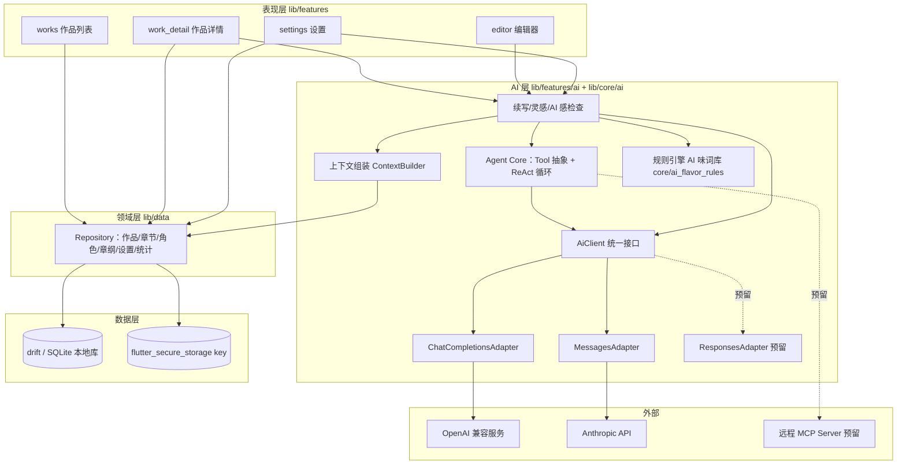
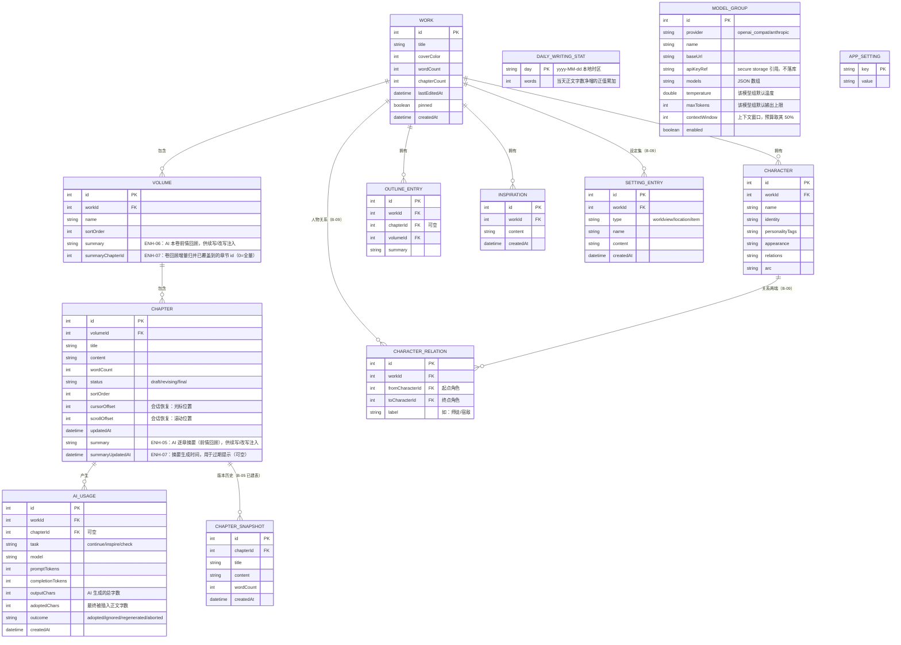
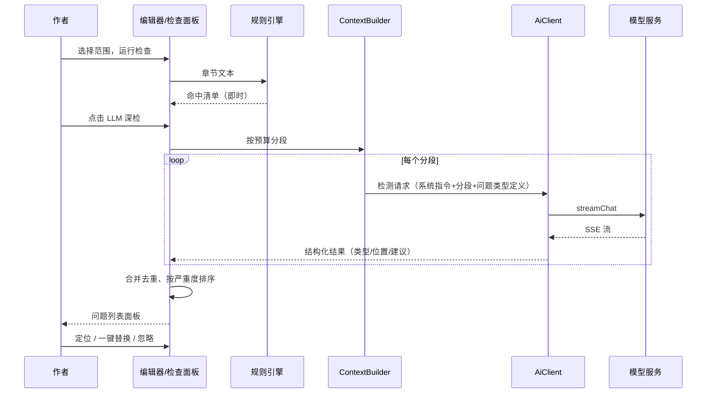

# NovelPhone 技术架构与开发文档

| 项 | 内容 |
|---|---|
| 版本 | v0.1（草案） |
| 日期 | 2026-09-30 |
| 状态 | 待评审 |
| 上游文档 | `docs/PRD.md`（定义做什么） |
| 下游文档 | `docs/TODO.md`（任务拆分与跟踪） |

---

## 1. 设计概述

### 1.1 范围

本文档覆盖 NovelPhone 的整体技术架构、模块划分、数据模型、AI 客户端设计、非功能性策略与演进路径。

明确不在本文档范围内：UI 视觉规范（另行输出设计规范）、MCP 与 SKILL 的详细设计（架构预留接入点，功能实现后补充）、服务端开发（产品为纯本地 app，无自建服务端）。

### 1.2 设计目标与约束

| 目标/约束 | 说明 | 证据 |
|---|---|---|
| 本地优先 | 写作与管理全程离线可用；仅 AI 功能联网，且仅传输 AI 请求所需的最小上下文 | `[Data-backed]` PRD 2.1 产品原则 |
| 用户自带 API Key | 不内置任何模型服务的凭证；key 仅存设备安全区；支持 OpenAI Chat Completions、Anthropic Messages 两种端点，结构上为 Responses 端点预留 | `[Data-backed]` 已确认的技术决策 |
| 手机端体验 | 启动快、长章节编辑不卡、误操作可恢复（撤销/自动保存） | `[Data-backed]` PRD 1.2 痛点 |
| 单代码库跨平台 | 优先交付 iOS/Android，架构不阻塞后续桌面端 | `[Expert judgment]` |
| 变更量最小的前提下可演进 | MCP、用户 SKILL、云备份等后置功能有明确接入点，不需要重构既有层 | `[Expert judgment]` |

### 1.3 术语表

| 术语 | 含义 |
|---|---|
| 端点（endpoint） | 模型服务商的 HTTP API 路径。本产品涉及 Chat Completions（`POST /v1/chat/completions`）、Messages（`POST /v1/messages`），预留 Responses（`POST /v1/responses`） |
| AiClient | 产品内部统一的模型调用抽象，屏蔽端点差异 |
| 上下文组装 | 从本地作品数据构造 AI 请求 prompt 的过程 |
| 规则引擎 | AI 感检查第一层：本地套话词库与句式模式匹配，零成本即时执行 |
| 待确认面板 | AI 产出进入的底部面板，作者编辑确认后才写入正文 |

---

## 2. 总体架构

### 2.1 架构风格

采用**分层 + 功能模块**混合组织：横向按技术关注点分层（表现层 / 功能层 / 领域层 / 数据层），纵向按功能域切模块（works / work_detail / editor / ai / settings）。分层之间通过接口（Dart abstract interface）通信，功能模块不直接持有数据库句柄与安全存储句柄，业务数据经 Repository 读写，API key 经 SettingsRepository 读写。选此风格的理由：单机 app 无并发写入方，不需要事件驱动；分层保证 AI 端点适配、数据源替换等变化被限制在单层内 `[Expert judgment]`。

### 2.2 架构图



架构图说明：UI 功能模块只依赖 Repository 与 AI 层的公开接口，不感知端点协议与数据库细节；所有出网请求收敛在 AiClient 的适配器内，便于做统一的错误处理与 token 统计；MCP（B-02）与 Responses（B-01）已由预留接入点落地为新增工具源与新增适配器，上层未改动。key 与 MCP 认证头的读写统一经 Repository 访问 flutter_secure_storage，UI 不直连安全存储。

### 2.3 技术选型

| 选型 | 理由 | 证据 |
|---|---|---|
| Flutter + Dart | 单代码库交付 iOS/Android；本地 app 形态（无服务端）与其定位匹配 | `[Expert judgment]` |
| Riverpod | 状态管理；编译期安全的依赖注入，编辑器与 AI 面板的流式状态用 StreamProvider 自然衔接；只在单一页面消费的 Provider 显式 `.autoDispose`，离开页面即释放底层流订阅（ENH-11） | `[Expert judgment]` |
| drift | SQLite 的类型安全封装；响应式查询让章节列表随编辑自动刷新；schema 迁移机制应对后续加表 | `[Expert judgment]` |
| go_router | 声明式路由；作品列表 → 作品详情 → 编辑器三层导航与深度链接 | `[Expert judgment]` |
| flutter_secure_storage | key 存入 keychain / keystore，满足 PRD 5.8 的安全要求 | `[Expert judgment]` |
| http | 出网请求；SSE 流式用 `StreamedResponse` 逐行解析，不引入更重的客户端 | `[Expert judgment]` |
| mcp_dart | 实现 MCP 2026-07-28 规范核心 wire surface，支持 Streamable HTTP 与 stdio，与官方 TS/Python SDK 有互操作验证；B-02 引入 2.4.2，不自研协议 | `[Research-backed]` pub.dev 包文档 |

关键取舍记录：

- **不自研模型调用封装，也不引入 flutter_ai_sdk 等统一封装库**：产品只需要流式文本对话，封装库的 vision/embeddings/本地模型等能力用不到，且其 model-agnostic 抽象会与端点适配层重叠；直连 http + 自写适配器总量约 400 行，可控可测 `[Expert judgment]`。
- **M1/M2 不引入 MCP**：iOS 无法 spawn 子进程，stdio transport 在手机上不可用，用户侧 MCP 只能走远程 HTTP server；产品上前置条件（配置界面、安全模型、计费可见性）未就绪，先用 Tool 抽象占位 `[Research-backed]` MCP transport 的平台限制。
- **agent 编排自写而非引入 Genkit**：本项目 agent 形态是单 agent + 工具，ReAct 循环约 300 行；Genkit Dart 尚为 preview，且其 model-agnostic 层与端点适配层职责重叠。Tool 抽象按 MCP tool schema 结构设计（name/description/inputSchema），将来若迁移 Genkit 只换编排层 `[Expert judgment]`。

---

## 3. 模块设计

目录结构与模块职责：

```
lib/
├── main.dart                     # 入口：初始化 drift、secure storage、ProviderScope
├── app/                          # 应用壳：主题（PaperPalette 亮/暗调色板 + 全局深浅模式）、go_router 路由表、应用内语言（app/locale.dart，ENH-17）
├── l10n/                         # 国际化（ENH-17）：app_zh.arb / app_en.arb（zh 为模板）+ generated/（gen-l10n 产物）+ l10n.dart（context.l10n 扩展）+ error_text.dart（错误文案展示时本地化）
├── models/                       # 数据模型（与 drift 表对应的实体）
├── data/
│   ├── db.dart                   # drift 数据库定义与迁移
│   ├── dao/                      # 各表 DAO
│   └── repositories/             # Repository：领域操作的唯一入口
├── core/
│   ├── ai/
│   │   ├── ai_client.dart        # AiClient 抽象 + 统一请求/响应模型
│   │   ├── chat_completions_adapter.dart
│   │   ├── messages_adapter.dart
│   │   ├── sse.dart              # SSE 行解析（三个端点共用骨架）
│   │   ├── context_builder.dart  # 上下文组装（PRD 6.2 的实现）
│   │   ├── agent_core.dart       # Tool 抽象 + ReAct 循环
│   │   ├── mcp/mcp_bridge.dart   # 远程 MCP 工具源（B-02）+ OAuth 令牌接入（ENH-21）
│   │   ├── mcp/mcp_oauth.dart    # MCP OAuth 2.1 PKCE 授权流程（ENH-21）
│   │   ├── skills/skill.dart     # 用户自定义 SKILL：指令 / 白名单 / 参数模板与注入（B-03）
│   │   ├── skills/skill_front_matter.dart # SKILL.md front matter 解析 / 导出（ENH-21）
│   │   └── tools/                # 内置工具：get_chapter、get_character 等
│   ├── ai_flavor_rules.dart      # AI 味规则引擎（问题模型 + 句式模式 + 指标 + 纯函数检测）
│   ├── flavor_lexicon.dart       # 套话词库（约 200 条，按权重分级）
│   ├── text_diff.dart            # 段落级文本 diff（ENH-18）：快照与当前文本对比（LCS + 超限回退）
│   ├── text_search.dart          # 查找/替换匹配原语（ENH-19）：编辑器查找与全书替换共用（大小写折叠、非重叠匹配、UTF-16 偏移）
│   ├── word_count.dart           # 中文字数统计
│   ├── importer/                 # txt/docx 导入与分章
│   ├── exporter/                 # 单章/整作导出（txt/md/docx/epub）、备份 zip 组装与分享
│   └── cloud/                    # 云备份（B-08）：S3 兼容客户端（SigV4 签名）与备份编排
└── features/
    ├── works/                    # 作品列表
    ├── work_detail/              # 作品详情（卷/章/角色卡/设定集/章纲/人物关系图/导入/导出）+ 全书查找替换（ENH-19）
    ├── editor/                   # 编辑器 + AI 待确认面板 + AI 感检查面板 + 版本历史（含快照差异对比，ENH-18）
    ├── ai/                       # 续写/灵感用例编排
    ├── search/                   # 全局搜索（B-06）：跨作品检索章节标题与正文；公共高亮组件（ENH-19，search 与全书替换共用）
    ├── stats/                    # 写作统计（B-07）：每日目标、连击、番茄钟、近 7/30 天字数趋势图（ENH-18）与全年写作热力图（ENH-19）
    └── settings/                 # key 与模型配置、token 统计、本地备份与恢复、云备份（B-08）、关于页（ENH-19）、MCP OAuth 授权与技能导入（ENH-21）
```

| 模块 | 职责 | 输入 | 输出 | 依赖 | 明确不做 |
|---|---|---|---|---|---|
| features/* | UI 与交互状态 | 用户操作、Repository 流 | 界面 | Repository、AI 用例接口 | 不直接访问数据库与 http |
| features/search | 全局搜索（B-06）：关键词检索与命中高亮（高亮组件 `highlighted_text.dart` 为 ENH-19 公共提取，search 与全书替换共用） | 关键词（输入 300ms 防抖，ENH-11） | 命中列表（作品/章节/片段） | ChapterRepository.search（autoDispose，关键词未变不重查；命中位置与片段在 SQL 内计算，ENH-14） | 不做索引与分词（本地 LIKE 直查，作品量级不构成瓶颈） |
| features/stats | 写作统计（B-07）：每日字数目标进度、连续写作天数、番茄钟；近 7/30 天字数趋势图（ENH-18，自绘柱状图、无第三方依赖）；全年写作热力图（ENH-19，53×7 自绘网格 + 月份/星期标注 + 色阶图例） | 每日统计流 + 设置 | 统计页 | ChapterRepository(watchDailyWritingStats)、SettingsRepository | 番茄钟为页面内计时，不后台常驻 |
| features/work_detail（设定集/关系图） | 设定集（B-09）：世界观/地点/道具条目；人物关系图（B-09）：环形绘制角色关系并可增删改；txt/docx 导入（解析在 `Isolate.run` 执行，ENH-12）；txt/md/docx/epub 导出（docx/epub 构建在 `Isolate.run` 执行，ENH-14）；全书查找替换（ENH-19）：预览命中后单事务替换全作正文 | 设定/角色/关系流 + 用户编辑 + 文件 bytes | 设定集 Tab、关系图页、导入预览、导出文件、替换页 | SettingRepository、CharacterRepository(relations)、ChapterRepository(import / findReplaceHits / replaceInWork) | 关系图为静态环形布局，不做自动布局与拖拽 |
| data/repositories | 领域读写：作品/卷/章/角色/设定集/关系/章纲/统计 | DAO 结果 | 领域模型、响应式流 | drift | 不含业务编排（如分章策略在 importer） |
| core/ai/ai_client | 屏蔽端点差异的统一调用 | ChatRequest | `Stream<ChatChunk>` | http | 不做 prompt 组装 |
| core/ai/context_builder | 上下文组装与预算控制（前情摘要 / 本卷回顾只读元数据并按需按 id 取正文，ENH-12 / ENH-13） | 作品 id、任务类型 | ChatRequest.messages | Repository | 不发起网络请求 |
| core/ai/agent_core | Tool 注册与 ReAct 循环 | 任务描述 + 工具集 | 最终文本 / 工具调用记录 | AiClient、tools | 不感知具体端点 |
| core/ai/tools | 内置本地工具（读章节、查角色等；标题映射只读元数据，ENH-12） | 工具入参 JSON | 工具结果文本 | Repository | 不直接调模型 |
| core/ai/skills | 用户自定义 SKILL（B-03）：指令拼接与工具白名单过滤；front matter 导入 / 导出（ENH-21，Anthropic SKILL.md 约定：name / description / allowed-tools / parameters / enabled） | 启用的 Skill 列表 + 组装结果 / 工具集 / SKILL.md 文本 | 注入后的 system 与工具集 / SkillDraft | 无 | 不做网络与持久化（落库在 SettingsRepository） |
| core/ai/mcp | 远程 MCP 工具源（B-02）：Streamable HTTP 连接、白名单包装、会话关闭；OAuth 2.1 PKCE 授权流程（ENH-21）：受保护资源 / 授权服务器元数据发现、动态客户端注册、S256 PKCE、loopback 回调换令牌、refresh_token 续期 | 服务器地址 / 客户端配置 / http.Client | 工具集 / McpOAuthTokens | mcp_dart、http | 不直接碰安全存储与浏览器（令牌存取在 SettingsRepository、打开系统浏览器在设置页） |
| core/ai_flavor_rules | 规则引擎检测 | 章节文本 | 问题列表 | 无 | 不做 LLM 检测 |
| core/text_search | 查找/替换匹配原语（ENH-19）：大小写折叠、非重叠匹配、UTF-16 偏移、段替换计数 | 文本、关键词（+ 替换词） | 匹配区间列表 / 替换结果与次数 | 无 | 不做正则与全词匹配；编辑器查找与全书替换共用同一实现 |
| core/importer | 解析与分章（由 features 侧经 `Isolate.run` 调用，避免整文同步计算卡 UI，ENH-12） | 文件 bytes | 分割预览 | 无 | 不写库（确认后交 Repository） |
| core/exporter | 导出文本生成与备份 zip 组装/解析（组装与解析的重活经 isolate 执行，ENH-14 / ENH-15） | 章节数据、导出数据 Map | txt/md/docx bytes、zip bytes | archive | 不写库、不直接调分享面板（由 features 触发） |
| core/cloud | 云备份（B-08）：S3 兼容对象存储读写（SigV4 签名）与备份/恢复编排（上传、列举、清理、下载） | 服务商配置（endpoint/region/bucket/凭证）+ zip bytes / 远端对象列表 | 远端对象列表、下载 bytes、操作结果 | http、core/exporter（zip 组装） | 不直接读写数据库（配置与编排由 features/settings 与 SettingsRepository 协作），不含中心化服务器与账号体系 |
| features/settings | key/模型配置、token 累计、本地备份与恢复、云备份配置与触发（B-08）、语言设置（ENH-17）、关于页（ENH-19，package_info_plus 读取版本号 + 隐私说明 + 开源许可）、MCP OAuth 授权（ENH-21，系统浏览器 + loopback 回调）与技能文件 / 粘贴导入（ENH-21） | 用户输入 / 文件 bytes / 粘贴文本 | 经 Repository 落库、经安全存储存 key / 令牌、经 core/cloud 上传下载 | SettingsRepository、TokenStatsRepository、AiUseCase(testConnection)、CloudBackupService、McpOAuthClient | 不直接接触数据库、安全存储与网络（file_picker 例外：仅读取用户选中的文件） |
| l10n | 国际化（ENH-17）：ARB 资源（zh 模板 + en 翻译，约 659 键）、`context.l10n` 读取扩展、错误文案展示时本地化（error_text.dart） | ARB 生成代码、结构化错误（kind/code/detail） | 本地化文案 | Flutter gen-l10n（编译期生成） | 不翻译 AI 提示词与中文语料域数据（flavor 词库/规则名/导出内容/DB 默认值） |

依赖方向：features → repositories / ai 用例 → core/ai → ai_client；无环 `[Expert judgment]`。

### 3.1 导入分章与导出格式规则（M2 实现约定）

分章规则（`core/importer/chapter_splitter.dart`）——按行匹配、整行即标题：

| 类型 | 模式 | 标题取值 |
|---|---|---|
| markdown | `#{1,3}\s+(.+?)` | `#` 之后的文本 |
| 中文网文 | `第\s*[数字/中文数字]+\s*[章节回篇]\s*(.*?)` | 保留整行（保留章序信息） |
| 英文 | `chapter\s+\d+\s*(.*?)` | 保留整行 |

- 全文无标题行时整篇作为一章，标题留空；第一个标题之前的内容单独成章（卷首语 / 作者的话），标题留空。
- 标题超过 50 字按 50 字截断（与 `CHAPTER.title` 约束一致）；截断按码点（`runes`）而非 UTF-16 码元，避免标题含 emoji 等代理对时被劈成半个字符（ENH-09）。
- 空标题章节导出时写作 `未命名章节`，再导入还原为空标题——这是保证「导出 → 再导入」结构一致的往返约定。
- docx 导入优先按段落样式分章（`Title` / `Heading*` / `标题*`），无标题样式时降级为上述正则。
- 解析移出 UI 线程（ENH-12）：编码探测（`decodeTextBytes`）、正则分章（`splitIntoChapters`）与 docx 解压解析都是同步整文计算，10MB 上限内的文件足以在 UI 线程造成可见卡顿。`features/work_detail/import_page.dart` 把解析收敛为顶层 `parseImportFile(fileName, bytes)`，生产入口 `parseImportFileAsync` 用 `Isolate.run` 执行（与 5.5 的规则引擎 isolate 化同理）。**约束**：isolate 闭包只允许捕获可发送的值（`String` / `Uint8List` 等），若捕获文件选择器返回的平台对象会抛「Illegal argument in isolate message: object is unsendable」，故必须先取出 `file.name` 再进入 isolate，且 isolate 调用封装在只接受 `String` / `Uint8List` 的顶层函数里（调用方无法把平台对象带进闭包）。

导出格式（`core/exporter/`）：

- 单章：txt（标题行 + 正文）、markdown（`# 标题` + 正文）。
- 整作 txt：各章标题单独成行，不写作品标题（避免再导入时多出一段前言）。
- 整作 markdown：每章一个一级标题，可被分章正则完整还原；不写卷信息（卷结构与更细字段由整库备份 JSON 承载）。
- 整作 docx：自建最小 zip，标题段落用 `Heading1` 样式，可被 docx 导入按样式分章。
- 整作 epub：EPUB 3 最小结构（`mimetype` 首条目且 STORE 存储、`META-INF/container.xml`、`OEBPS/` 的 `content.opf` + `nav.xhtml`(properties="nav") + `style.css` + 逐章 `chapter_N.xhtml`），可被主流阅读器打开；`dc:identifier` 取 `urn:novelphone:<作品名>` 保证确定性。
- 备份 zip：`data.json`（作品/卷/章/角色/章纲/灵感/章节快照/每日统计/设定集/人物关系等业务表 `toJson`，含正文，供恢复）+ `works/*.md`（各作品全文，供人工查阅）；不含 API key（key 仅在 flutter_secure_storage，从不进库）。恢复支持合并（作为新作品导入）与覆盖（清空后按原 id 还原），恢复时按 `workIdMap` / `volumeIdMap` / `chapterIdMap` / `characterIdMap` 重映射外键。
- 构建移出 UI 线程（ENH-14）：整作 docx / epub 的逐章拼 XML 与 `ZipEncoder` 压缩、整库备份的 `jsonEncode` + zip 聚合都是整文同步计算，大作品足以在 UI 线程造成可见卡顿。`features/work_detail/export_actions.dart` 的 docx / epub 分支与 `core/exporter/backup_archive.dart` 的 `buildBackupZip` 调用改由 `Isolate.run` 执行（与 3.1 的导入解析、5.5 的规则引擎同理）；txt / markdown 构建廉价仍同步。**约束**（沿用 ENH-12）：传入 isolate 的只允许可发送值——导出传 `List<ExportChapter>`（纯 `String` 字段数据类），备份传 `Map<String, dynamic> data` + `Map<String, String> workMarkdowns`（`BackupRepository.exportData()` 的逐表 `.toJson()` 因 drift 行对象不可发送，仍在主线程完成）。
- 解析与 markdown 拼接同样移出 UI 线程（ENH-15）：备份 zip 的解析（`ZipDecoder.decodeBytes` + `utf8.decode` + `jsonDecode`）是恢复整库备份的主要 CPU 开销，`core/exporter/backup_archive.dart` 新增 `parseBackupZipAsync`（`Isolate.run`），本地恢复（`features/settings/backup_actions.dart`）与云端恢复（`features/settings/cloud_backup_page.dart`）两处调用点改走它（同步版 `parseBackupZip` 保留给用例），`FormatException` 仍原样抛回调用方；`exportBackupZipBytes` 则先把作品正文收敛为纯数据记录 `WorkMarkdownSource`（`title` + 各章 `title` / `content`，不带 drift 行对象），再把「逐作品拼 markdown + 重名避让 + zip 组装」整体放进同一个 isolate，主线程不再为拼 markdown 重扫整库正文。

---

## 4. 数据设计

### 4.1 ER 图



> MODEL_GROUP.apiKeyRef 说明：key 本体只进 flutter_secure_storage，数据库仅存引用标识；备份 zip 不含 key。APP_SETTING 存全局偏好（默认模型、上次打开的作品等）与任务→模型映射（键如 `task_model_continue` / `task_model_inspire` / `task_model_check`），不含任何凭证。

### 4.2 表设计要点

- CHAPTER.content 存纯文本；单章 10 万字上限（PRD 5.3），SQLite 单行无压力。
- CHAPTER.cursorOffset / scrollOffset 供会话恢复（PRD 5.3）使用，不参与 AI 上下文组装。
- 生成参数与任务映射：温度/输出上限存在 MODEL_GROUP（模型级默认值）；"哪个任务用哪个模型组"存在 APP_SETTING 的 `task_model_*` 键（PRD 5.8 的多任务模型配置）。
- WORK.wordCount/chapterCount 为冗余汇总字段，随章节保存事务内更新，避免列表页聚合查询（ENH-14 起保存正文按「新字数 − 旧字数」差量增量维护，仅删章 / 删卷 / 导入等才全量重算）`[Expert judgment]`。
- AI_USAGE 是 token 统计的唯一数据源，设置页按 model/task 双维度聚合（ENH-15 起该聚合在 SQL 内完成：`selectOnly` + `groupBy(model, task)` + `COUNT` / `SUM` / `COUNT(filter:)`，不再把整表读回 Dart 逐行累加，也不再跑与聚合无关的 `ORDER BY createdAt DESC`；仓储侧只保留「先 task 再 model」排序与类型映射）。
- 统计口径落点：AI_USAGE.outcome 记录每次生成的结果（采纳/忽略/重新生成/中止），用于采纳率与忽略率；outputChars/adoptedChars 记录生成总字数与最终插入正文字数，支撑 PRD 2.2 的字符口径采纳率；检查问题处置率由检查会话结束时写入 APP_SETTING 计数器（`check_stat_total` / `check_stat_handled`）（对应 PRD 2.2、6.3、7 的本地指标）。
- MODEL_GROUP.contextWindow 为该模型组的上下文窗口声明值，ContextBuilder 的 token 预算取其 50%（见 5.3）。
- 迁移：drift schema 版本号管理，每个版本一个迁移步骤；MVP 内预计 1-2 次迁移（AI_USAGE、MODEL_GROUP、APP_SETTING 表在 M3 引入）`[Expert judgment]`。
- CHAPTER_SNAPSHOT：章节版本历史（B-05），仅存标题与正文全文、字数与创建时间，随章节级联删除；不参与 AI 上下文组装。快照由作者在编辑器中手动创建（单章最多保留 50 条，超出清理最旧），恢复前会自动为当前内容补一份快照避免误操作丢稿。表随 B-05 落地（schemaVersion 2 → 3），并纳入整库备份。
- DAILY_WRITING_STAT：每日写作字数（B-07），`day`（yyyy-MM-dd 本地时区）为主键、`words` 为当天正文字数净增的**正值累加**（只加不减，删改正文不回退），在章节保存事务内随正文一并更新，供每日目标进度与连续写作天数统计；每日目标（`daily_word_target`）、番茄钟时长（`pomodoro_minutes`）与按日的完成数（`pomodoro_done_<yyyy-MM-dd>`）落在 APP_SETTING。表随 B-07 落地（schemaVersion 3 → 4），并纳入整库备份。
- SETTING_ENTRY：设定集（B-09），`type` 区分世界观/地点/道具（对应 `SettingType` 枚举），每条含名称（1-50 字）与设定内容，随作品级联删除；页面按类型筛选展示，并纳入 AI 上下文组装（见 5.3，排在角色卡之后）。
- CHARACTER_RELATION：人物关系（B-09），一条有向关系 `fromCharacterId → toCharacterId` 附关系标签，两端角色删除时随外键级联删除；`workId` 便于按作品查询。关系图页用 CustomPainter 将角色均布于圆周、按关系连线（线条中点标注标签），下方列表支持增删改；为静态环形布局，不做力导向/拖拽。SETTING_ENTRY 与 CHARACTER_RELATION 随 B-09 落地（schemaVersion 4 → 5），并纳入整库备份。
- CHAPTER.summary：AI 逐章摘要（ENH-05），默认空串，由「AI 章节工具 → 生成本章摘要」写入，供后续章节续写/改写注入「前文摘要」（见 5.3），区别于 OUTLINE_ENTRY 手写章纲；随章节级联删除、纳入整库备份。列随 ENH-05 落地（schemaVersion 5 → 6，`m.addColumn`）；恢复旧备份（无该键）时 `putIfAbsent('summary', '')` 兜底，避免 drift `fromJson` 对非空列缺键抛异常。
- VOLUME.summary：AI 本卷前情回顾（ENH-06），默认空串，由「AI 章节工具 → 生成本卷前情回顾」写入，续写/改写时与最近 1-2 章摘要一并注入「前文摘要」（见 5.3）；卷摘要为空时输出与旧版逐字一致（零回归）。列随 ENH-06 落地（schemaVersion 6 → 7，`m.addColumn`）；恢复旧备份（无该键）时 `putIfAbsent('summary', '')` 兜底。
- CHAPTER.summaryUpdatedAt（ENH-07）：可空，`saveChapterSummary` 写入时记录当前时间；「查看/编辑本章摘要」弹窗在摘要非空且正文 `updatedAt` 晚于它（或缺值）时提示「摘要可能过期」（见 PRD 5.5.1）。列随 ENH-07 落地（schemaVersion 7 → 8，`m.addColumn`）；恢复旧备份（无该键）时 `putIfAbsent('summaryUpdatedAt', null)` 兜底。
- VOLUME.summaryChapterId（ENH-07）：默认 0，`saveVolumeSummary` 传入 `coveredChapterId` 时记录本次归并覆盖到的章节，供 `buildVolumeSummary` 增量归并（上一版回顾 + 新增章节摘要）；0 表示尚未归并过、按全量处理（零回归）。列随 ENH-07 落地（schemaVersion 7 → 8，`m.addColumn`）；恢复旧备份（无该键）时 `putIfAbsent('summaryChapterId', 0)` 兜底。
- 热点外键索引（ENH-08 / ENH-13）：为 VOLUME.workId / CHAPTER.volumeId / CHAPTER_SNAPSHOT.chapterId / CHARACTER.workId / OUTLINE_ENTRY.workId / INSPIRATION.workId 六个高频过滤列加 drift `@TableIndex`，消除作品/卷维度列表查询的全表扫描（ENH-08，schemaVersion 8 → 9，`if (from < 9)` 块 `m.createIndex` 补建）；ENH-13 再为 SETTING_ENTRY.workId / CHARACTER_RELATION.workId 两列补同型索引（schemaVersion 9 → 10，`if (from < 10)` 块补建）。建库时由 drift `createAll()` 自动创建；升级路径的该 SQL 无 `IF NOT EXISTS`，但旧库本就没有这些索引，故安全。仅新增索引、不改表结构。
- 快照清理只读 id 列（ENH-09）：`SnapshotDao.pruneBeyond` 由「取回整行再丢弃」改为 `selectOnly` 仅取 `id` 列（按 `createdAt desc, id desc` 排序后 `skip(keep)`），避免每次创建快照时把该章最多 50 条正文全文读进内存。仅改查询方式、不改表结构与落库语义。
- 章节目录流只读元数据（ENH-10）：新增 `ChapterDao.watchMetaByWork`（`selectOnly` + `addColumns` 只取 id / volumeId / title / wordCount / status / sortOrder / 光标与滚动位置 / updatedAt / summary，`content` 置空）与 `ChapterRepository.watchChapterMetas`，`chaptersProvider`（章节目录、章纲、AI 感检查范围）改用它——写作期间每次自动保存写 `CHAPTER` 不再让目录流重发并重读全书正文。`watchByWork`（含正文）保留给编辑器加载当前章、导出等确实需要正文的场景。`ChapterDao.findMetaByVolume`（删除卷 / 章节排序）同样只取 id 与 sortOrder。
- 快照列表只读元数据（ENH-10）：`SnapshotDao.watchMetaByChapter` 只取 id / title / wordCount / createdAt（`content` 置空）供版本历史列表使用，点开预览或恢复时经新增的 `ChapterRepository.getSnapshot(id)` 单取该条正文，避免列表流把该章最多 50 条正文全文读进内存；`findByChapter`（含正文）保留给备份与既有用例。
- 自动保存只读轻量投影（ENH-14）：`saveChapter` 只需旧字数与所属作品，新增 `ChapterDao.findLightById`（`selectOnly` + `JOIN VOLUME`，只投影 `wordCount` 与 `workId`、不取 `content`），取代原先两次 `findById`（均为 `select *` 含正文，一次拿旧字数、一次拿 `workId`）。
- 搜索命中片段在 SQL 内计算（ENH-14）：`ChapterRepository.search` 改 `selectOnly` 投影，用 `INSTR(lower(content), ?)` 算命中位置、`MAX` / `MIN` / `substrExpr` 直接截出「命中前 12 字 + 关键词 + 后 24 字」（未命中正文时取正文前 40 字），只回传片段与偏移，不再把整章正文读回 Dart；`LIKE` 通配符转义与「标题命中 offset = -1」语义不变。

### 4.3 一致性规则

- 卷/章/角色删除走事务，级联清理（OUTLINE_ENTRY.chapterId 置空而非级联删除）；角色删除时其两端的人物关系随外键级联删除，作品删除时设定集与人物关系随外键级联删除。
- 恢复备份时，设定集按 `workIdMap`、人物关系按 `workIdMap` 与角色 `characterIdMap` 重映射外键，避免跨库 id 不一致导致的悬空引用。
- 恢复备份的叶表批量写入（ENH-15）：`chapterSnapshots` / `dailyWritingStats` / `settingEntries` / `characterRelations` / `outlineEntries` / `inspirations` 六表的外键在上一阶段已映射完成、新 id 不被下游使用，故先攒成 Companion 列表再 `insertAll` 一次写入（取代逐行 `await insert` 的数千次往返）；`works` / `volumes` / `chapters` / `characters` 需回传新 id 供后续重映射，仍逐行插入。批量写入仍在 `restore` 的单个事务内（drift 在事务中的 `Batch` 不会开嵌套事务），原子性不变；`dailyWritingStats` 沿用 `InsertMode.insertOrIgnore` 的「已有日期以本机为准」合并语义。
- 删除作品为单事务删除其全部关联行；不可恢复，UI 层二次确认（PRD 5.1）。
- 自动保存与字数汇总在同一事务，杜绝"正文新、字数旧"；汇总按差量增量维护（ENH-14）：保存正文只改字数、不改章节数，`_bumpWorkAggregate` 用 `delta = 新字数 - 旧字数` 更新 `WORK.wordCount` 与 `lastEditedAt`，不再每次自动保存都 `SUM` 扫该作品全部章节正文；删章 / 删卷 / 导入等仍走 `_syncWorkAggregate` 全量重算。
- 编辑器仅在正文/标题相对上次落库确有变化时才重写整章（ENH-09）：`TextEditingController` 在选区变化时也会通知，`EditorController` 用 `_lastSavedText` / `_lastSavedTitle` 比对，纯移光标/改选区时只落库光标与滚动位置（`saveCursorPosition`），不触发 `saveChapter`、不重算字数、不闪「保存中」。
- 编辑器撤销栈按「条数 + 累计字符数」双重裁剪（ENH-10）：每步快照保存整章副本（10 万字章节单条约 20 万字符），除 `_maxHistory`（100 条）外新增 `_maxHistoryChars`（200 万字符）与 `_minHistoryKeep`（10 条），超限时从最旧开始丢弃且始终保留最近 10 步可撤销；「同内容合并」与「新输入截断重做栈」逻辑不变。
- 字数重算防抖（ENH-10）：`countWords` 对长章是整章 rune 遍历，`_onTextChanged` 改为停顿 `wordCountDebounce`（120ms）后重算（`_recountWords`），避免每次按键都全章扫描；`_dirty` / 自动保存 / 历史栈节奏不变，落库字数仍由 `saveChapter` 按实际正文计算。
- Provider 生命周期（ENH-11）：只在单一页面消费的 Provider 一律加 `.autoDispose`（Riverpod 3 的 `.autoDispose` 修饰符默认 `isAutoDispose: false`，必须显式声明）——作品详情的 9 个流 Provider（work / volumes / chapters / characters / settingEntries / characterRelations / snapshots / outline / inspirations）与其消费页一一对应，`dailyWritingStatsProvider` 属统计页，`taskModelIdProvider` 属 AI 设置，离开页面后无人监听即释放底层 drift 流订阅；`searchProvider` 以关键词为 `family` 参数，改 autoDispose 后输入过的每个前缀不再各自常驻。
- 元数据优先读取（ENH-12 / ENH-13）：只需章节标题 / 卷内顺序 / 检查范围等元信息时一律走 `ChapterRepository.watchChapterMetas`（`ChapterDao.watchMetaByWork` 投影，`content` 置空），确需正文时再按 id 单取（`getChapter`）——AI 续写 / 改写 / 灵感的前情摘要、内置工具 `get_outline` 的标题映射、单章 AI 感检查（ENH-13）、本卷回顾前置校验与 `buildVolumeSummary`（ENH-13）均已按此办理；仅编辑器正文编辑与导出仍取完整章节。

---

## 5. AI 层设计

### 5.1 AiClient 抽象与统一模型

```dart
// 统一请求（与端点无关的内部表示）
class ChatRequest {
  final String model;            // 模型名，取自选定的 ModelGroup
  final String? system;          // 系统指令
  final List<ChatMessage> messages; // user/assistant 轮次
  final double temperature;
  final int maxTokens;
}

// 流式增量
sealed class ChatChunk {
  // TextDelta(text) | Usage(prompt, completion) | Done(finishReason) | Error(...)
}

abstract interface class AiClient {
  Stream<ChatChunk> streamChat(ChatRequest req);
}
```

- ChatCompletionsAdapter：构造 `messages[]`（system 作为首条 role=system 消息），解析 SSE 的 `choices[].delta.content`，末帧取 usage。
- MessagesAdapter：system 提为顶层字段，解析 `content_block_delta` 事件序列，区分 `message_start`（含 input usage）与 `message_delta`（含 output usage）。
- 两者共享 `core/ai/sse.dart` 的行缓冲与 `data:` 前缀解析骨架，仅事件载荷映射不同 `[Expert judgment]`。
- 客户端构造：一个 ModelGroup（provider + baseUrl + key + model 列表）构造一个 AiClient 实例；适配器从实例侧取 baseUrl 与 key，从 ChatRequest 侧取 model、温度与输出上限。key 在构造时由 SettingsRepository 注入，不放进请求对象 `[Expert judgment]`。
- tool calling：Chat Completions 的 `tools` / `tool_calls`、Messages 的 `tool_use` / `tool_result` 的构造与解析同样收敛在适配器内，Agent Core 只见统一表示（见 5.4）`[Expert judgment]`。
- ResponsesAdapter：system 提为顶层 `instructions`，`input` 为条目数组（消息 / `function_call` / `function_call_output`），解析 `response.output_text.delta` 文本增量，`response.completed` 取 usage 与 status，`function_call` 系列事件的工具调用亦在此收敛（B-01 已实现）。
- 客户端复用（ENH-12）：适配器原为 `client ?? http.Client()` 自建实例——每次生成都要重新 TLS 握手，且旧实例无人持有、从不关闭。现由 `features/ai/ai_providers.dart` 的 `httpClientProvider`（`Provider<http.Client>` + `ref.onDispose(client.close)`）提供全 App 唯一实例并注入 `AiService`，AI 调用复用同一条 keep-alive 连接；测试仍可注入 `MockClient` / 自定义 `BaseClient`。

端点选择逻辑：ModelGroup.provider 字段区分 `openai_compat`（覆盖 OpenAI 官方与 DeepSeek/Kimi/通义等全部 OpenAI 兼容服务，差异仅在 baseUrl 与模型名）、`anthropic` 与 `responses`。用户配置的每个模型组自带 provider 类型，运行时无猜测 `[Data-backed]` 已确认的端点决策。

### 5.2 错误分类与重试

| 错误类 | 判定 | 处理 |
|---|---|---|
| 网络错误 / 超时 | SocketException、超时 | 保留已收流，UI 提供重试 |
| 401/403 | 鉴权失败 | 提示 key 无效，跳设置 |
| 429 | 限流 | 未产出文本前由 `RetryingAiClient` 指数退避自动重试 1 次，再失败提示 |
| 400 + 内容过滤标识 | 服务商拒绝 | 透出服务商原因文案，提供修改指令重试 |
| 5xx | 服务端故障 | 未产出文本前由 `RetryingAiClient` 指数退避自动重试 1 次，再失败提示 |
| 本地 IO | 保存失败 | 正文保留编辑器，状态栏告警 |

所有错误经 `ChatChunk.Error` 汇入同一条流，UI 层单点处理，不在适配器内弹 UI `[Expert judgment]`。

自动重试由 `lib/core/ai/retrying_ai_client.dart` 的 `RetryingAiClient` 装饰器统一实现（`buildAiClient` 出口统一包装）：仅对**已收到首个文本增量之前**的 429 / 5xx 重试（首个文本增量之前收到的 usage / 工具调用先缓冲，重试时丢弃），一旦已吐出文本增量即不再重试，避免产生重复内容与重复扣费；`baseDelay` 默认 1s、按次数线性退避，`maxRetries` 默认 1 次。

### 5.3 上下文组装（ContextBuilder）

按 PRD 6.2 的优先级装配，实现要点：

1. 预算计算：`budget = min(模型上下文窗口, 配置上限) * 0.5`，按字符数近似 token（中文 1 字 ≈ 1 token，留 20% 余量）`[Expert judgment]`。
2. 装配顺序：system 指令 → 本章尾部（保留最近 3000 字，超出截断并标注"（前文略）"）→ 本章章纲 → 前文摘要（ENH-06 起**本卷前情回顾 `VOLUME.summary` 前置为「【本卷前情】…」，随后是最近 1-2 章摘要**；ENH-05 起**优先使用 AI 已生成的 `CHAPTER.summary`**，未生成的章节回退本地按段落抽首句拼接，超预算再截断；ENH-07 起**当前章为其所属卷首章时再前置「【前卷前情】…」（上一卷 `VOLUME.summary`）**，且超预算压缩前文摘要时**保留以「【本卷前情】/【前卷前情】」开头的回顾行**，避免卷级前情被压没）→ 相关角色卡（本章正文做姓名匹配，最多 8 张，超出保留匹配最多的 3 张）→ 设定集（世界观/地点/道具，按类型分组）→ 卷级大纲。
3. 超预算时从优先级最低项开始丢弃（先卷级大纲，再设定集，再角色卡减张、前文摘要压缩、尾部截断/整段丢弃），面板提示"已省略较早前文"。
4. 全部注入内容在待确认面板的"上下文详情"中可展开查看——作者能看见 AI 看到了什么，这是产品信任的一部分 `[Expert judgment]`。
5. 改写任务（ENH-04，`buildRewrite`）：不注入本章尾部正文，改为把「【待改写原文】」作为末尾 user 消息 payload；该 payload 不参与超预算截断（始终完整保留），system 走「改稿助手」角色指令（只输出正文、保持人称视角与既有事实、不增删情节）。
6. 逐章摘要（ENH-05，`buildSummary`）：以本章正文为主材料直构上下文（system + 作品/章节头 + 正文），正文按 `budget - system - header` 截断并标记 `truncated`；走「摘要」system 指令（只产出摘要正文，非对话）；不做分段 map-reduce。
7. 章纲扩写（ENH-05，`buildOutlineExpand`）：以作者一句话梗概为种子直构上下文（system + 作品/章节头 + 梗概），走「章纲扩写」system 指令产出分场/分段大纲；上下文详情展示「本章梗概」段落。摘要与章纲扩写均不参与 `_assemble` 的优先级丢弃（内容确定、一次成文）。
8. 本卷前情回顾（ENH-06，`buildVolumeSummary`）：以本卷「当前章及之前」各章摘要为主材料直构上下文（system + 作品/卷头 + 各章摘要），按 `budget - system - header` 截断并标记 `truncated`；走「本卷前情回顾」system 指令（只产出回顾正文，非对话）；同样不参与 `_assemble` 的优先级丢弃。ENH-07 起改为**增量滚动归并**：卷已归并过（`VOLUME.summaryChapterId != 0`）时，素材为「【上一版本卷回顾】（上一版 `VOLUME.summary`） + 【新增章节摘要】（`summaryChapterId` 之后的各章摘要）」；未归并过（0）时仍按全量归并（零回归）。
9. AI 灵感（ENH-07，`buildInspireContext`）：桥段点子模式补注入「前文摘要」（复用续写的前文摘要逻辑，含卷级/跨卷前情）与「本章章纲」两段；上下文详情同步展示「前文摘要」「本章章纲」条目。
10. 前情摘要取数改按需读正文（ENH-12）：续写 / 改写 / 灵感三处原用 `chapters.watchChapters(workId).first` 取「最近 1-2 章摘要」，为一段摘要把整部作品正文读进内存；现改为 `watchChapterMetas(workId)`（元数据投影，`content` 置空），仅对「近期且尚无 `CHAPTER.summary`」的章节按 id 单取正文做抽句兜底（`_recapSource` 返回 `ordered` + `fallbackContents`，`_previousSummary` 用可选 `fallbackContents` 兜底，摘要优先逻辑不变）。ENH-13 起 `buildVolumeSummary` 同样改为 `watchChapterMetas(workId)` 取顺序，仅对「本卷待归并且无 AI 摘要」的章节按 id 单取正文做抽句兜底（原「例外」消除）；单章 AI 感检查也只 `getChapter(chapterId)` 单取该章而非整部作品。

### 5.4 Agent Core 与 Tool 抽象

```dart
class Tool {
  final String name;             // 对齐 MCP tool 命名空间，如 get_chapter
  final String description;
  final Map<String, dynamic> inputSchema; // JSON Schema，对齐 MCP 结构
  final Future<String> Function(Map<String, dynamic> args) execute;
}

// ReAct 循环：调用模型 → 有 tool_calls 则执行工具、结果回传 → 直到无 tool_calls
```

- MVP 的内置工具：`get_chapter`（按 id 取正文）、`get_characters`（按作品取角色卡）、`get_outline`（取章纲）。供灵感类任务按需取数，避免一次性塞满上下文 `[Expert judgment]`。其中 `get_outline` 只需「章节 id → 标题」映射，ENH-12 起改走 `watchChapterMetas` 元数据流，不再为一张标题表读入整部作品正文。
- Tool 的 schema 结构刻意与 MCP 对齐（name/description/inputSchema），执行签名也一致；MCP 接入时，远程工具经 mcp_dart 的 `callTool` 包一层即成为同构 Tool，编排层零改动 `[Research-backed]` MCP 工具定义结构。
- **远程 MCP 工具（B-02 已实现）**：`core/ai/mcp/mcp_bridge.dart` 用 `StreamableHttpClientTransport` 连接远程 server（手机端不支持 stdio），`tools/list` 结果按白名单包装为 `Tool` 并加 `mcp_` 前缀；认证支持自定义请求头（如 `Authorization: Bearer xxx`）与 OAuth 2.1（ENH-21），文本与令牌都只存安全存储。工具在「桥段点子」生成时并入 `AgentCore.run(tools:)`，流结束即关闭会话；单个 server 连接失败不阻断生成。设置页「MCP 工具服务」负责配置与「测试连接」`[Expert judgment]`。
- **MCP OAuth 2.1 PKCE（ENH-21 已实现）**：`core/ai/mcp/mcp_oauth.dart` 按 MCP 授权规范（2025-06-18）实现移动端公开客户端流程——① RFC 9728 受保护资源元数据发现：先读 401 `WWW-Authenticate` 的 `resource_metadata`，兜底 `/.well-known/oauth-protected-resource`（含路径变体）；② RFC 8414 授权服务器元数据（`/.well-known/oauth-authorization-server`，兜底 OIDC discovery）；③ RFC 7591 动态客户端注册（可预填 client_id；注册结果回填保存）；④ RFC 7636 S256 PKCE + state 校验；⑤ RFC 8252 loopback 回调 `http://127.0.0.1:<随机端口>/callback`，授权在系统浏览器完成、回调后换令牌并展示成功页；⑥ RFC 8707 `resource` 参数绑定 MCP 服务器地址。令牌（access / refresh / expiresAt）由 `SettingsRepository` 以 `mcp_oauth_<id>` 写入安全存储，access 令牌过期前 30 秒视为失效，桥接层自动用 refresh_token 换新；刷新失败或 HTTP 401/403 映射为 `McpAuthRequiredException`，设置页提示重新授权。删除 server 时同步清除认证头与令牌。`tool/fake_mcp_oauth_server.dart` 为本地回环假授权服务器 + MCP server（`/stats` 观测各步骤计数），集成测试覆盖完整授权、PKCE 失败、令牌刷新、401 映射与 UI 全流程。
- tool calling 的端点差异（Chat Completions 的 `tools`/`tool_calls`、Messages 的 `tool_use`/`tool_result`）收敛在适配器内，Agent Core 只见统一表示 `[Expert judgment]`。
- 与 ContextBuilder 的职责边界：续写与开篇助手走 ContextBuilder 预注入（内容确定、一次成文）；桥段点子走工具按需取数（需跨章检索、按需展开）。同一任务不同时使用两种方式，避免数据重复注入 `[Expert judgment]`。

### 5.5 AI 感检查流水线



- 规则引擎：词库 + 句式模式（模式化对话标签正则、段尾感悟句特征、连续同结构段落），纯本地计算，MVP 内置约 200 条规则 `[Expert judgment]`。实现落点：词库 `core/flavor_lexicon.dart`（高 3 / 中 2 / 低 1 三级权重，含可直接替换词条的替换文本），检测纯函数 `core/ai_flavor_rules.dart`。
- 词库单趟匹配（ENH-10）：`_matchLexicon` 由「约 200 条词条各自 `indexOf` 全文」改为一条组合正则（候选按词长降序、同级按权重降序排列）一次 `allMatches`——同一位置优先命中更长（更具体）的词条，「组合正则 + 位置的贪心去重」结果与逐条匹配一致，把 O(词条数 × 正文长度) 的重复扫描降为单趟。
- 规则引擎移出 UI 线程（ENH-11）：整部作品可达数十万字，词库匹配与段落分析是同步 CPU 计算，在 UI 线程执行会让面板在出结果前冻结。`AiService.checkFlavor` 把范围文本取出后经 `await Isolate.run(() => runFlavorRules(scopeText))` 在独立 isolate 执行，再以 `CheckRuleResult` 事件回填；`runFlavorRules` 保持同步纯函数不变，`FlavorResult` / `FlavorIssue` / `FlavorMetrics` 全为普通数据（String / int / double / List，无 RegExp 与闭包），可安全跨 isolate 传递。
- 检测参数（`core/ai_flavor_rules.dart` 常量）：套话密度告警 > 12 处/千字、破折号 + 省略号 > 8 处/千字、同一套话单章 ≥ 4 次触发句式重复提示；密度类判断最小样本 300 字，短章不告警避免误报。
- 回归集（M4-05）落点：`test/core/fixtures/flavor_regression_samples.dart`（段落级样本，标注正/负），`test/core/flavor_regression_test.dart` 每版本跑一次；判定口径 `isFlavorFlagged`（存在可定位的"中"及以上问题，不含全文级密度提示）。v1 基线：40 条样本（20 正 / 20 负），召回 100%、误报 0%。
- LLM 深检：要求模型返回 JSON（问题类型枚举、原文片段起止、建议文本），适配器层解析失败时按纯文本降级展示。
- 两层结果按"原文位置 + 类型"去重合并。
- 严重度来源：规则引擎按词库权重映射为高/中/低，LLM 深检由模型在 JSON 中返回严重度字段；合并后统一为高/中/低三级，同级按原文位置排序（对应 PRD 5.7 的"按严重度排序"）。
- 检查面板 `features/editor/flavor_check_panel.dart`：范围可选当前章或整作；规则结果即时渲染，LLM 深检按事件流更新进度与实测 token；支持按类型筛选，单次最多渲染 100 条。
- 定位与处置：面板绑定编辑器时可就地选中高亮（`EditorController.revealRange`）与一键替换（`replaceRange`，走编辑器历史栈可撤销）；跨章节定位经路由参数 `checkStart/checkEnd` 打开对应章节编辑器并高亮；作品详情弹层为只读，仅提供定位（提示"修改请在编辑器中完成"）。替换前校验原文字段未漂移，原文已变化时拒绝执行并提示重新检查；单章范围内替换后同步平移其余问题的偏移。
- 检查处置率计数：会话结束时把本轮问题总数与已处置数（替换 + 忽略）累加进 `APP_SETTING` 的 `check_stat_total` / `check_stat_handled`（`SettingsRepository.addCheckStats`），统计页据此展示处置率。
- 首次联网告知（M4-16）：会携带作品内容的联网入口（编辑器 AI 续写/灵感、检查面板的 LLM 深检与重试）在发起请求前统一经 `features/ai/ai_notice.dart` 的 `ensureAiNotice` 门控；未确认时弹窗告知数据传输范围与 key 存储方式，确认后写入 `APP_SETTING` 的 `ai_notice_ack`（`SettingsRepository.hasConfirmedAiNotice` / `confirmAiNotice`），此后不再重复弹窗；用户取消则中止本次 AI 操作。设置页"测试连接"只发最小请求、不含作品内容，不作门控。文案与合规说明见 `docs/COMPLIANCE.md`。

### 5.6 续写、灵感、改写与章节工具的用例编排

- 续写：ContextBuilder 组装 → AiClient.streamChat → 流式文本进待确认面板 → 作者编辑 → 插入光标处（插入走编辑器历史栈，可撤销）。多候选（ENH-05）：默认并发生成 3 路流（`variant` 参数仅微调温度 -0.15/+0/+0.15，clamp 0..2，上下文一致），面板并发订阅、各自独立可编辑，采纳某一路时该路记 `adopted`、其余记 `ignored`。多候选三路上下文完全一致，面板起播前经 `AiService.prebuildContinue` 组装一次、三路共用（ENH-09），省掉两次全量取数与组装。
- 灵感（桥段）：ContextBuilder + system 指令要求输出编号列表 → 面板逐条展示 → 存灵感箱或插入。
- 灵感（开篇）：作者方向指令拼入 user 消息 → 生成单个段落。
- 改写（ENH-04）：`buildRewrite` 组装（不含本章尾部，末尾为【待改写原文】）→ 面板选意图（润色/扩写/缩写/改语气，切换即重跑）+ 作者补充指令 → 产出可编辑 → 「替换原文」按点击时快照的选区经 `EditorController.replaceSelection` 回写（走撤销栈，原文漂移则拒绝）。
- 逐章摘要（ENH-05）：`buildSummary` 组装 → 流式产出 → 面板「保存摘要」经 `ChapterRepository.saveChapterSummary` 写回 `CHAPTER.summary`；模型组优先 `task_model_summary`，未配置回退续写组。
- 章纲扩写（ENH-05）：`buildOutlineExpand`（种子为作者一句话梗概）→ 流式产出 → 面板「保存到章纲」经 `OutlineRepository.saveChapterSummary` 覆盖写入本章章纲；模型组优先 `task_model_outline`，未配置回退续写组。
- 本卷前情回顾（ENH-06）：`buildVolumeSummary`（素材为本卷当前章及之前各章摘要）→ 流式产出 → 面板「保存前情回顾」经 `ChapterRepository.saveVolumeSummary` 写回 `VOLUME.summary`；模型组优先 `task_model_volume`，未配置回退续写组；作者亦可用「查看/编辑本章摘要」弹窗手动查看/修改 `CHAPTER.summary`（上限 1000 字）。ENH-07：`buildVolumeSummary` 改为增量归并（保存时记录 `summaryChapterId`）、面板 header 显示实时生成耗时秒数；作者亦可在作品详情「章节」Tab 卷头「…」菜单「查看/编辑本卷前情回顾」手改 `VOLUME.summary`；AI 产出（摘要 / 卷回顾 / 章纲）落库前统一经 `sanitizeAiText` 清洗 Markdown 标记与多余空行；ENH-09 起续写「插入光标处」与改写「替换原文」写进正文前也走同一清洗，清洗入口全项目一致。
- 全部用例共享同一 AiClient 与错误处理，不各写一套 `[Expert judgment]`。

---

## 6. 接口设计（模块契约）

### 6.1 模块间接口

| 接口 | 方法 | 说明 |
|---|---|---|
| WorkRepository | `watchWorks()` / `createWork(...)` / `deleteWork(id)` | 作品列表响应式流；删除为事务 |
| ChapterRepository | `watchChapters(workId)` / `watchChapterMetas(workId)` / `saveChapter(...)` / `search(keyword)` / `reorder(...)` / `saveChapterSummary(chapterId, summary)` / `saveVolumeSummary(volumeId, summary)` | 保存内含字数汇总事务（ENH-14 起只读轻量投影 `findLightById` 并按差量增量维护 `WORK.wordCount`）；`search` 在 SQL 内计算命中位置与片段（ENH-14）；`saveChapterSummary`（ENH-05）只改 `CHAPTER.summary`、`saveVolumeSummary`（ENH-06）只改 `VOLUME.summary`，均不触碰正文与汇总 |
| CharacterRepository | `watchCharacters(workId)` / CRUD | — |
| OutlineRepository | `watchOutline(workId)` / CRUD | — |
| AiUseCase.continueWriting | `(workId, chapterId, options: {direction?, length?, style?, variant?}) → Stream<AiEvent>` | AiEvent = 文本增量/错误/完成；length 对应 PRD 5.5 面板可调的生成长度；`variant`（ENH-05）仅微调温度用于多候选；上下文组装在内部 |
| AiUseCase.inspire | `(workId, mode, anchorChapterId?, direction?) → Stream<AiEvent>` | mode = ideas/opening；anchorChapterId 表示当前进度位置 |
| AiUseCase.rewrite | `(workId, chapterId, selectedText, intent, instruction?) → Stream<AiEvent>` | intent = polish/expand/condense/tone（ENH-04）；模型组优先 `task_model_rewrite`，未配置回退续写组；上下文走 `buildRewrite`（末尾为【待改写原文】） |
| AiUseCase.summarizeChapter | `(workId, chapterId) → Stream<AiEvent>` | ENH-05：模型组优先 `task_model_summary`，未配置回退续写组；上下文走 `buildSummary`（本章正文为主材料，超预算截断） |
| AiUseCase.expandOutline | `(workId, chapterId, seed) → Stream<AiEvent>` | ENH-05：种子为作者一句话梗概；模型组优先 `task_model_outline`，未配置回退续写组；上下文走 `buildOutlineExpand` |
| AiUseCase.summarizeVolume | `(workId, chapterId) → Stream<AiEvent>` | ENH-06：模型组优先 `task_model_volume`，未配置回退续写组；上下文走 `buildVolumeSummary`（本卷当前章及之前各章摘要，超预算截断；ENH-07 起增量归并「上一版回顾 + 新增章节摘要」） |
| AiUseCase.checkFlavor | `(scope: 单章 chapterId 或整作 workId, deep) → Stream<CheckEvent>` | scope 二选一，支持整作检查（PRD 5.7）；deep=false 仅规则引擎 |
| SettingsRepository | `watchModelGroups()` / `watchTaskModelId(task)` | key 经 secure storage；任务→模型映射存 APP_SETTING 的 `task_model_*` 键，不暴露明文给 UI 之外 |
| AiUseCase.testConnection | `(group) → Future<TestResult>` | 用该模型组构造 AiClient 发一次最小请求；网络调用不放 Repository 层，设置页直连此用例（图 F4 → A1） |
| TokenStatsRepository | `watchStats()` | AI_USAGE 聚合流（按 model+task 分组，含采纳率/忽略率；ENH-15 起分组与求和由 SQL 完成，仓储只排序与映射） |

### 6.2 外部端点契约（摘要）

Chat Completions（OpenAI 兼容，含国产服务）：

| 项 | 内容 |
|---|---|
| 请求 | `POST {baseUrl}/chat/completions`，`Authorization: Bearer {key}`，body: `model`、`messages[{role,content}]`、`stream:true`、`temperature`、`max_tokens`、可选 `tools` |
| 流式 | SSE，`data: {choices:[{delta:{content}}]}`，`[DONE]` 结束；usage 在末帧（需 `stream_options: {include_usage: true}`） |
| 错误 | 401 无效 key；429 限流；400 参数或内容策略 |

Messages（Anthropic）：

| 项 | 内容 |
|---|---|
| 请求 | `POST {baseUrl}/v1/messages`，`x-api-key` + `anthropic-version` 头，body: `model`、`system`（顶层）、`messages`、`stream:true`、`max_tokens`（必填） |
| 流式 | SSE，事件序列 `message_start`（含 input usage）→ `content_block_delta`（text_delta）→ `message_delta`（含 output usage）→ `message_stop` |
| 错误 | 401；429；400（含 overloaded 提示） |

Responses（OpenAI Responses 端点，B-01 已实现）：

| 项 | 内容 |
|---|---|
| 请求 | `POST {baseUrl}/v1/responses`，`Authorization: Bearer {key}`，body: `model`、`instructions`（顶层 system）、`input[]`、`stream:true`、`temperature`、`max_output_tokens`、可选 `tools`（扁平 `{type:function,name,description,parameters}`） |
| 流式 | SSE，`response.output_text.delta`（文本增量）、`response.output_item.added` / `response.function_call_arguments.delta` / `response.output_item.done`（工具调用累积）、`response.completed`（含 usage 与 status） |
| 错误 | 401 无效 key；429 限流；事件流内 `error` / `response.failed` / `response.incomplete` |

> 具体字段以服务商当时文档为准；适配器内集中处理，契约变更只影响适配器 `[Expert judgment]`。

---

## 7. 非功能设计

| 维度 | 目标 | 设计策略 |
|---|---|---|
| 启动性能 | 冷启动到可编辑 ≤ 3s（中端机） | drift 懒加载、列表分页、避免启动时聚合查询 `[Expert judgment]` |
| 保存可靠性 | 输入停止 1s 内落盘；进程被杀不丢已保存内容 | 防抖 + 事务写入；保存失败可见可重试 |
| 编辑流畅度 | 10 万字章节输入不掉帧 | TextField 分段渲染、避免每次按键重建全文组件、字数统计防抖 `[Expert judgment]` |
| 安全 | key 不出设备；备份不含 key；无遥测上传 | flutter_secure_storage；zip 导出过滤；除用户配置的模型服务端点外，无任何出网请求 `[Data-backed]` PRD 原则 |
| 离线 | 非 AI 功能全离线 | 所有 Repository 本地；AI 失败不影响写作主链路 |
| 可测试性 | 核心逻辑可单测 | AiClient 可注入 fake 实现；规则引擎纯函数；ContextBuilder 输入为 Repository 接口，可 mock `[Expert judgment]` |
| 备份 | 整库 zip 可迁移 | 导出全部表数据为 JSON（含正文，供恢复）+ 各作品 markdown 全文（供人工查阅与迁移）；恢复支持合并/覆盖 |
| 国际化 | zh / en 双语 UI，默认跟随系统（ENH-17） | Flutter gen-l10n + ARB（zh 为模板，值即原硬编码串保证 zh 行为不变；en 计数用 ICU plural）；`context.l10n` 统一读取；语言设置三态（跟随系统 / 简体中文 / English，落 `APP_SETTING.app_locale`，null=跟随系统）；错误文案经 `error_text.dart` 展示时本地化；AI 提示词、flavor 词库/规则名、导出内容与 DB 默认值保持中文（域数据不随 UI 语言变化）`[Expert judgment]` |

---

## 8. 错误处理总策略

错误分三类处置：**本地错误**（保存失败、IO）在 UI 状态栏提示且不打断写作；**网络类错误**按 5.2 表分级处理，全部保留现场可重试；**数据类错误**（导入解析失败、备份损坏）给出明确原因与修复建议（如"编码识别失败，请转存为 UTF-8"）。任何自动重试不超过 1 次，避免弱网下重复扣费 `[Expert judgment]`。

错误文案本地化（ENH-17）：错误对象的 message 保持 zh 构造不变（保护既有行为与断言），另携带结构化字段 `kind` / `code` / `detail`；UI 展示统一经 `lib/l10n/error_text.dart` 的 `aiErrorText` / `aiFailureText`（AiFailed / CheckDeepFailed 事件）/ `cloudErrorText` / `backupErrorText` / `testResultText` 按当前 locale 重组合文案；类型或字段无法识别时回退原始 message / toString，保证信息不丢。

---

## 9. 演进路径（架构预留）

| 后置功能 | 接入点 | 触发条件 |
|---|---|---|
| Responses 端点 | 新增 `ResponsesAdapter implements AiClient`，ModelGroup.provider 增加枚举 | 需要 OpenAI 新端点独占能力（如新模型 tool calling）时 —— **B-01 已实现**（`core/ai/responses_adapter.dart`，provider 取值 `responses`，设置页协议类型可选） |
| MCP 接入 | `AgentCore` 注册远程 Tool：经 mcp_dart 连接 Streamable HTTP server，`tools/list` 结果包装为 `Tool`；设置页 MCP server 配置 | M1-M4 交付后；产品上前置：远程 server 配置界面、工具调用计费透明化 —— **B-02 已实现**（`core/ai/mcp/mcp_bridge.dart`，配置见设置页「MCP 工具服务」），**OAuth 2.1 PKCE 已由 ENH-21 补齐**（`core/ai/mcp/mcp_oauth.dart` + 设置页授权状态 / 开始授权 / 清除授权） |
| 用户自定义 SKILL | 新增 `Skill` 模型（指令文本 + 工具白名单 + 参数模板），在用例编排层作为可选的 system 指令与工具集注入；数据结构与 Genkit/Anthropic skills 的 markdown 约定保持兼容以便导入 | AI 基础能力稳定后 —— **B-03 已实现**（`core/ai/skills/skill.dart`，续写与灵感均注入附加 system 并在上下文详情列出；工具白名单按并集过滤内置与 MCP 工具；配置见设置页「自定义技能」），**markdown front matter 导入已由 ENH-21 补齐**（`core/ai/skills/skill_front_matter.dart` 解析 / 导出，设置页支持从文件与粘贴导入，预览确认后落库） |
| 云备份（B-08） | 备份模块替换 zip 的 destination：新增 `core/cloud` 的 S3 兼容客户端（SigV4）与备份编排，复用 `core/exporter` 的 zip 组装；数据层不变；配置走 APP_SETTING + 安全存储 | 用户反馈换机诉求强烈时 —— **已实现**（`lib/core/cloud/`，需求 PRD 5.10，方案见 9.1） |
| 桌面端 | 架构无桌面阻塞项；drift 支持桌面 SQLite | 资源允许时 |

以上每一项都只新增模块或新增适配器，不修改既有层接口——这是当前架构划分的核心约束 `[Expert judgment]`。

### 9.1 云备份（B-08）设计

需求见 PRD 5.10。**已实现**（`lib/core/cloud/`、`lib/models/cloud_backup_config.dart`、`lib/features/settings/cloud_backup_page.dart`）。技术方案要点：

- **服务商统一为 S3 兼容**：AWS S3、阿里云 OSS、腾讯云 COS、七牛云 Kodo、华为云 OBS 均支持 S3 兼容 API 与 AWS SigV4，因此只写一套 S3 兼容客户端，按 `endpoint` / `region` 参数化即可覆盖五家；各家差异由配置吸收：
  - 阿里云 OSS：走 S3 V4 签名时需附加请求头 `x-oss-s3-compat: true`；
  - 华为云 OBS：endpoint 形如 `obs.<region>.myhuaweicloud.com`（不要把桶名拼进 endpoint，否则 `SignatureDoesNotMatch`）；
  - 腾讯云 COS / 七牛云 Kodo：直接使用其 S3 兼容 endpoint。
  - 寻址统一用 path-style（`{endpoint}/{bucket}/{key}`），规避虚拟主机风格在兼容端点上的差异。
- **模块划分（`lib/core/cloud/`）**：
  - `s3_signer.dart`：SigV4 签名的纯函数实现（canonical request → string to sign → signing key → `Authorization` 头），无副作用、可单测；
  - `cloud_storage_client.dart`：`CloudStorageClient` 抽象 + `S3CompatibleClient`（`putObject` / `getObject` / `deleteObject` / `listObjects`），仅依赖 `http`；
  - `cloud_backup_service.dart`：编排——调用 `core/exporter` 生成备份 zip bytes → 上传带时间戳对象 → 列举同前缀对象 → 按保留份数 N 删除最旧；
  - `models/cloud_backup_config.dart`：服务商枚举（显示名 + endpoint 模板 / region 提示）与配置模型。
- **配置存储**：非敏感项（开关、服务商、endpoint、region、bucket、前缀、保留份数、自动备份开关）存 APP_SETTING（走 `SettingsRepository`）；AccessKey / SecretKey 走 `SecureKeyStore`，不落库、不进备份、不上传。
- **分层归属**：网络调用不下沉到 Repository（与 AI 层一致）——上传 / 下载 / 列举属 `CloudBackupService`（core/cloud）；配置持久化属 `SettingsRepository`；页面在 `features/settings`，仅做编排调用。
- **对象命名与保留**：`{prefix}{yyyyMMddTHHmmss}.zip`（本地时区），默认前缀 `novelphone/backups/`；列举按 key 内时间戳倒序，保留最近 N 份（默认 10、最小 1），其余删除。
- **恢复流程**：列举远端 → 用户选一份 → `getObject` 下载 bytes → 复用既有 zip 解析与恢复（合并为新作品 / 覆盖本机，作者选择）。
- **错误处理**：沿用第 8 章"错误分类 + 明确提示"总策略；区分网络失败、`403` / `SignatureDoesNotMatch`（凭证或 endpoint/region 不匹配）、`404`（桶不存在）、`RequestTimeTooSkewed`（设备时钟偏差），均不阻断本地使用。
- **自动调度**：`features/settings/cloud_backup_auto.dart` 的 `CloudBackupScheduler`——仅当「总开关 + 自动开关」均开启且配置、凭证齐全时，于应用启动 / 回到前台（`CloudBackupAutoRunner`，`WidgetsBindingObserver`，无常驻定时器）检查是否到期（`isCloudBackupDue`：距上次成功备份满 `autoIntervalHours`，默认每天/可配 12h/24h/168h），到期则复用 `CloudBackupService.backupNow()` 上传；成功后把时间写入 APP_SETTING（`cloud_backup_last_at`），手动备份成功同样记录以避免重复触发。失败静默、不打断使用，下次检查重试。
- **本轮范围**：手动「立即备份 / 测试连接 / 从云端恢复」+ 自动备份（启动 / 回到前台按间隔触发，频率可选）；更细的调度（后台常驻、系统级定时）不在本轮。

---

## 10. 开发环境与规范

- 开发基线：Flutter 3.44.3 stable（`flutter --version`，CI 固定同版本），Dart SDK 约束 `^3.12.2` 在 `pubspec.yaml` 的 `environment.sdk` 中声明。
- 依赖版本策略：锁定 `pubspec.lock`；第三方包优先选发布超 6 个月、维护活跃的；MCP 包（mcp_dart）版本策略单独评估 `[Expert judgment]`。
- 代码规范：`flutter_lints`；注释与提交信息使用中文；每个里程碑出口标准对应 `docs/TODO.md` 中的验收项。
- Android 权限：`android/app/src/main/AndroidManifest.xml` 必须显式声明 `android.permission.INTERNET`（Flutter 模板默认只在 `debug/`、`profile/` 清单声明）；漏声明会导致 release 构建下所有联网功能（AI、云备份）被系统阻断且仅表现为 `SocketException: Operation not permitted`。
- 每次修改保证可运行、变更量最小（项目既定约束）。
- Android release 签名（ENH-16）：keystore（`android/upload-keystore.jks`）与 `android/key.properties`（storeFile / storePassword / keyAlias / keyPassword）均不入库（`.gitignore`），**需离线备份**——丢失将无法对已发布应用做覆盖升级；`app/build.gradle.kts` 的 release 构建读 `key.properties` 并挂 `signingConfigs.release`，启用 R8（`isMinifyEnabled` + `isShrinkResources`）与 `proguard-rules.pro`（keep `io.flutter.**`；`-dontwarn com.google.android.play.core.**` 对应 Flutter 延迟组件按需引用的可选类）。
- 发布产物与备份语义（ENH-20）：正式产物为 AAB（`flutter build appbundle --release`，Google Play 上架格式）+ 分 ABI APK（`flutter build apk --release --split-per-abi`，侧载分发）；AAB 构建完成后 flutter 会用 SDK `cmdline-tools` 的 `apkanalyzer` 校验调试符号已随 `BUNDLE-METADATA` 剥离，SDK 缺 `cmdline-tools` 时会误报「failed to strip debug symbols」并中断构建（产物本身正常，本机经符号链接接入 Homebrew 的 cmdline-tools 修复）。备份语义：`AndroidManifest.xml` 的 `<application>` 显式 `android:allowBackup="false"` + `android:dataExtractionRules="@xml/data_extraction_rules"`（Android 12+ 将 cloud-backup 全部 9 个数据域排除）——系统自动云备份（Google Drive）彻底关闭，与隐私声明「数据只存本机、卸载即清除」及商店 Data Safety 口径一致，备份能力收敛到应用内「备份到文件 / 云备份（用户自持对象存储）」；`device-transfer`（D2D 换机直传，不经云端）刻意保持系统默认开启。
- CI（ENH-16 / ENH-21）：`.github/workflows/ci.yml` 在 push / PR to main 上执行 `flutter pub get` → `dart format --output=none --set-exit-if-changed lib test` → `flutter analyze` → `flutter test`，Flutter 版本固定 3.44.3 与本地一致；格式校验只覆盖 `lib` / `test`（`tool/` 为开发工具，只参与 analyze）。ENH-21 新增 `ios-build` job（`macos-latest`）：同一 Flutter 版本下执行 `flutter build ios --release --no-codesign`，尽早发现 iOS 工程 / 插件集成问题；只做编译校验、不产出可分发产物，也不需要签名证书。
- 假 LLM 服务（ENH-16，开发工具）：`tool/fake_llm_server.dart` 在本机回环模拟 Chat Completions / Messages 正常流与 429 / 5xx / 内容过滤错误（分场景路径，`GET /stats` 观测请求计数、`GET /stats/reset` 重置），`dart run tool/fake_llm_server.dart [port] [chunkDelayMs]` 启动；配合 `adb reverse tcp:8899 tcp:8899` 可在真机验证重试与错误分类路径，无需真实供应商 Key，不随应用产物发布。
- 国际化（ENH-17）：`l10n.yaml` 配置 `arb-dir: lib/l10n`、`template-arb-file: app_zh.arb`（zh 为模板）、输出 `lib/l10n/generated/`、`nullable-getter: false`；`pubspec.yaml` 开启 `flutter: generate: true`，`flutter pub get` 自动重新生成（产物确定性、经 `dart format` 保持整洁）。UI 读取统一 `context.l10n.x`（`lib/l10n/l10n.dart` 扩展）；新增 UI 文案一律加键到两份 ARB，禁止硬编码中文（AI 提示词、`flavor_lexicon.dart` / `ai_flavor_rules.dart` 语料、导出内容与 DB 默认数据除外）；en 计数文案用 ICU plural，zh 模板值为原硬编码串（保证 zh 行为与全部既有测试断言不变）；iOS 侧 `Info.plist` 声明 `CFBundleLocalizations`。
- iOS 构建基线（ENH-18）：`ios/Runner.xcodeproj/project.pbxproj` 的 `IPHONEOS_DEPLOYMENT_TARGET` 为 15.0（Xcode 27 最低支持的部署目标即 15.0，13.0 会被直接拒绝构建）；Flutter 3.44.3 走 Swift Package Manager（`ios/Flutter/ephemeral/Packages`），本机未安装 CocoaPods 也可 `flutter build ios --no-codesign --release` 构建通过。iOS 侧暂以无签名 release 构建为验证基线（本机无 Apple 签名证书，未做真机 / 模拟器安装），Android 仍为主要交付与真机验收目标。
- 品牌资源（ENH-19）：应用图标为钢笔笔尖主题自适应图标（Android `mipmap-anydpi-v26/ic_launcher.xml` 前景/背景分层 + 各密度 PNG 回退；iOS `Assets.xcassets/AppIcon.appiconset` 全尺寸替换；源图在 `vibe_images/`，不入库）。启动闪屏在 Android 12+ 由 `values-v31` 主题（`windowSplashScreenBackground` + `windowSplashScreenAnimatedIcon`）呈现，旧版本走 `launch_background.xml`（暖纸色 + 居中图标），深浅配色见 `values/colors.xml` 与 `values-night/colors.xml`（另有 `values-night-v31/`）；iOS 侧 `LaunchScreen.storyboard` + `LaunchBackground.colorset` 同理，均随 release 构建验证。关于页（`features/settings/about_page.dart`）展示应用名、版本号（package_info_plus）、隐私说明要点与开源许可清单入口。
- 开放能力与可访问性（ENH-21）：MCP OAuth 2.1 PKCE 见 9 章；技能导入以 Anthropic SKILL.md 约定为准——文件需以 `---` 起始、第二个 `---` 结束元数据，`name` 与正文必填，`description` / `allowed-tools`（行内逗号或缩进 `- 项`）/ `parameters`（缩进 `键: 值` 或行内 `键=值`）/ `enabled` 可选，未知键忽略；设置页「自定义技能」导入菜单支持从文件（file_picker，md / markdown / txt）与粘贴，导入前弹预览确认，`enabled: false` 落库后保持停用。无障碍 Semantics 约定：开关一律包 `Semantics(label: l10n.commonToggleSwitch(name))`，弹层菜单带 `tooltip: commonMoreActions`，仅长按可达的操作同时暴露为 `CustomSemanticsAction`（作品卡 / 章节行以 `MergeSemantics` 合并为单一焦点节点），图表（热力图 / 趋势图 / 关系图）提供摘要 label、滑杆与标签 `MergeSemantics` 合并，新建作品色块为带选中态的按钮节点；新增交互控件需同步补语义并由 `test/features/a11y_semantics_test.dart` 抽查。CI 新增 iOS 无签名构建 job（见上）。
