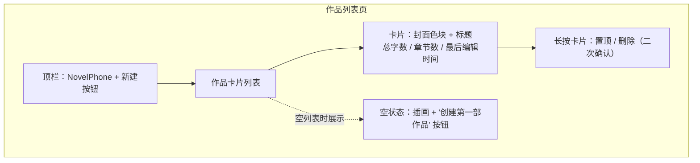
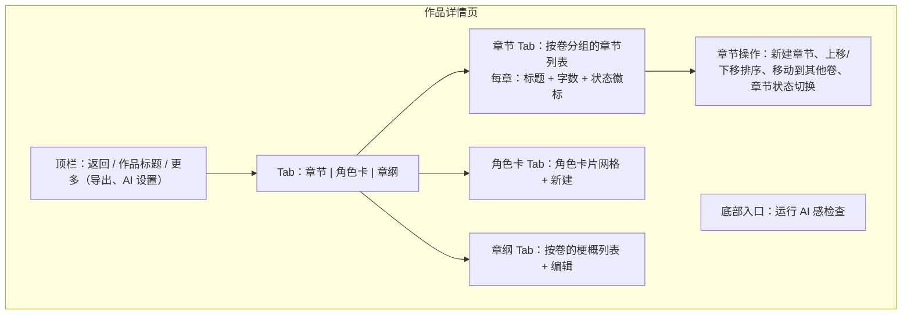
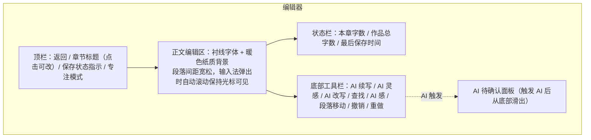
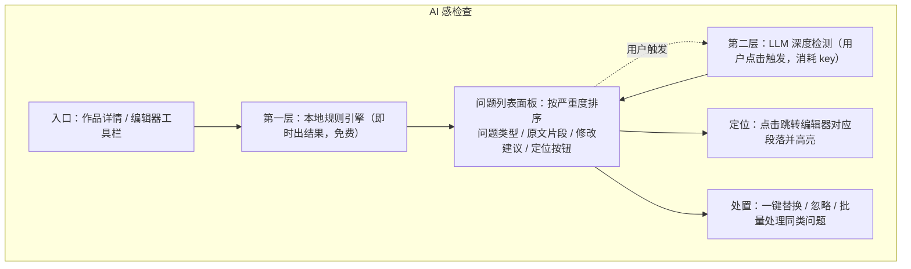

# NovelPhone 产品需求文档（PRD）

| 项 | 内容 |
|---|---|
| 版本 | v0.1（草案） |
| 日期 | 2026-09-30 |
| 状态 | 待评审 |
| 上游文档 | 无（0 到 1 新产品） |
| 下游文档 | `docs/ARCHITECTURE.md`（技术架构）、`docs/TODO.md`（任务跟踪） |

---

## 1. 需求背景

### 1.1 业务背景

小说创作工具长期分为两个割裂的世界：一边是纯本地写作软件（数据在设备里，隐私安全，但没有任何智能能力）；另一边是云端 AI 写作产品（能续写能灵感，但作品正文要上传到别人服务器，且 AI 不懂你的作品——它不知道你的角色叫什么、大纲走到哪一章、上一章的伏笔埋在哪里）。

同时，通用 AI 工具产出的中文网文内容有浓重的"AI 味"：套话密集、句式重复、每段结尾都要感悟人生。作者拿到 AI 续写后，清理"AI 味"的时间和成本甚至超过自己重写。

### 1.2 用户痛点

| 痛点 | 现状 | 后果 |
|---|---|---|
| 数据焦虑 | 云端工具停服、限流、扫描正文，作品是作者的核心资产 | 作者不敢把长篇正文托付给云端 |
| AI 没有作品上下文 | 通用 AI 每次从零开始，续写内容与角色、设定、前文脱节 | 生成内容不可用，反复重写 |
| AI 味清理成本高 | 没有工具系统化检测"AI 味"，只能靠作者语感逐段改 | 要么忍受 AI 味，要么放弃 AI 辅助 |
| 手机写作体验差 | 现有工具多为桌面端移植，手机上误删、改人名、调结构都很痛苦 | 碎片时间（通勤、睡前）无法有效利用 |

### 1.3 不解决的后果

目标用户继续在"隐私但无 AI"和"有 AI 但无隐私"之间二选一，碎片时间的创作灵感持续流失。

---

## 2. 产品定位与目标

### 2.1 产品定位

**本地优先的手机小说创作工具，AI 是按需介入的写作伙伴。**

三条产品原则：

1. **作品数据永远在用户设备上**。写作、阅读、管理全程离线可用；只有用户主动触发 AI 功能时才联网，联网传输的范围仅限 AI 请求所需的最小上下文，且由用户自带 API Key 直连模型服务商。
2. **AI 懂这部作品**。所有 AI 能力以作品上下文（大纲、角色卡、前文）为输入，不是通用问答。
3. **作者对 AI 产出拥有完全控制权**。AI 生成内容默认进入待确认面板，作者可编辑、部分采纳或拒绝，不直接改动正文。

### 2.2 产品目标

| 目标 | 衡量方式 | 目标值 |
|---|---|---|
| 完整走完"灵感 → 续写 → 检查 → 成稿"闭环 | 本地统计中，单部作品内四个环节均有使用记录的作品占比 | ≥ 60% `[Hypothesis]` |
| AI 产出被作者实际采纳 | 采纳率 = 被插入正文的 AI 文本字数 / AI 生成总字数 | ≥ 40% `[Hypothesis]` |
| 作者敢把长篇托管进来 | 导入 ≥ 5 万字作品的用户中，导入后 7 日内继续写作的比例 | ≥ 50% `[Hypothesis]` |

> 以上目标值为立项预判。MVP 不做云端埋点与账号体系，指标只能来自 app 内本地统计面板（口径见第 7 章）；跨用户的留存类指标在 MVP 阶段由用户主动导出本地统计后估算，不作为版本发布门槛。采纳率口径：作者编辑后插入的，按插入时刻的实际文本字数计。

### 2.3 非目标（MVP 明确不做）

- MCP 工具接入、用户自定义 SKILL 系统（架构预留，功能后置）
- 云同步、多设备协同、账号体系
- 社区、投稿、稿费结算等平台化功能
- 桌面端（架构上兼容，MVP 只交付手机端）
- AI 语音输入、AI 配图

---

## 3. 用户与场景

### 3.1 目标用户

**Persona A：网文作者「日更写手」**
- 画像：25-40 岁，日更 4000-10000 字，作品 20 万字起步
- 熟练度：对写作软件有明确偏好，愿意为效率付费，对数据归属敏感
- 频率：每天 2-4 次写作时段，单次 30-90 分钟
- 核心诉求：稳定不丢稿、日更压力下的卡文救援、AI 味清理
- 决策权：自己就是用户和购买决策者

**Persona B：业余创作者「灵感记录者」**
- 画像：18-35 岁，有完整创作欲望但时间碎片化，作品 1-10 万字
- 熟练度：会用手机备忘录写东西，对专业软件有畏难情绪
- 频率：每周 2-3 次，单次 10-30 分钟
- 核心诉求：随时随地能写、卡文时有人推一把、看到自己在进步
- 决策权：自己决定用什么工具

### 3.2 核心场景（按优先级）

| 优先级 | 场景 | 版本 | 描述 |
|---|---|---|---|
| P0 | 碎片写作 | MVP | 通勤路上打开 app，进入昨天写的章节，光标自动落到上次位置，继续写 800 字，锁屏走人 |
| P0 | 卡文救援 | MVP | 写到主角对峙卡住，调出 AI 续写，AI 带着角色卡和前两章上下文给出一段续写，可用"换个方向"重跑，选定后插入再手动改写 |
| P0 | 成稿去 AI 味 | MVP | 用 AI 辅助写完三章，跑一遍 AI 感检查，按问题清单逐条定位修改 |
| P1 | 老稿迁移 | MVP | 把电脑里 30 万字的 txt 导入，按章节标题自动分章，角色卡补录 |
| P1 | 深夜沉浸 | 二期 | 关灯后切换到护眼深色模式，全屏专注写作，字数连击带来正反馈 |
| P2 | 灵感收集 | MVP | 等电梯的三分钟，让 AI 基于当前作品生成 5 个冲突点子，存入作品灵感箱 |

---

## 4. 功能范围

### 4.1 功能总览表

| # | 模块 | 功能描述 |
|---|---|---|
| 1 | 作品列表 | app 顶层导航。以卡片列表展示全部作品，含封面色块、标题、总字数、章节数、最后编辑时间；支持新建、删除（二次确认）、置顶排序；空状态引导新建第一部作品 |
| 2 | 作品详情 | 作品内导航枢纽。按卷分组展示章节列表，显示每章标题、字数、状态（草稿/修订中/定稿）；入口通往角色卡、章纲、AI 感检查；作品级操作：导出、AI 设置 |
| 3 | 编辑器 | 核心写作界面。正文编辑区（衬线字体、暖色纸质背景）、顶部返回与章节标题、顶部「专注模式」开关与「AI 章节工具」菜单（生成本章摘要 / AI 扩写本章纲）、底部工具栏（AI 续写、AI 灵感、AI 改写、查找替换、段落移动、撤销重做）；自动保存（停止输入 1 秒后触发，保存中有状态指示）；实时字数统计（本章字数、总字数）；光标位置与滚动位置跨会话恢复 |
| 4 | 章纲 | 每章一句话梗概与目标（0-1000 字）。在作品详情和编辑器中均可查看编辑；是 AI 上下文组装的重要输入；支持按卷组织；可用 AI 章纲扩写把一句话梗概扩成分场大纲（覆盖写入本章章纲） |
| 5 | 角色卡 | 角色档案管理。字段：姓名、身份、性格标签、外貌特征、人际关系、角色弧光；支持增删改；AI 续写与灵感时按相关性注入上下文 |
| 6 | AI 续写 | 卡文救援。在编辑器内触发，基于当前作品上下文流式生成续写，默认并发生成 3 个候选版本供挑选；产出进入底部待确认面板，作者可编辑后插入光标处，或重新生成、换个方向；生成过程可取消。ENH-27：结果可逐段勾选采纳、在面板内直接编辑后写入；可对当前结果追加修改意见继续修改（不整篇重生成）；放弃时可选原因，用于本地偏好学习 |
| 7 | AI 灵感 | 创意激发。两种模式：桥段点子（基于当前进度生成冲突/转折选项）和开篇助手（给定方向生成开头段落）；产出可存入作品灵感箱或直接插入 |
| 8 | AI 感检查 | 去 AI 味。对选中章节或整部作品运行；两层检测：本地规则引擎（即时、免费）+ LLM 深度检测（用户触发、消耗 key 额度）；结果按严重度排序，展示问题类型、原文定位、修改建议；点击定位到编辑器对应段落，支持一键替换和忽略 |
| 9 | 设置 | API Key 管理（多套 key，按服务商分组，每组含协议类型（OpenAI 兼容 / Anthropic）、baseUrl（可自定义，支持中转）、模型列表，key 存于设备安全区）；默认模型选择（可按任务分别指定：续写用强模型、AI 感检查用快模型、摘要与章纲扩写未配置时回退续写组）；温度等生成参数调节；可选的应用锁（ENH-25，系统生物识别 / 设备凭证，默认关闭）；可选的截屏 / 最近任务缩略图保护（ENH-26，默认关闭）与备份密码加密（ENH-26，默认关闭，密码只存设备安全存储） |
| 10 | Token 统计 | 成本可见。按模型、按任务统计累计 token 消耗与调用次数；可按模型单价估算费用并设置月度预算提醒（80% 提示、100% 告警）；本地存储，不上传 |
| 11 | 导入 | txt / docx / Markdown / EPUB 文件导入。按章节标题正则自动分章（提供分割预览，可手动调整分割点）；导入后保留原始文件备份 |
| 12 | 导出与备份 | 单章导出（txt/markdown）、整部作品导出（txt/markdown/docx/epub）、整库备份与恢复（zip 含全部作品数据与角色卡）；可选密码加密导出为 `.npbak` 密文（ENH-26） |

### 4.2 MVP 边界

| 能力 | MVP | 二期及以后 |
|---|---|---|
| 编辑器 | 撤销重做、查找替换、段落移动、自动保存、字数统计、纸质主题 | 护眼深色模式、字体调节、章节快照、全局搜索 |
| 作品结构 | 卷、章节、角色卡、章纲、章节状态 | 设定集（世界观/地点/道具）、人物关系图 |
| AI | 续写、灵感、AI 感检查、Chat Completions 与 Messages 端点 | Responses 端点、MCP 接入、用户自定义 SKILL |
| 数据 | 本地存储、txt/docx 导入导出、zip 备份恢复 | 云备份（P2，B-08 已实现，需求见 5.10）、版本历史（P2，B-05 已实现） |
| 其他 | — | 每日目标、连击统计、番茄钟 |

> 说明：上表右列为 MVP 立项时划出的后置范围。截至当前，B-01 Responses 端点、B-02 MCP、B-03 用户 SKILL、B-04 外观、B-05 章节快照、B-06 全局搜索、B-07 写作统计、B-08 云备份、B-09 设定集与人物关系图均已实现（详见 docs/TODO.md 与 ARCHITECTURE.md）。

---

## 5. 功能模块详情

### 5.1 作品列表页（功能 1）

页面原型：

- 业务逻辑：作品按置顶优先、再按最后编辑时间倒序排列；删除作品需二次确认，确认后移入回收站（保留 30 天，可在设置 →「回收站」恢复或永久删除；过期条目在启动与打开回收站时自动清理），删除前提示可先导出。
- 交互逻辑：点击卡片进入作品详情；点击新建进入新建表单（标题必填，封面色块从预设色板选择）；长按弹出操作菜单。
- 规则约束：作品标题 1-50 字，必填；单个 app 作品数量上限 200 `[Expert judgment]`；封面色块从 8 色预设中选择，默认随机。
- 边界异常：作品数为 0 时展示空状态引导；删除进行中按钮防重复点击。

### 5.2 作品详情页（功能 2）

页面原型：

- 业务逻辑：章节归属卷，卷可重命名、按上移/下移排序；章节排序同样用上移/下移与"移动到其他卷"（手机端拖拽精度差，不用拖拽交互）；章节状态三态（草稿/修订中/定稿），切换仅改状态不改内容；AI 感检查入口对当前选中范围（本章/全作）运行。
- 交互逻辑：点击章节进入编辑器；章节列表项左滑露出更多（重命名、状态、删除）；角色卡点击进入编辑。
- 规则约束：卷名 1-30 字；章节标题 1-50 字，允许空标题（显示为"未命名章节"）；删除章节二次确认，移入回收站保留 30 天，可从回收站恢复或永久删除。
- 边界异常：作品无章节时章节 Tab 显示新建引导。

### 5.3 编辑器（功能 3）

页面原型：

- 业务逻辑：停止输入 1 秒后自动保存当前章节（防抖），保存成功更新状态指示与字数；每次保存同步更新作品总字数与最后编辑时间；会话恢复时回到上次光标与滚动位置。
- 交互逻辑：查找面板支持本章内关键词替换与全部替换（替换前显示命中数，支持大小写选项）；段落移动提供"上移/下移"按钮操作光标所在段；撤销重做走编辑器自己的历史栈，与系统输入法撤销隔离；顶栏「专注模式」开关隐藏底部工具栏与状态栏，并把光标行固定到编辑区竖直中线（沉浸写作，章末亦可居中）。
- 规则约束：单章正文上限 10 万字 `[Expert judgment]`；自动保存失败时状态栏提示"保存失败，点击重试"，正文不丢失（留在编辑器）。
- 边界异常：编辑中接到 AI 生成插入请求时，插入点基于当前光标；保存中 app 退到后台不打断保存。

### 5.4 角色卡与章纲（功能 4、5）

- 业务逻辑：角色卡字段如上；章纲按卷组织，每章一条梗概；AI 续写时角色卡注入规则见 6.2。
- 交互逻辑：角色卡网格点击编辑；章纲在作品详情与编辑器侧栏均可编辑。
- 规则约束：角色姓名 1-20 字必填，性格标签最多 10 个；章纲梗概 0-1000 字（ENH-05 起上限由 200 提到 1000，AI 章纲扩写的分场大纲也写入该字段）。
- 边界异常：角色卡可无上限创建，但单次 AI 请求最多注入 8 张最相关角色卡（超出按相关度截断，规则见 6.2）。

### 5.5 AI 续写与改写（功能 6）

- 业务逻辑：触发时按 6.2 的上下文策略组装 prompt（前文章节 + 章纲 + 角色卡 + 当前章已写内容），流式生成；生成中可随时取消；产出进入待确认面板，作者编辑后可"插入光标处"或"放弃"；面板提供"重新生成"与"换个方向"（重新生成用同上下文，换个方向由作者补充一句方向指令后重跑）。
- 交互逻辑：编辑器底部点"AI 续写"→ 面板滑出并显示加载态 → 流式文本逐字呈现 → 完成后出现操作按钮。
- 规则约束：续写默认长度 300-800 字，作者可在面板调整；生成内容默认不自动插入正文。
- 多候选续写（ENH-05）：续写默认并发生成 3 个版本，面板用「版本 1/2/3」切换查看与采纳，可关掉「3 个候选」切回单候选；不同版本仅温度略有差异（更稳 / 更保守 / 更放得开），上下文一致；采纳某版本时其余记入忽略。
- 边界异常：模型返回内容触发服务商内容过滤时，面板显示具体服务商的拒绝原因与"修改指令重试"入口；网络中断显示重试按钮，已生成的部分保留在面板中可手动保存。
- AI 改写（选中段落）：作者在正文中选中一段后点工具栏"AI 改写"，面板提供润色 / 扩写 / 缩写 / 改语气四种意图（切换即重新生成）与可选补充指令；产出进入同一待确认面板（可编辑、可"重新生成"、可"放弃"），点"替换原文"回写选中区间（走撤销栈可撤销）。改写不注入本章尾部正文，仅以选中段落为目标；未配置改写专属模型组时回退续写模型组。
- 改写边界：未选中正文时点"AI 改写"给提示且不打开面板；生成期间原文被改动则在替换时校验失败并提示重新选中；改写记录同样计入 Token 统计与采纳/忽略计数。

### 5.5.1 AI 章节工具：逐章摘要、本卷前情回顾与章纲扩写（ENH-05 / ENH-06 / ENH-07）

- AI 逐章摘要（前情回顾）：编辑器顶栏「AI 章节工具」→「生成本章摘要」，AI 以本章正文为主材料流式产出一段本章摘要，作者确认后点"保存摘要"写回该章摘要字段。摘要用于后续章节续写/改写时注入"前文摘要"，让长篇后期的 AI 仍能记住前情（未生成摘要的章节仍回退本地抽句）。摘要随备份导出/恢复。
- AI 本卷前情回顾（ENH-06）：编辑器顶栏「AI 章节工具」→「生成本卷前情回顾」，AI 以本卷「当前章及之前」各章摘要为素材，归并成一段卷级前情回顾，作者确认后点"保存前情回顾"写回本卷摘要字段。续写/改写时该卷摘要与最近 1-2 章摘要一并注入"前文摘要"，解决写长后早期剧情被挤出上下文的问题；本卷前情回顾为空时行为与旧版一致。本卷当前章之前无已写章节时给提示不打开面板。卷摘要随备份导出/恢复。ENH-07 起改为**增量滚动归并**：已归并过本卷时，仅以「上一版卷回顾 + 新增章节摘要」滚动更新，避免每次全量重算。
- 查看 / 编辑本章摘要（ENH-06）：编辑器顶栏「AI 章节工具」→「查看/编辑本章摘要」，弹窗内可查看并手动修改该章 AI 摘要（上限 1000 字），保存写回该章摘要字段；解决原只能靠"重新生成"覆盖、作者看不到也改不了已存摘要的问题。ENH-07 起，若正文在此摘要生成之后又有改动，弹窗顶部提示"正文已改动，摘要可能过期，建议重新生成"。
- AI 章纲扩写：作者先写一句话梗概（章纲），再点「AI 章节工具」→「AI 扩写本章纲」，AI 据此产出分场/分段大纲，作者确认后点"保存到章纲"覆盖写入本章章纲；未填写梗概时给提示不打开面板。
- 交互逻辑：以上模式共用编辑器顶栏同一菜单入口，产出均进入同一待确认面板（可编辑、可"重新生成"、可"放弃"），摘要、本卷前情回顾与章纲扩写不再提供"换个方向"（目标明确）。
- 规则约束：摘要、本卷前情回顾与章纲扩写默认不单独配置模型组时回退续写模型组（零配置可用）；超长章节的摘要、超预算的卷回顾按模型预算截断并在上下文详情标注"已省略较早前文"。
- 体验与上下文优化（ENH-07）：待确认面板的"上下文详情"改为限高 + 内部滚动（输出框同步收窄），展开后下方按钮仍在视口内；生成期间面板 header 显示实时耗时（"N 秒"），产出完成 / 停止 / 出错时停表。作品详情「章节」Tab 卷头「…」菜单新增「查看/编辑本卷前情回顾」，可查看并手改本卷摘要（上限 1000 字）。AI 产出（摘要 / 卷回顾 / 章纲）落库前统一清洗行首 Markdown 标记（`#` / `-` 列表 / 数字编号）与多余空行。AI 灵感（桥段点子）上下文补注入"前文摘要"与"本章章纲"。

### 5.6 AI 灵感（功能 7）

- 业务逻辑：桥段点子模式基于当前作品进度生成 3-5 个冲突/转折选项，每条含一句话概括与展开说明；开篇助手模式基于作者给的一句话方向生成开头段落。产出可"存入灵感箱"（作品内简单列表）或插入正文。
- 交互逻辑：入口在编辑器工具栏；触发后选择模式 → 输入可选的方向指令 → 生成 → 选择条目操作。
- 规则约束：灵感箱条目可删除、可编辑，不进 AI 上下文（除非作者主动粘贴）。

### 5.7 AI 感检查（功能 8）

页面原型：

- 业务逻辑：规则引擎内置中文网文高频套话词库与句式模式（如"不禁""仿佛""一丝""嘴角勾起""眸中闪过"、模式化对话标签、段尾感悟句），输出命中清单与套话密度统计；LLM 深检将章节分段送检，返回问题类型（套话/句式重复/翻译腔/过度总结/节奏拖沓）、原文定位与改写建议；两层结果合并去重后统一展示。
- 交互逻辑：问题条目点击"定位"跳编辑器对应段落；"一键替换"将建议文本替换原文并标记为已处理；"忽略"移出列表；支持按问题类型筛选。
- 规则约束：检查范围可选"当前章"或"整部作品"；LLM 深检单次消耗按实际 token 计，面板显示预估与实测；规则词库随 app 版本内置更新，不做在线下发，也绝不联网扫描用户内容。
- 边界异常：章节为 0 字时禁用；LLM 检测失败（网络/过滤）时保留规则引擎结果并提示。

### 5.8 设置与 Token 统计（功能 9、10）

- 业务逻辑：key 按服务商分组管理（每组：名称、协议类型（OpenAI 兼容 / Anthropic / Responses）、key、baseUrl、模型列表、温度、输出上限与上下文窗口、每百万 token 输入 / 输出价格（ENH-23，可留空））；应用锁（ENH-25）默认关闭，开启后冷启动与从后台返回均需系统生物识别或设备 PIN / 图案 / 密码解锁；开关应用锁本身也需先通过系统认证，设备未设置任何安全锁时不可开启；截屏保护（ENH-26）默认关闭，开启后 Android 系统截屏与最近任务卡片为空白、iOS 退后台时以遮罩覆盖系统快照（iOS 无公开 API 阻止前台主动截屏，界面注明）；备份密码加密（ENH-26）默认关闭，开启时需设置并确认至少 8 位密码，密码只存设备安全存储、关闭加密时一并清除；可为不同任务（续写/灵感/改写/AI 逐章摘要/AI 本卷前情回顾/AI 章纲扩写/AI 感检查/设定一致性检查/文风提取/设定补全/剧情推演/作品问答）指定不同模型组（文风与设定补全未配置时回退续写组；剧情推演回退章纲扩写组再回退续写组；作品问答回退续写组；设定一致性检查未配置时依次回退 AI 感检查组与续写组）；key 仅存于设备安全存储（keychain / keystore），不随备份 zip 导出（恢复后需重新填写）；token 统计按模型与任务双维度累计，提供"重置统计"，并在配置了模型价格时展示估算费用（ENH-23，未配置价格的模型单独标注）；可设置月度 AI 预算（ENH-24，按自然月聚合费用，0 表示不限制，达到 80% 提示、100% 红色告警，仅提示不阻断调用）。
- 交互逻辑：设置页列出全部模型组，支持新增、编辑、删除、启用停用；"测试连接"按钮验证 key 有效性（发一次最小请求）。
- 规则约束：key 删除前二次确认；默认端点（OpenAI 官方、DeepSeek 官方等）预置 baseUrl，允许自定义覆盖。
- 边界异常：未配置任何 key 时，编辑器 AI 按钮点击后引导去设置页，而不是报错。

### 5.9 导入导出与备份（功能 11、12）

- 业务逻辑：导入 txt / docx / Markdown / EPUB 时按章节标题模式（如"第 X 章"）自动分章，先展示分割预览（每章标题 + 字数），作者确认或调整后才写入，并把原始文件复制到 app 目录留档（供回溯）；Markdown 按 `#`~`###` 标题分章，EPUB 按 OPF spine 顺序读取 XHTML、跳过目录页，单个文件含多个标题时继续按标题拆分（ENH-24）；导出单章为 txt/markdown，整作为 txt/markdown/docx/epub（epub 为 EPUB 3 最小结构，`mimetype` 首条目且 STORE 存储，可被主流阅读器打开）；整库备份导出 zip（全部表数据 JSON（含正文，供恢复）+ `manifest.json` 校验清单 + 各作品 markdown 全文（供人工查阅），不含 key），恢复前展示导出时间、schema 版本、作品/章/角色数量并校验 SHA-256（旧备份无清单时提示），确认后合并或覆盖（作者选择）。
- 备份密码加密（ENH-26，可选，默认关闭）：开启后导出改为 `.npbak` 密文，采用 NPBK v1 信封（magic + 版本 + salt + nonce + MAC + 密文），PBKDF2-HMAC-SHA256 210,000 次派生 256 位密钥、AES-256-GCM 认证加密；密码至少 8 位，仅存设备安全存储，不写日志、不随备份导出。关闭加密后恢复生成明文 zip；开启状态下不存在静默明文回退。恢复兼容旧版明文 zip 与其他历史备份：按魔术头识别加密文件，弹出密码后解密，再走既有预览 / SHA-256 校验 / 合并或覆盖流程。
- 分章口径：可识别 markdown 一级标题（`# 标题`）、中文"第 X 章/节/回/篇"（保留整行以保留章序）、英文 `Chapter N`；全文无标题行时整篇作为一章；首个标题之前的内容单独成章（卷首语 / 作者的话）。
- 往返约定：整作 markdown 每章写为 `# 标题`，空标题章节写作"未命名章节"，再导入时还原为空标题，保证"导出 → 再导入"章节结构与正文一致。
- 规则约束：导入文件大小上限 10MB `[Expert judgment]`；导出文件名去掉路径分隔符等非法字符；docx 导出仅含正文与章节结构，不含样式细节。
- 边界异常：导入文件编码自动探测（UTF-8 / GBK，UTF-8 带 BOM 自动剥离）；分割预览中某章为 0 字时提示是否保留；解析失败给出明确报错；作品无章节时不进入导出流程；加密备份密码错误或文件被篡改（MAC 校验失败）时提示「密码错误或备份文件已损坏」，不进入预览、不改动本机数据。

### 5.10 云备份（P2 / B-08）

在本地 zip 备份之外，提供"用户自带的云端对象存储"作为备份目的地，解决换机/换端成本高的问题（对应 8 章风险表的二期缓解措施）。默认关闭，由用户显式开启；不提供中心化服务器与账号体系。

- 总开关：设置 → 云备份，可开启/关闭。关闭状态下不联网、不产生任何云端请求，行为与当前本地 zip 备份完全一致。
- 服务商可选：AWS S3、阿里云 OSS、七牛云 Kodo、腾讯云 COS、华为云 OBS（均走 S3 兼容协议，故统一为一套配置形态）。
- 配置项：服务商、Endpoint、Region、存储桶 Bucket、路径前缀（默认 `novelphone/backups/`）、保留份数 N（默认 10，最小 1）；凭证为 AccessKey ID 与 Secret Access Key。仅当总开关开启时展示这些字段。
- 备份（手动）：点击"立即备份"，将当前整库备份上传为该前缀下带时间戳的对象文件（如 `novelphone/backups/20261008T153000.zip`；开启备份密码加密时上传 `.npbak`，如 `20261019T024500.npbak`）；上传成功后自动清理同前缀下超出 N 份的最旧文件。
- 恢复：列出远端已有备份（按时间倒序，兼容 `.zip` 与 `.npbak`），用户选择一份下载后走既有恢复流程——加密备份先输入密码解密——合并为新作品 / 覆盖本机，由作者选择。
- 测试连接：配置后可一键验证 Endpoint、桶与凭证是否可用（发一次最小请求）。
- 自动备份：独立开关（默认关）。开启后于应用启动 / 回到前台时检查，距上次成功备份满所选间隔（每 12 小时 / 每天 / 每周，默认每天）则自动备份并清理旧份数；关闭时不参与调度。检查与上传均在后台静默进行，失败不打断使用、下次检查重试。
- 安全与合规：AccessKey / SecretKey 仅存设备安全存储（keychain / keystore），不落库、不随备份导出、不上传；备份内容与本地 zip 一致（含正文，不含任何 key），开启备份密码加密（ENH-26）时为 NPBK 密文；仅在用户主动开启并触发时才联网，属"用户显式启用的可选联网能力"，不破坏"作品数据全本地、仅 AI 功能联网"的默认约定。自动备份在开启加密但安全存储中无密码时直接跳过（不联网、不生成明文）。
- 规则约束：备份默认沿用本地 zip 的形态（依赖存储桶自身权限）；用户可在设置中开启可选密码加密（ENH-26，PBKDF2-HMAC-SHA256 + AES-256-GCM），密码只存本机安全存储，关闭加密时一并清除。
- 边界异常：网络失败、凭证错误（403 / SignatureDoesNotMatch）、桶不存在（404）均给出明确提示，且不影响本地数据与既有本地备份；远端无可恢复备份时给出空态提示。

### 5.11 AI 创作辅助（ENH-23 / ENH-24）

围绕长篇创作的「写得更像你、设定更完整、后续更清楚、资料查得到、全书更自洽」补充本地优先能力，数据默认只在本机：

- 文风档案：作品级保存叙事人称与视角、语言风格与基调、禁忌与偏好、示例段落四个字段，注入续写、改写、开篇、剧情推演等任务的 system 提示；可点「AI 从最近章节提取」自动分析最近正文并回填表单（不直接覆盖已保存内容，需作者确认保存）。档案随作品备份往返。
- AI 设定补全：从最近章节抽取角色、世界观 / 地点 / 道具条目与角色关系（ENH-24），预览列表标注「已存在」并按名称去重，作者勾选后一键写入角色卡、设定集与人物关系图；关系端点可对应既有或本次新增角色，无法解析的条目显示跳过原因；不覆盖已有条目，不修改正文。
- 剧情推演：结合作品章纲、角色卡与最近正文，输出 2-4 条后续剧情走向（含看点与风险）和分章建议；可输入一句「希望的方向」约束推演；满意的条目可逐条存入灵感箱，分章建议可一键转为章纲（ENH-24：标题匹配已有章节时写回该章，否则作为未关联章节的梗概）。
- 批量摘要（ENH-24）：按章顺序为「缺少摘要 / 正文已更新」的章节生成摘要并写回，实时显示进度，支持在当前章完成后停止；失败时保留已生成章节。
- 输出有效性（ENH-24 / ENH-25）：模型若只输出推理内容而无可见正文，优先自动把输出上限翻倍并重试一次（上限为模型上下文窗口与 16384 的较小值），重试后仍无正文才收到明确错误「AI 未返回内容，请重试或提高输出上限」而非空白结果；重试仅用于直连模型请求，已进入工具调用的编排流不重放；剧情推演遇到合法但字段不匹配的 JSON 会提示解析失败，不静默丢结果。
- 作品问答：针对单部作品的多轮对话，先注入作品资料与章节目录，模型可按需调用本地工具检索章节正文、角色、设定与章纲；回答引用章节名。对话记录按作品存本机（最多 40 轮，存储于 APP_SETTING），不进入备份、清空需二次确认；支持停止生成并保留已生成内容、查看本轮上下文用量。
- 全书一致性体检：按章顺序检查正文与角色卡、设定集、章纲、前情是否冲突（顺序执行避免服务商限流），实时进度、可中途停止并保留已完成结果，结果可展开查看与一键复制；编辑器内的单章检查改为流式展示，可随时停止并保留部分报告。
- 稳定性：三类端点适配器均设置 30 秒连接超时与 90 秒流式空闲超时（超时给出可读提示，不无限等待）；模型组可填每百万 token 价格，Token 统计据此展示估算费用。

### 5.12 AI 结果协作与作者偏好（ENH-27）

在"生成 → 整段采纳 / 放弃"的基础上，把 AI 产出变成可协商的草稿，并让作者的选择在本地沉淀为后续生成的依据。

- 分段采纳与直接编辑：续写 / 改写结果进入待确认面板后，按空行切分为可勾选段落；作者可逐段勾选、在弹窗内直接编辑段落文本，点「采用 N 段」按原顺序写入（续写插入光标处、改写替换选中原文，均走编辑器撤销栈）。改写结果会标出与原文不同的段落；未勾选的段落不写入正文。合并弹窗展示已选段数与总段数，正文写入前不产生任何数据库改动。
- 结果内多轮修改：作者在待确认面板输入修改意见并提交后，应用以「当前候选草稿 + 本次意见 + 原任务上下文」单独发起一次流式请求，只替换当前结果，不重新生成整篇、不改动正文；新结果返回前旧结果保留，失败时保留旧结果并提示可重试。多轮修改仍按实际 token 计入统计与预算。
- 放弃原因与本地偏好：放弃结果时可选择「太像 AI / 角色出戏 / 节奏拖沓 / 设定不符 / 其他」（可跳过）。选择的原因按作品累计计数；采纳结果时把实际写入的片段（截断后）作为近期样本保存，最多 5 条、单条最多 600 字。数据只存本机 `APP_SETTING`（`ai_feedback_<workId>` / `ai_adopted_samples_<workId>`），不新增数据库表、不随备份导出。
- 偏好注入：后续续写 / 改写时，同一放弃原因累计达到 2 次即把对应约束（去 AI 味 / 角色一致性 / 节奏 / 设定一致性）写入 system 提示；同时注入最近最多 3 条采纳片段（每条截断到 200 字）供参考语气、节奏与细节密度，并明确要求"不要照抄内容"。无高频原因且无样本时不注入，行为与旧版一致。偏好块在待确认面板的「上下文详情」中显示为「作者协作偏好」。
- 数据边界：偏好与样本只保存在本机；仅在作者触发续写 / 改写时随该次上下文直接发送给作者配置的模型服务商，不经过 NovelPhone 服务器，也不进入任何导出 / 备份。

---

## 6. AI 功能规格

### 6.1 任务定义与 I/O

| 任务 | 输入 | 输出 | 约束 |
|---|---|---|---|
| 续写 | 系统指令（写作风格要求）+ 作品上下文（前文章节摘要、本章已写内容、章纲、角色卡）+ 可选方向指令 + 可选「当前候选草稿 + 修改意见」（ENH-27） | 300-800 字续写文本，接续当前章风格（默认 3 个候选版本） | 不改变已写事实；不复读前文；输出为纯正文；多候选仅温度略有差异；带草稿时只修改该草稿，单路请求 |
| 结果内多轮修改（ENH-27） | 当前候选草稿 + 作者修改意见 + 原任务上下文 | 修改后的完整候选文本（流式），替换面板中的当前结果 | 不重新生成整篇、不并发生成候选、不直接改正文；失败保留旧结果；计入 token 统计 |
| 灵感（桥段点子） | 作品上下文 + 进度位置 | 3-5 个点子，每个一句话概括 + 2-3 句展开 | 点子之间方向差异明显；不与已写情节矛盾 |
| 灵感（开篇助手） | 作者方向指令 + 作品基调 | 1 个开头段落（100-300 字） | — |
| 改写 | 系统指令 + 选中段落文本 + 作品上下文（章纲、角色卡，不含本章尾部）+ 意图（润色/扩写/缩写/改语气）+ 可选补充指令 | 改写后的段落文本（流式） | 仅重写选中区间，不改动其余正文；意图切换即重新生成；产出经"替换原文"回写并走撤销栈 |
| AI 逐章摘要 | 系统指令 + 本章正文（超预算截断） | 一段本章摘要（前情回顾），写回该章摘要字段 | 供后续章节续写/改写注入；非对话式输出；不做分段 map-reduce |
| AI 本卷前情回顾 | 系统指令 + 本卷当前章及之前各章摘要（超预算截断） | 一段本卷前情回顾，写回本卷摘要字段 | 供后续章节续写/改写注入；非对话式输出；不做增量滚动，每次全量归并 |
| AI 章纲扩写 | 系统指令 + 本章一句话梗概（种子） | 分场/分段大纲，覆盖写入本章章纲 | 种子为空则不开面板；输出为结构化大纲文本 |
| AI 感检查 | 章节文本（分段；范围可选单章或整作） | 问题列表：类型、严重度、位置、建议改写 | 严重度为高/中/低三级；建议保留作者原意；只标记不重写全文 |

### 6.2 上下文组装策略

AI 请求的上下文按以下优先级装配，受 token 预算约束（预算 = 模型上下文窗口的 50%，预留输出空间）：

1. 系统指令（写作风格、禁令清单：禁套话、禁复读）
2. 本章已写内容的尾部（越近优先级越高）
3. 本章章纲
4. 前文摘要：ENH-06 起本卷前情回顾（`VOLUME.summary`）前置，随后是前 1-2 章的摘要（ENH-05 起优先使用 AI 已生成的章节摘要，未生成的章节回退本地抽句）；ENH-07 起，当前章为其所属卷**首章**时额外前置上一卷的前情回顾（"【前卷前情】…"），且超预算压缩前文摘要时保留卷级前情回顾行
5. 相关角色卡（按当前章提及的角色匹配，最多 8 张）
6. 作品整体大纲（卷级）
7. 作者协作偏好（ENH-27，仅续写 / 改写）：同一放弃原因累计 ≥ 2 次时对应的写作约束，最近最多 3 条采纳片段（每条 200 字）；随 system 指令一并注入，无高频原因与样本时不出现

超出预算时的截断顺序：从优先级低的开始丢，角色卡减到最相关的 3 张，前文摘要缩短。该策略的实现在架构文档 5.3 节展开。

### 6.3 质量评估

| 维度 | 评估方式 | 通过标准 |
|---|---|---|
| 续写可用性 | 内测期人工评分：连贯性、风格一致性、无事实矛盾、AI 味程度，各 1-5 分（AI 味维度反向计分：1 = 完全无 AI 味，5 = 浓重） | 均分 ≥ 3.5，AI 味单项 ≤ 2.5 |
| AI 感检查准确性 | 用人工标注"AI 味"段落做回归集（每版本跑） | 召回 ≥ 80%，误报率 ≤ 20% `[Hypothesis]` |
| 用户侧信号 | 采纳率、重新生成率、忽略率（本地统计） | 见 2.2 目标值 |

### 6.4 降级与异常

| 异常 | 处理 |
|---|---|
| 未配置 key | AI 按钮引导至设置页 |
| key 无效 / 欠费 | 明确提示服务商返回的错误码与含义，提供"去设置"入口 |
| 限流（429） | 自动退避重试一次，仍失败则提示稍后重试 |
| 推理模型无可见正文（ENH-25） | 输出上限翻倍后自动重试一次（以上下文窗口与 16384 封顶），每次尝试独立计入用量；仍为空则提示提高输出上限 |
| 加密备份密码错误 / 文件被篡改（ENH-26） | 统一提示「密码错误或备份文件已损坏」，不进入预览、不改动本机数据；可重新选择文件或输入密码 |
| 内容过滤拒绝 | 展示服务商拒绝原因，提供修改指令重试的入口，不静默失败 |
| 网络中断 | 保留已生成部分，提供重试 |
| 结果内多轮修改失败（ENH-27） | 保留修改前的旧结果与作者输入的意见，提示失败并可重试；不写入正文 |
| 上下文超预算 | 按 6.2 截断策略自动执行，面板提示"已省略较早前文" |

---

## 7. 数据与指标

本地优先定位决定：**MVP 不做云端埋点与账号体系**。指标通过两类方式获得：

1. 本地统计面板（app 内可见）：AI 调用次数、token 消耗、采纳率、检查问题处置率、单作品累计字数与章节数——数据留在用户设备上，用户可在设置中查看与导出。
2. 发布后的用户反馈渠道：应用商店评论与内测群，用于修订 2.2 的目标值。

跨用户的留存类指标（如 7 日留存）在 MVP 阶段不采集。若后期确有必要，须先取得用户明确授权并单独立项，默认不启用。

---

## 8. 风险与依赖

| 风险 | 概率 | 影响 | 缓解 |
|---|---|---|---|
| 模型服务商内容政策影响续写可用性（成人/暴力桥段被拒） | 高 | 高 | 友好的拒绝提示 + 指令修改重试 + 可切换服务商 |
| 用户自带 key 的配置门槛 | 中 | 中 | 预置主流服务商默认配置、测试连接、图文引导 |
| 单机数据无云备份，换机成本高 | 中 | 中 | zip 备份恢复 + 明确的备份引导（一期）；二期云备份：用户自带对象存储上传（方案见 5.10） |
| 手机端长文编辑性能 | 中 | 中 | 章节分载、防抖保存、性能测试用例 |
| 上下文策略效果不及预期 | 中 | 中 | 6.2 策略参数化，内测期可调 |
| 上架合规（隐私政策、数据安全说明） | 高 | 高 | 发布前补齐隐私政策与数据安全说明；AI 功能首次联网前明确告知传输范围；把"key 与手稿不出设备"写进商店文案。**已缓解（M4-16 / ENH-24）**：隐私政策、数据安全说明、上架资料要点与首次联网告知文案见 `docs/COMPLIANCE.md`；对外隐私政策见 `docs/PRIVACY.md`，构建命令 / 商店资料 / Data safety 口径见 `docs/RELEASE.md`（关于页提供隐私政策外链）；代码侧首次联网前弹告知（`ai_notice_ack` 记录确认） |

外部依赖：模型服务商 API 可用性与计费规则（OpenAI / Anthropic / DeepSeek 等，由用户自行持有 key，产品不依赖特定一家）。

---

## 9. 里程碑

| 里程碑 | 范围 | 出口标准 |
|---|---|---|
| M1 骨架与编辑器 | 项目骨架、数据层、作品与章节管理（含分卷）、编辑器（自动保存/字数/撤销重做/查找替换/段落移动/会话恢复） | 新建作品写章节不丢稿，杀掉 app 重进内容在 |
| M2 作品管理 | 角色卡、章纲、txt/docx 导入、导出备份 | 30 万字 txt 导入成功并正确分章；导出后可再导入还原 |
| M3 AI 核心能力 | AI 客户端（Chat Completions + Messages 端点）、上下文组装、续写、灵感、设置页、token 统计 | 用真实 key 完成一次续写插入；上下文含角色卡与章纲 |
| M4 AI 感检查与打磨 | 规则引擎、LLM 深检、问题定位与替换、纸质主题细节、异常流完善 | 规则引擎对回归集达标（6.3）；全流程无阻断性 bug |

MCP 接入、SKILL 系统、Responses 端点、云备份等见架构文档第 9 章演进路径，不在本 PRD 的 MVP 承诺内；其中云备份的需求见本 PRD 5.10，已实现。
